# Building & Decoration validation — v2.16.0

Implementation and validation, October 18, 2026. Publication approved by the user
after local validation. No real installation upgrade or real player-save
modification was performed during testing. All write tests use temporary profiles
or workspace fixtures.

## Implemented content

142 appended block/item types, with recipes and original 16×16 artwork:

- Six woods: stairs, slabs, fences, gates, trapdoors, paired doors, stripped logs,
  buttons, pressure plates, tables, chairs, benches, signs and shelves.
- Eleven stone families: stairs, slabs and connected walls. Decorative masonry,
  smooth/cut sandstone, polished/decorated deepslate, shingles and paving.
- Clear, rose, amber and smoked connected panes; lanterns, chains, candles,
  lit/unlit campfires, beds, barrels, paintings, frames, pots, carpets and scaffold.

Stairs have four orientations, upper/lower halves and five corner shapes. Slabs
have lower/upper/double states. Gates, doors and trapdoors retain their opening
state. Connection changes update nearby blocks across negative/positive chunk
edges. Furniture uses actual multi-box collision and selection.

The [complete ID map](building-decoration/building-ids.csv) and
[recipe list](building-decoration/building-recipes.csv) are exported by the native
regression driver. All 142 new types have an acquisition recipe. Existing recipes
remain: legacy slab/door conversions resolve overlapping wood-group recipes.
The recipes include Recipe Book, autofill and batch-crafting coverage. There are
258 recipes in total. Dedicated stonecutter UI is deferred.

## Follow-up: thin surfaces, potted plants and icon alignment

These fixes are included in **v2.16.0**. No generator, save format, hostile mob
or version number was changed for this follow-up.

- **Thin surfaces:** the former step predicate recognized only stairs/slabs.
  Grounded horizontal movement now also recognizes collision boxes no thicker
  than 1/16 block, with a maximum 1/16 rise. This works while sneaking. The full
  raised player volume must be loaded and unobstructed. Existing stair/slab steps
  retain their larger rise; ordinary cubes and airborne players cannot auto-step.
- **Potted plants:** pots previously submitted a fixed, one-sided item-atlas
  sprite. They now submit two crossed, double-sided world-atlas planes using the
  same tile as the ground plant, rooted at the pot rim. They share the existing
  item shader/buffer, with one additional draw batch only when plants are visible.
  No per-pot GPU resource or terrain remesh is needed. Item frames are unchanged.
- **Icons:** the original projection could reach y=17 on a 16-pixel canvas.
  Rendering now uses a larger temporary canvas, crops complete geometry, and
  centers it with a transparent margin. All 142 new icons and their atlas cells
  match. Historical 206 occupied item cells and historical world pixels are exact.

Validation, using isolated profiles:

| Check | Result |
| --- | --- |
| Native building suite | 4,603 assertions passed; 1,736 valid states |
| New movement checks | All four directions, ordinary/sneak movement, chunk seam, headroom, airborne rejection, full-cube rejection; existing stairs passed |
| Existing farming suite | 260 assertions passed |
| Production Creative paging/click suite | 2,440 assertions passed across all four pages |
| Native stability subsystems | Passed, including unloaded collision, slab targeting, negative-Y crops, saves and navigation |
| Full-game + packaged standalone regressions | Survival, fluids, UI and commands: 8/8 passed; demo wrote no persistent world data |
| Original-save fixture | Passed; original fixture retained |
| Icon/registry compatibility | 198 block IDs, 206 item IDs and old pixels unchanged; all 142 new icons centered, unclipped and atlas-matched |
| Production pot screenshots | Front/side/back inspected; each contains upright flower and stalk; automated pixel checks passed |
| Release packaging | Full-game installer and standalone rebuilt locally; checksums refreshed |

Visual validation caught an inverted atlas-V orientation during development; it
was corrected before final packaging. The automated screenshot check rejects
that intermediate image and passes the final three views. No new performance
speedup is claimed; this focused follow-up did not repeat the earlier RD benchmarks.
The previous historical generator-hash evidence remains applicable: generator
code was not changed by these fixes.

Evidence: [functional tests](building-decoration/polish-functional.log),
[compatibility and plant pixel checks](building-decoration/polish-compatibility.json),
[full/demo results](building-decoration/polish-regressions.csv),
[subsystem checks](building-decoration/polish-subsystems.log),
[visual run](building-decoration/polish-visual.log).

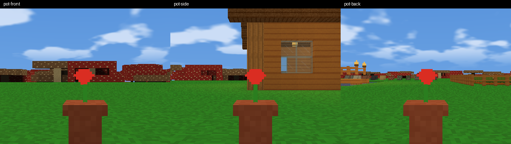
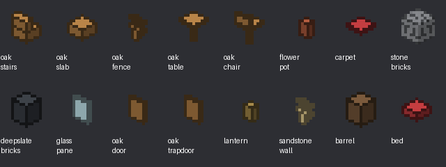

Reproduce the focused checks:

```powershell
./tools/run_building_validation.ps1 -SkipBuild -Visual -Output build/v2160-validation/polish
python tools/check_building_compatibility.py --visual-dir build/v2160-validation/polish
```

## Registry and state architecture

`Block` is a 32-bit state: **low 16 bits = stable type**, **high 16 bits = properties**.
`Item` and definition save IDs are 16-bit. Historical blocks 0–197 and items 0–205
are unchanged; new blocks are 198–339 and new items 206–347. `BuildingContent.inc`
is the shared material/shape registration table. Properties are validated before
loading; unknown IDs and illegal combinations fail transactionally.

| Shape | Properties |
| --- | --- |
| Stairs | facing bits 0–1, upper half bit 2, corner bits 4–6 (0–4) |
| Slabs | upper bit 2, double bit 3; upper+double rejected |
| Fence/wall/pane | four horizontal connection bits 4–7 |
| Door | facing 0–1, open 3, upper part 4, right hinge 7 |
| Trapdoor | facing 0–1, upper 2, open 3 |
| Gate | facing 0–1, open 3 |
| Bed | facing 0–1, head part 4, shared color 8–9 |
| Painting | facing 0–1, companion 4, medium size 5, art 8–9 |
| Frame | facing 0–1, item rotation 8–9 |
| Sign | facing 0–1, wall attachment 4; text stored separately |
| Log | axis 0–2 |
| Candle/carpet | shared color 8–9; candle unlit bit 3 |

Four artwork/color choices use properties rather than permanent IDs. The current
renderer still uses an 8-bit shared material tile (187 tiles, below 255). This is
independent of the expanded type registry; more future textures would require a
separate vertex/material extension.

### Resident memory

Ordinary generated chunks retain **one byte per cell**, with no state allocation
per ordinary block. An extended edit converts the chunk to byte palette indices
and a vector of full states. More than 256 accumulated palette entries uses a
safe full-state fallback. Retired chunks move compact payloads.

A full 384-high chunk has 98,304 cells: **98,304 payload bytes** for ordinary
terrain versus 393,216 bytes for the deliberately wide fallback. Palette storage
and sparse building/sign/display indices apply to decorated chunks. The compact
object and three empty index vectors add small fixed per-chunk overhead; this is
not a claim of identical total object size. Removing blocks does not automatically
shrink a chunk's established palette/fallback mode.

Worker generation and mesh snapshots use 32-bit temporary arrays. These are
bounded by the existing worker/queue/cache limits, but their memory and copy cost
increase. Matched whole-process measurements below include that cost. This hybrid
keeps fast ordinary reads and avoids applying four-byte storage to every resident
terrain cell. A global four-byte chunk array was rejected.

## Persistence and ownership

| Component | New writer | Older readers retained |
| --- | --- | --- |
| World edits | VXWORLD3, version field 3, 32-bit states | World versions 1/2 |
| Containers | VXENTS3, 16-bit item IDs | VXENTS1/2 |
| Inventory/equipment | VXINV7, 16-bit IDs | VXINV4/5/6 |
| Dropped items | DRP2, 16-bit IDs | DRP1 |
| Sign text | BLD1 world extension | Absent extension = empty |
| Deferred recovery drops | BDP1 world extension | Absent extension = empty |
| Personal bed | BED1 player extension after nutrition | Absent extension = unset |

Old byte formats explicitly reject formerly invalid block IDs ≥198/item IDs ≥206;
they cannot silently reinterpret corrupt old data as new content. Signs require
ASCII, at most four lines ×24 characters, legal coordinates and ownership by an
actual saved sign. Failed loads do not partially mutate active state.

Barrels reuse 27-slot containers. Frames/pots own one complete stack, including
map identity and durability. Insertion transfers an actual stack even in Creative;
the catalog remains unlimited. Mining recovers owned contents in both modes.
If live drops are full, frame removal retains its item and support/mining recovery
is queued in the same world checkpoint. Deferred map identities remain referenced.

Signs, containers, queued drops and bed points use the existing generation-numbered
checkpoint transaction, checksum validation, backup recovery, session reservation
and asynchronous commit coordination. No new sidecar is independently overwritten.
A tracked **immutable v2.15.1 checkpoint fixture** was captured before migration;
all original bytes remained unchanged after upgrade/roundtrip tests. Its source
executable SHA-256 is
`F4FC322D0530D78B91E8D036248EA09D186D18DB009E0010A9B99D339A45BBAD`.

New-format saves are not readable by older releases. Keep external backups before
upgrading; do not downgrade a world written by v2.16.0.

## Functional behavior

- Beds have two parts and one recovery item. Right-click sets a personal point;
  nighttime use advances to morning. Safe exits are validated. Destroyed/blocked
  beds fall back to canonical world spawn; the compass keeps its original target.
- Doors preserve hinge and paired state. Support destruction recovers one item.
- Lanterns use the existing light solver (14); candles use 10 and campfires 15.
  Hanging lights/chains drop on support loss. Wall torches retain the original
  material and use stateful attachment.
- Sign editing: Tab newline, Enter save, Escape cancel, Ctrl+A clear. Up to eight
  nearby signs use the existing font/UI batch projected onto their boards.
- Paintings have four original designs and 1×1 or Sneak-placed 2×1 footprints.
  Both parts cycle together and remove as one object. Frames rotate in 90° steps;
  Sneak-right-click removes an item/plant without breaking its frame/pot.
- Red/yellow flowers and Bone Meal recolor beds, carpets and candles. Creative
  Sneak + empty hand cycles all four; blue is intentionally Creative-only.
- Sneak + shovel creates a path without replacing normal tilling. Covered paths
  revert to dirt. Axes strip logs. Scaffold uses jump/sneak for up/down passage.
- Buttons have bounded timed release; plates use player contact. These provide
  local feedback, not a new redstone/network system. Reload clears transient press.
- Creative catalog has 108 entries per page (12×9), with the same 44×44 slots and
  48-pixel spacing as inventory slots, and separate actual hotbar/equipment
  ownership. This prevents the expanded catalog overlapping inventory controls.

### Creative paging follow-up

The reported page-two bug was reproduced through `UIManager` with actual input:
catalog index 192 selected item ID 1 instead of ID 193. The initial geometry-only
tests verified slot hits but missed a second hit-test inside inventory handling
that defaulted to page zero. Selection and right-button drag now consume the
already-resolved UI hit; tooltips and selection therefore share the same absolute
catalog index. The coordinate convenience API also accepts an explicit page.

The larger inventory-sized slots use four pages for the 347-item catalog. A tracked
`--creative-ui` regression exercises real left/right/shift clicks on every catalog
entry, held-right dragging on each page, tooltips, empty final-page cells and slot
sizes at 1280×720, 1024×768 and 800×700. Native screenshots are captured per page.
No save format, generator or item ID changes are part of this correction.

The corrected input test passes **2,440 assertions**, repeated three consecutive
times over all 347 entries. The original 4,582 building assertions, 260 farming
assertions and legacy fixture tests also pass after this correction. The test uses
GLFW's virtual cursor to avoid racing the physical desktop pointer during rapid
input injection. See [reproduction](building-decoration/creative-ui-before.log)
and [corrected production-input results](building-decoration/creative-ui.log).
Both Release variants and local packages were rebuilt; focused full/demo command
and UI suites pass (4/4), including demo persistence restrictions. See
[follow-up regression results](building-decoration/creative-regressions.csv).

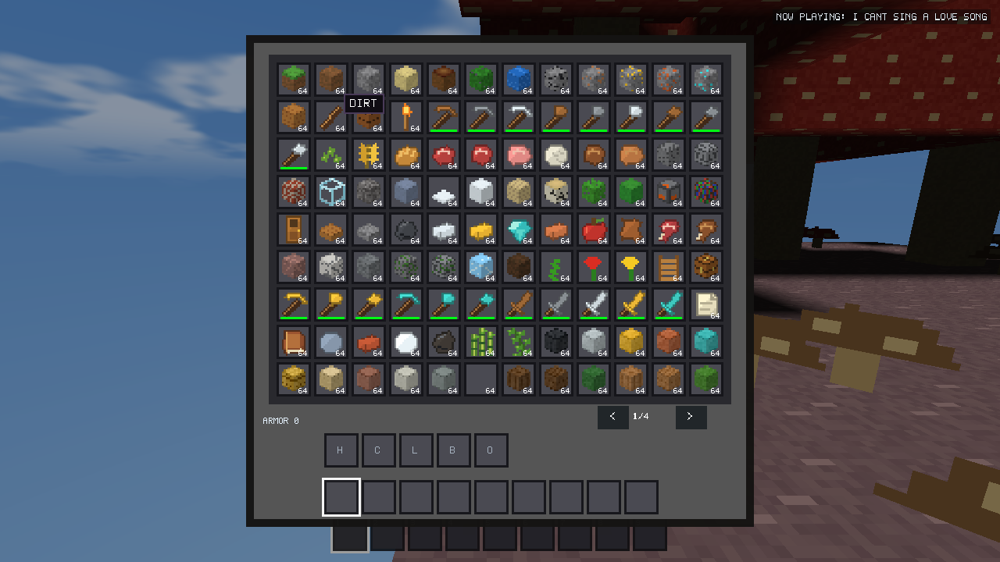
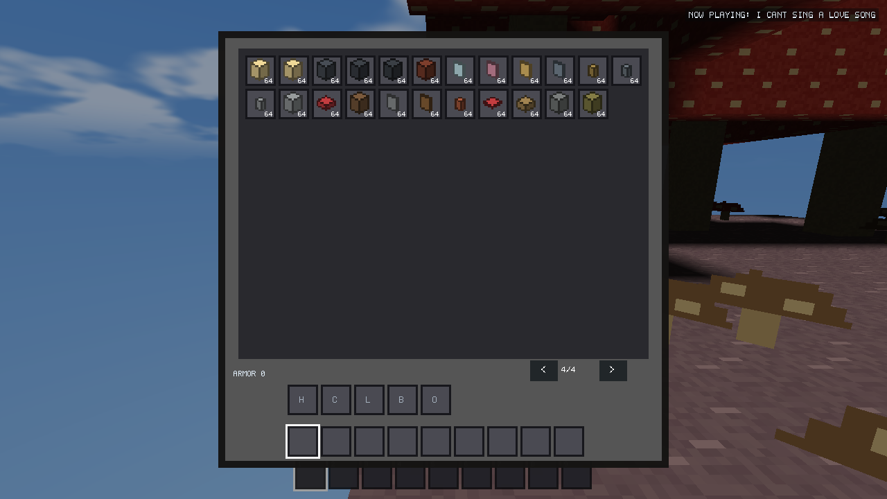

## Rendering and observed corrections

Greedy terrain meshing, packed/indexed 28-byte vertices, shared GPU buffers,
workers, LOD and conservative occlusion remain. Fixed-size shape boxes and bounded
face clipping remove internal faces and clip full/partial neighbors. Transparent
panes use the existing transparent batch. Thin geometry does not impose full-cube
AO, and pane AO is zero. Shape surfaces sample neighboring sunlight/block light.

Actual visual tests found and corrected: strict packer rejection of a nonquantized
AO value (validation retained), full-state AO cache indexing, double atlas UV
mapping, dark paving caused by sampling inside opaque blocks, and mirrored sign
text. All supported states now render and pass the unchanged lossless packer.
Legacy occupied texture pixels and all 206 inventory icon cells match v2.15.1.

## Automated results

- **4,582 building assertions**, covering **1,736 valid states** through geometry,
  texture bounds, packed meshes and exact save roundtrip.
- **260 existing farming assertions**, including Creative statistics preservation
  with simulation and mature wheat's 2 XP.
- Legacy checkpoint decoding, all historical ID comparisons, formerly invalid old
  IDs, no partial load mutation, palette fallback and immutable fixture checks pass.
- Native interactions cover corners/seams, slab merge/body exclusion, stair walking,
  scaffold movement, bed sleep/respawn, paired doors, support recovery, signs,
  frame map identity/rotation/removal, plants, barrels and high-ID drops/inventory.
- Capacity tests fill 100,000 live drops: ownership is retained, deferred recovery
  survives save/reload, and delivery occurs once after capacity becomes available.
- Queued asynchronous saves and reload preserve the latest sign/container state.
- At 10/15/20/30/60/120 simulated FPS, ten seconds produces 1,200 fixed steps;
  Creative retains health 9, hunger 12 and saturation 3 in every case.

Full/demo final suite, installer and matched performance results are recorded
below when their runs finish. Intermediate failures are retained under
`build/v2160-validation/`: legacy fixture byte offsets, a catalog hit test unaware
of pages, and an old content fixture that overwrote a newly added block. Tests
were updated to their actual formats/layouts, not removed or weakened.

## Dense decorated scene stress

Current-build constructed fixtures, RD8, 360 measured render calls per size.
Bulk placement is fixture assembly, not a claim that every normal edit is free.
Mesh/upload totals cover touched chunks; save time is the world component only.

| Placed blocks | 1,000 actual connected edits ms | Mesh + pack ms | Upload ms | Expanded vertices | Compact block payload MiB | World save MiB / ms | Render mean / p99 ms |
| ---: | ---: | ---: | ---: | ---: | ---: | ---: | ---: |
| 1,000 | 24.03 | 64.60 | 1.21 | 235,032 | 0.72 | 0.015 / 2.34 | 0.224 / 1.363 |
| 10,000 | 16.21 | 340.47 | 3.79 | 1,126,638 | 3.60 | 0.455 / 5.39 | 0.237 / 1.213 |
| 100,000 | 15.59 | 1,429.73 | 17.51 | 6,695,322 | 8.63 | 4.85 / 37.47 | 0.719 / 1.113 |

Complete synchronous checkpoint latency was 23.12 / 24.24 / 66.15 ms for these
three sizes. Each world component also reloaded with exactly equal edit records.
At 100,000 blocks, measured working set was 340 MiB and terrain live/capacity
183/232 MiB. Expanded vertices are before terrain indexing. These are current-only
stress results on an i7-14700F / Radeon RX 9060 XT, not a speedup over v2.15.1 or
proof of performance on physical low-end hardware. Dense surface geometry costs
more than terrain; very large decorated scenes can require substantial meshing.

## Matched performance, compatibility and packaging

Matched original v2.15.1/current full Releases, seed 123456789, identical camera
path, FOV 74, VSync/AA off, LOD Low, occlusion Auto, simulation distance 8. Two
alternating-order runs at each distance, each with stationary, rotating and edit
phases. All 36 phase records retained 100% foreground/visibility. These are means
of six phase summaries per variant/RD; averaged p95/p99 are **not pooled frame
percentiles**. Raw [phase records](building-decoration/foreground.csv) and
[summary](building-decoration/performance-summary.csv) include CPU/GPU timings,
geometry, throughput counters, private memory, live bytes and draw calls.

| RD | Mean ms old/new | p95 ms old/new | p99 ms old/new | Worst ms old/new | Peak working set MiB old/new | Mesh sample ms old/new |
| ---: | ---: | ---: | ---: | ---: | ---: | ---: |
| 8 | 0.313 / 0.307 | 0.566 / 0.551 | 1.624 / 1.597 | 6.16 / 20.20 | 355 / 301 | 4.72 / 4.85 |
| 16 | 0.463 / 0.444 | 0.866 / 0.771 | 1.658 / 1.480 | 11.34 / 3.97 | 370 / 350 | 6.13 / 6.42 |
| 32 | 0.941 / 0.940 | 1.086 / 1.093 | 1.349 / 1.445 | 7.38 / 7.19 | 571 / 578 | 4.97 / 5.40 |

Mean render time is effectively unchanged; small differences are not claimed as
speedups. Ordinary terrain GPU live bytes/capacity stay comparable (RD32 roughly
548/632 MiB current). Mesh samples increase about 3–9%, consistent with wider
temporary state data and extra shape eligibility work. RD32 private memory rose
about 8 MiB (1407→1415); working-set differences are affected by Windows residency.
RD8 has one 20.2 ms outlier; its cause was not established and it is not concealed.
This does not establish low-end-hardware certification or multi-hour stability.

The matched runs precede the final sign multiline layout correction; there are no
signs/editors in that comparison scenario. Final packages rerun visual and full/
demo regressions after that correction. No settings were reduced for the results.

All 20 Release suites pass (11 full, 9 demo), with production Game/checkpoint and
save-failure/session tests. Both variants match **663/663** historical chunk hashes
(1,326 total). Optimization validation retains eight legacy/packed/indexed pixel
comparisons and 480 full-scene visibility comparisons per variant, worker revision
cancellation and local edits at RD2/32/64. The demo wrote no persistence files.
An isolated installer upgrade from v2.15.1 to v2.16.0 passed: exact executable
payload hashes, old world loading, unchanged fixture saves on upgrade/uninstall,
unchanged production installation registration, and removal of only the test
registration. [Installer evidence](building-decoration/installer-check.json).
Both locally packaged executables use embedded assets; demo persistence and
privileged-command restrictions pass. `dist/SHA256SUMS.txt` records package hashes.

### Traversal, timing and generation

Actual production Survival walking and boat traversal passed at RD8/16/32 with
rain, iron equipment, a shield, maps, waypoints, save/reload and an injected
500 ms frame interruption in each phase. The walking phases exercised actual
10/15/20/30/60/120 FPS limits; fixed-step accounting retained elapsed time (maximum
unaccounted error below 0.01 seconds). See `survival-rd*.csv` and `timing-rd*.csv`.
The roughly 510 ms worst frames in those records are deliberately injected and
must not be mistaken for measured spontaneous stalls. Checkpoint capture was
4.85–5.66 ms and complete checkpoint time 23.66–30.27 ms in these traversal worlds.

A separate brief RD64 run completed with 12,853 resident chunks, 1,387 MiB
working set, 5,135 MiB private bytes and terrain live/capacity 2,672/3,080 MiB.
Foreground visibility remained 100%; phase means were 3.48–3.70 ms. This is a
stress check on this GPU, not a recommendation for low-end gameplay or proof of
an enforced GPU budget. [Raw RD64 evidence](building-decoration/rd64.csv).

The [generation audit](building-decoration/generation-cpu.csv) covers identical
663 seed/version/coordinate cases per build. One audit measured V22 means of
6.67 ms old / 5.13 ms new (96 cases each); all-version means 4.77 / 3.66 ms. These
single-run timings are not evidence of a causal generation speedup: thermal,
cache and OS conditions were not controlled across audit runs. Exact output
hashes match. The repeated foreground comparison above is the stronger evidence
for ordinary gameplay cost.

## Actual in-engine screenshots

The native fixture uses production Release objects, the actual game loop, GL 3.3
renderer, textures, lighting and screenshot path. Buildings are explicitly placed
in an isolated test yard on V22; they are not generated new structures or mockups.
Each of these views was inspected during implementation.

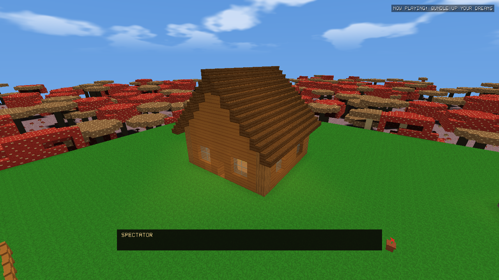
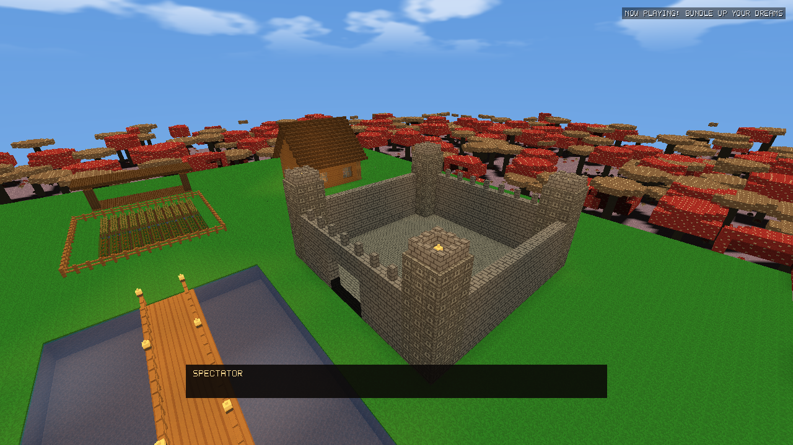
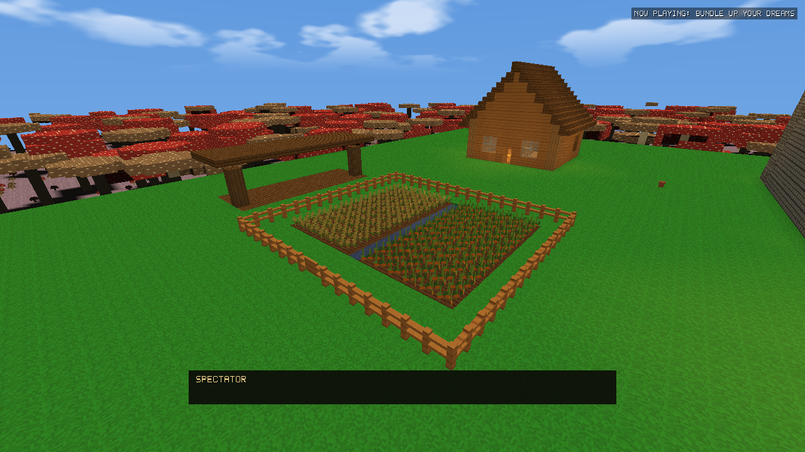
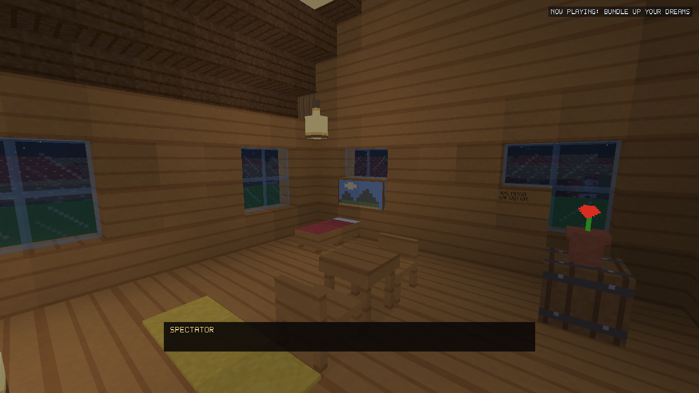
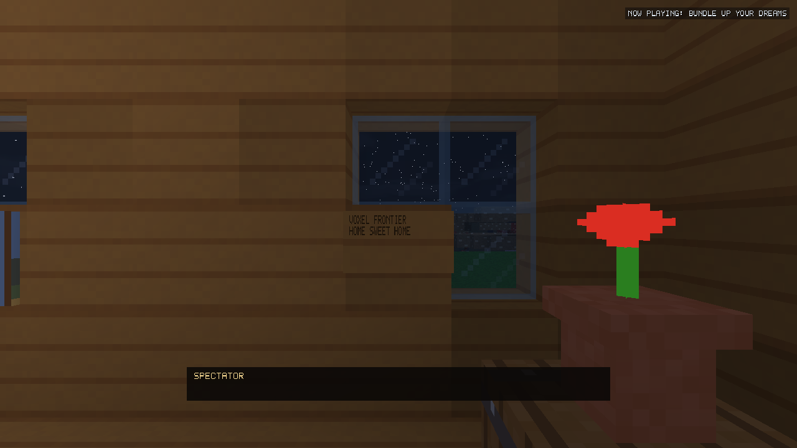
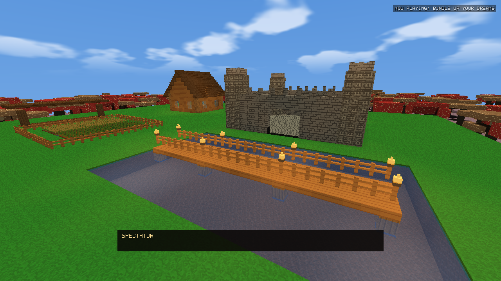
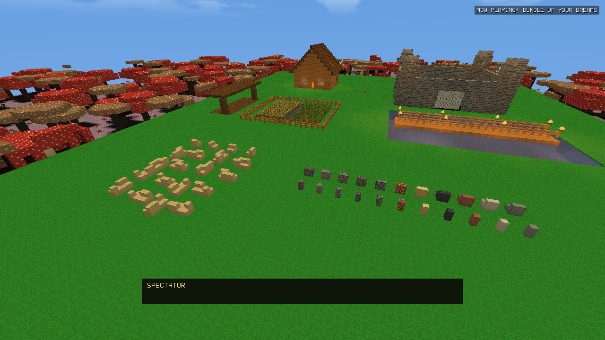

## Reproduction

```powershell
./package_release.ps1 -BuildJobs 4
./tools/run_building_validation.ps1 -SkipBuild -Visual -Benchmark
./tools/run_stability_regressions.ps1 -SkipBuild -IncludeDemo
# Use Python with Pillow for exact pixel comparisons:
python tools/check_building_compatibility.py --baseline v2.15.1
./tools/run_farming_benchmarks.ps1 -BaselineExe build/v2160-validation/baseline/VoxelFrontier-v2.15.1.exe -Output build/v2160-validation/matched-new -Distances 8,16,32 -Repeats 2
```

The regression driver always creates a fresh temporary working directory. The
installer test uses a unique fixture AppId and a workspace-only installation.
The production installation and user worlds are never test targets.

## Remaining limits and deferred features

- No sitting, campfire cooking/smoke, banner pattern UI, dedicated stonecutter,
  copy/paste/undo or full waterlogging. These were optional, not unfinished saves.
- Open/close uses immediate state toggles with sound, not interpolated animation.
- Signs are ASCII-only; nearby projected text uses a center-ray occlusion check,
  so complex partial occlusion is approximate. No separate glyph depth pass.
- Color is block state; Pick Block preserves the material/shape item, not a full
  cosmetic state inside an inventory stack. Blue has no Survival dye recipe.
- Chunk remeshing remains at existing chunk granularity; connection updates are
  local, but a single edit still remeshes affected chunks. No subchunk rewrite.
- Existing mob navigation remains a coarse grid approximation around furniture;
  livestock pens respect the new fence/gate barriers. The hostile billboard AI,
  movement logic, sprites and spawn behavior were not replaced.
- Temporary wider arrays, large palettes and highly decorated surfaces have real
  costs. No claim of universal FPS improvements or new enforced GPU budget.
- No multi-hour soak or physical power-loss certification; interruption/session
  regressions use deterministic isolated failures. Keep independent backups.
