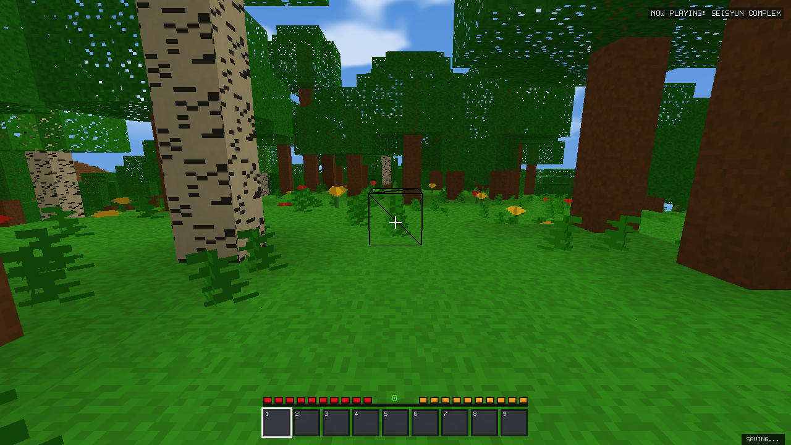
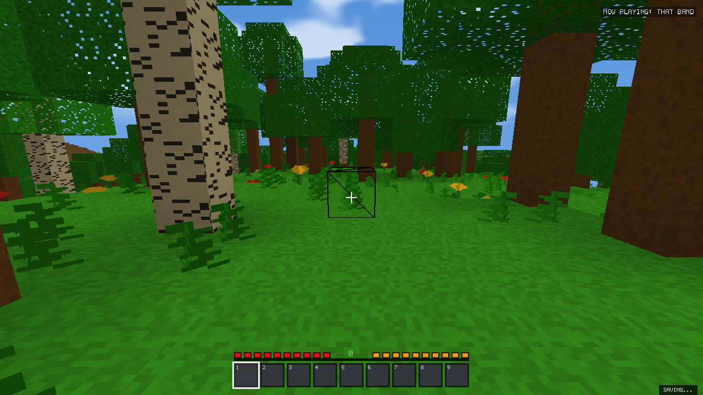
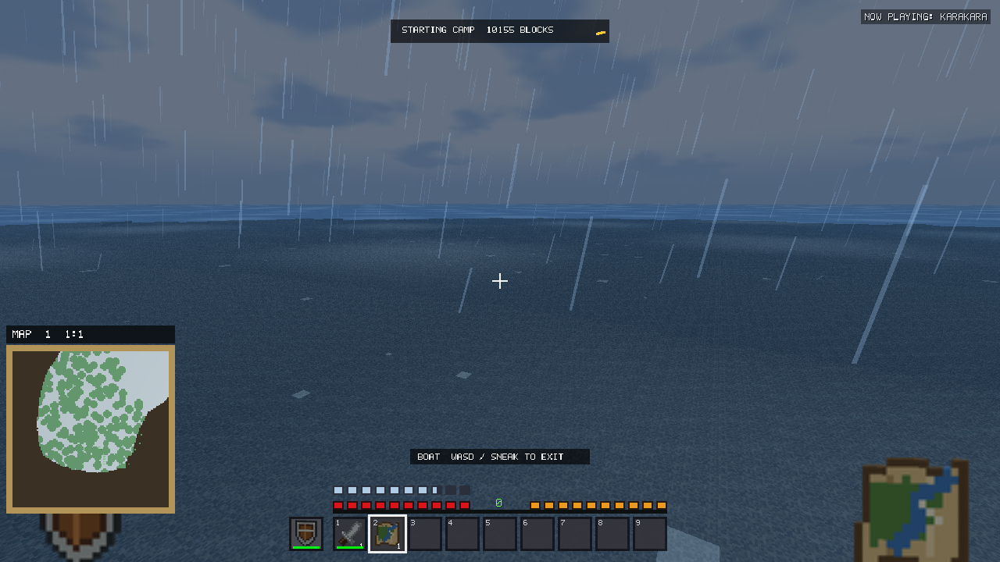

# Voxel Frontier v2.18.1 engine optimization validation

Local candidate; not published or installed. Tests use disposable profiles under
`build/v2181-validation/` or the stability driver's temporary fixture root. No real
player worlds or installation are used. No new generator or save format is added.

## Baseline and method

Baseline: released v2.18.0, `507fefdec29f5b2848d1344b520d94a34fe8df95`. The initial
working tree had no tracked modifications. Unrelated `.idea/`,
`.codex-remote-attachments/`, and Python cache files were left alone. Original full
and demo executables, the driver, source archive, settings and fingerprints were
frozen before editing in `build/v2181-validation/baseline/`.

Original full SHA256:
`d18ed5c07a769ade587e8513ee21b06e37a7b80e0f78c7a4c2f35bd7ed746847`.
Original demo SHA256:
`17366780e18af4686eb2b5fba6ae8d67ba210c163ebc897b4c9aad882dd391ae`.

Hardware: Intel i7-14700F, 28 logical processors, AMD Radeon RX 9060 XT, 32 GiB
RAM, Windows, OpenGL 3.3 API baseline. Native fixtures use the same seed
20260917, Generator V23, camera paths, 1280x720, SD8, Low terrain LOD, Auto
occlusion, AA/VSync off and uncapped rendering in both builds. No compiler or
second benchmark runs during a timed fixture. Uncapped FPS on this GPU is not a
low-end hardware guarantee. Intentional 10–120 FPS traversal limiters and the
injected 500 ms traversal stall are identified separately.

`tools/prepare_engine_baseline.py` builds a common timing/private-test-access
harness from the frozen source archive. It adds diagnostics and test entry points;
original generation, saving, worker scheduling, page allocation and retirement
algorithms remain the reference. `INSTRUMENTATION.json` fingerprints those edits.
This is distinguished from the untouched published executable. The new binary
freeze harness was linked against original production objects; its 192 overlapping
terrain records match the untouched baseline driver's records.

Native fixture scripts: `tools/benchmark_engine_v2181.py`. Alternating order and
repeats are recorded in each output's `method.json`, `events.jsonl` and binary
fingerprints. Percentiles in summary tables are medians of independent phase
summaries, not pooled raw-frame percentiles. Resident chunks, vertices and triangles
are retained in raw CSVs; streaming views need not finish an identical number of
meshes in a fixed time. Small timing differences are treated as noise.

## Confirmed bottlenecks and changes

### GPU lifetime and teleportation

The original RD64 reproduction reached 304.623 ms in the teleport phase. Its peak
retirement work was 53.6014 ms, including 52.7519 ms in page trimming; another trim
took about 20.6 ms. These are separate frames: retirement did not explain the
entire largest stall. Zero-time fence polling was already asynchronous and is
retained. Range release, buffer destruction, payload handoff, unloading, page
allocation and subdata uploads now have separate timing counters. Slow-frame
traces separate streaming from rendering and expose allocator/upload costs.

At distances above RD32, empty shared pages are reusable during travel/rebuilding, with an idle reserve
bounded at half the selected soft target (zero for Low). Once settled, the old
16/64 MiB reserves apply; an over-target world retains no settled idle reserve.
Only pages with no allocated ranges and no other owner can leave the pool.
The fence-backed range release remains authoritative. Detached GL objects enter
an eight-page queue; normal frames submit at most one GL object deletion per
10 ms. Pending bytes remain included in allocated/retired diagnostics until the
corresponding buffer is deleted. Shutdown drains with the valid graphics context.
No worker thread receives GL handles and no `glFinish` was added.

The general RD8–32 deletion experiment was rejected after repeated RD32 VAO
stalls of 28.866/10.640 ms versus baseline trim peaks of 2.236/0.530 ms. Those
distances retain the original one-page trimming/reserve policy. The bounded
separate-object pool is restricted to larger-distance stress workloads.

An initial experiment deleted buffer names before the VAO. The VAO retained the
storage, postponing its real release and producing a 79.27 ms VAO deletion. That
order was rejected. The retained order deletes VAO references first, then EBO,
then VBO, maintaining conservative pending-byte accounting. Individual driver calls
remain indivisible and may block. The queue bounds call count, not driver latency.
Terrain targets remain **soft limits**; visible required meshes can exceed them.
The original reference does not count individual deletion calls: zero in its
`page_delete_calls` column means unavailable, not zero GL deletions. Payload
timing measures main-thread handoff; worker-side heap frees are not individually
timed.

### Exact V23 column reuse

Profiling the concentrated 495-chunk fixture found repeated full terrain-column
queries in column setup and supported-entrance validation. Original cold mean
5.040 ms included 0.852 ms in columns and 1.211 ms in entrance work. These figures
use a different coordinate mix from the earlier 96-chunk 8.227 ms reference.

A fixed 4,096-entry thread-local direct cache stores the exact `TerrainSample`,
keyed by full signed X/Z, seed and generator. It applies only to V23 full shore +
drainage queries. Alternate recursive flags and V1–V22 use the unchanged arithmetic.
Collisions recompute; there is no allocation, shared eviction lock, changed noise
sample, approximate density or altered random sequence. Storage is roughly half a
MiB per participating thread and bounded for the thread lifetime. Immutable
procedural columns contain no edits, loaded chunks or gameplay state.

The first concentrated comparison was 5.040 -> 4.204 ms cold and 4.700 -> 4.059 ms
warm. Repeated distributed 96-chunk measurements, rather than that first result,
are used for final performance conclusions. Normal generation profiling is off;
its scope performs no clock reads or shared counter updates when disabled.

### Immutable checkpoint encoding

Previously `commitAsync` moved only final commit work: main-thread verification,
component validation, encoding, staging and full terrain traversal still preceded
it. The new autosave captures typed, owned values on the simulation thread and
creates the `SaveFile::Checkpoint` on its background worker. The worker owns the
writer lock and thread-local staging from verification through complete commit.
No background encoder traverses live chunks, inventory, map jobs, mobs or devices.

`SaveSnapshot.cpp` shares the world codec between synchronous/manual saves and
flat immutable edit/container/text/deferred-drop snapshots. It captures inventory,
equipment, player statistics, serialized mob/drop/marker fields, boats, surveyed
map pixels, waypoints, world metadata and AUT1 nodes with their range/timer history.
Only already-ready survey results are published during capture; unfinished map
work remains future state. No AI/render scratch data or mutable world pointer is
handed to the encoder. Existing codecs, IDs and extensions are unchanged.

One outstanding job and one coalesced newest-state request bound queued work.
Snapshot admission is 256 MiB of accounted owned data; rejection leaves the prior
checkpoint intact and reports that manual saving remains available. It is not a
hard process-RAM cap. Manual saves still use the validated synchronous path without
copying the entire world. Independent preference writes are deferred while the
world worker owns the save lock. Death, world changes and shutdown still wait for
or coordinate pending commits. `Saved` follows complete successful commit only.
Manifest generations, hashes, journaling, atomic replacement, verified backup
recovery, session locks and permanent-integrity-failure backpressure are preserved.

Captured five-component files match original codec bytes, including equipment
wear, map identity, finite mob markers and BDP1 ownership. New tests mutate all
live systems after capture and then reload the captured checkpoint. Encoding
failure, admission rejection, timer snapshots, coalescing and repeated latest-state
saves are exercised alongside the original interruption/corruption suites.

Save stage timers are inclusive: encoding includes staging, verification/commit
include their hash work. Their columns must not be summed as independent costs.
Main-thread `capture_ms` includes settings capture/serialization and job launch;
`total_ms` includes waiting for complete durable checkpoint commit.

### Remeshing and constrained CPU scheduling

Repeated high-priority edits formerly pushed another queue entry even when the
same dirty chunk was already promoted. Promotion now occurs once; every edit still
increments both revision and atomic cancellation token. Stale in-flight completion
still requeues explicitly, because its prior queue entry may already be consumed.
Lighting, connectivity, neighbor invalidation, AO and upload epochs are unchanged.
Ten thousand revisions remain ten thousand revisions while their pending request
occupies one queue entry. This reduces queue churn; it does not claim to eliminate
all necessary geometry rebuilds.

Worker planning now observes the Windows process-affinity mask as well as reported
hardware concurrency. Existing conservative plans remain unchanged: two/four
available logical CPUs receive one generation and one mesh worker. Full-machine
Auto retains its existing limits and adaptive generation/mesh backpressure.
Affinity proxy measurements are not physical two-core or integrated-GPU tests.
The old build already chose smaller pools on a physical low-core-count CPU; the
large proxy improvement specifically demonstrates correcting its process-affinity
blind spot and must not be generalized to every low-end processor. Fewer workers
trade some queue recovery speed for foreground responsiveness; recovery latency
is reported even when it regresses.

No section mesher, geometry simplifier, new LOD, SIMD rewrite, compression scheme,
renderer rewrite, save-format migration or large-coordinate precision change is
included. Existing queue priorities, bounded admissions, stale-job checks and
unloaded-terrain collision barriers are preserved.

## Measured results

Repeated codec fixture: six saves per edit count per variant, alternating two
process runs, with generation/mesh workers stopped only in this isolated codec
fixture. Actual foreground streaming/simulation are tested separately.

| Saved edits | Main-thread ms old/new | Complete checkpoint ms old/new | Snapshot accounted bytes |
|---:|---:|---:|---:|
| 0 + 3 container edits | 3.402 / 1.536 | 16.848 / 14.918 | 93,293 |
| 50,000 + 3 | 5.336 / 2.219 | 22.087 / 21.944 | 893,245 |
| 250,000 + 3 | 14.585 / 5.189 | 38.619 / 34.281 | 4,093,245 |

At 250k edits, capture is about 64% lower in this fixture. Disk, antivirus,
filesystem locking, object counts and world size affect results. This is not a
claim that all saves complete in 5 ms.

Repeated distributed V23 generation (192 samples/cache condition across two
process runs): cold 7.783 -> 6.236 ms; warm 3.570 -> 3.634 ms. Cold latency improves
about 20%; the small warm difference is inconclusive and no warm speedup is claimed.
The full sample distributions and stage costs are retained with the evidence.

<!-- final-evidence -->

## Final regression evidence
All 20 packaged Release suites passed (11 full, nine demo). All 1,326 historical generator records match; both full/demo variants match all 495 frozen V23 block/loot/encounter files. Cold/warm complete exports, 1/2/4/8 parallel callers, ecosystem tests and 50 deterministic V23 Survival spawn seeds pass. Demo profiles contain no persistent world, player, inventory or navigation files.
Twelve functional groups pass, including the new immutable-snapshot and 24-teleport/save/death/reload stress cases. Original assertion totals are retained in the logs. The narrowed RD8–32 cleanup policy was rechecked with matched repeated RD32 streaming.
## Final RD32 streaming comparison
Two matched runs per variant, final policy. Medians of phase summaries; worst is the largest frame across runs. Geometry and queues are recorded in the linked raw data.

| Phase | Mean ms old/new | p95 | p99 | p99.9 | Worst | Peak retirement ms |
|---|---:|---:|---:|---:|---:|---:|
| warmup | 2.044 / 2.014 | 3.779 / 3.588 | 5.654 / 5.361 | 17.294 / 17.616 | 23.139 / 22.078 | 0.033 / 0.030 |
| flight8x | 2.313 / 2.258 | 5.046 / 4.837 | 6.661 / 6.460 | 8.112 / 7.774 | 17.022 / 16.805 | 0.142 / 0.061 |
| recovery | 1.970 / 1.958 | 2.515 / 2.472 | 2.782 / 2.737 | 5.163 / 5.321 | 19.008 / 17.001 | 0.056 / 0.035 |
| teleport | 1.614 / 1.570 | 3.265 / 3.117 | 5.136 / 4.823 | 6.682 / 6.580 | 9.581 / 8.939 | 2.357 / 3.773 |

## Foreground scenes
One matched run per scene/RD, three 3-second phases after bounded warm-up. These short samples validate workloads and do not establish small FPS improvements. Frame metrics include presentation; GPU intervals exclude it. Rows below aggregate scene/phase summaries, so consult raw CSVs for geometry and scene-specific tails.

| RD | Mean ms old/new | p95 | p99 | p99.9 | Worst | GPU ms | Max RAM MiB | Terrain capacity MiB |
|---:|---:|---:|---:|---:|---:|---:|---:|---:|
| 8 | 0.283 / 0.287 | 0.585 / 0.596 | 2.419 / 2.430 | 3.190 / 3.386 | 15.824 / 5.492 | 0.126 / 0.130 | 341.680 / 340.938 | 96.000 / 96.000 |
| 16 | 0.586 / 0.599 | 1.549 / 1.598 | 2.710 / 2.570 | 3.312 / 3.474 | 5.796 / 12.122 | 0.381 / 0.385 | 392.344 / 410.418 | 416.000 / 416.000 |
| 32 | 1.423 / 1.415 | 2.010 / 1.958 | 2.463 / 2.483 | 3.115 / 3.099 | 9.033 / 4.282 | 1.225 / 1.228 | 720.859 / 734.309 | 1464.000 / 1456.000 |

## Constrained logical-CPU proxies
Both variants use the same RD16/Low memory preset. Affinity is set before process initialization. These are logical CPU masks and a soft terrain-memory preset, not hard system-RAM limits or physical low-end/iGPU certification.

| CPUs | Generation/mesh limits old/new | Recovery mean ms old/new | Recovery seconds old/new |
|---:|---|---:|---:|
| 2 | 6+1 / 1+1 | 1.549 / 0.767 | 5.261 / 8.204 |
| 4 | 6+1 / 1+1 | 0.718 / 0.694 | 0.677 / 4.826 |

## RD64 stress and queue recovery

One extended matched pair: 45 seconds for flight recovery and 20 seconds after teleport. This is not a repeated worst-frame guarantee.

| Variant | Flight recovery s | End recovery gen/mesh/upload | Teleport mean / p99 / p99.9 / worst ms | Peak retirement ms | Teleport allocations | End teleport gen/mesh/upload |
|---|---:|---|---|---:|---:|---|
| old | 16.023 | 0/0/0 | 3.117 / 8.285 / 93.705 / 247.569 | 99.850 | 301 | 69/7/0 |
| new | 15.546 | 0/0/0 | 3.065 / 7.926 / 81.404 / 239.454 | 50.147 | 0 | 92/3/2 |

Both flight workloads settle, with zero generation/mesh/upload debt. Teleport still has outstanding work at 20 seconds; later completion is unmeasured. Retirement peaks and allocations improve in this pair, but driver/render stalls persist and whole-frame worst-case improvement is unproven. Geometry differs while fixed-time queues are active; the raw records retain residents, vertices and capacity.

## Actual traversal and automation
Matched RD8/16/32 Survival traversal includes rain, equipment, progressive maps, boating, active streaming, checkpoint/reload, and 100/1,000/10,000 automation components. Deliberate 10/15/20/30/60/120 FPS limits and a 500 ms injected stall are not counted as spontaneous engine stalls. Per-run CSVs retain work/frame/save timings, memory and simulation debt. Isolated automation timing includes preparation/reconciliation and device commits.


### Automation tick comparison

Two matched process runs; medians of each run summary, milliseconds. The automation algorithm is unchanged. Small differences are not claimed as improvements.

| Components | Mode | Mean old/new | p99 old/new |
|---:|---|---:|---:|
| 100 | idle | 0.000103 / 0.000100 | 0.000150 / 0.000150 |
| 100 | toggling | 0.042386 / 0.041496 | 0.141250 / 0.116200 |
| 1000 | idle | 0.000091 / 0.000097 | 0.000100 / 0.000100 |
| 1000 | toggling | 0.186653 / 0.179607 | 0.720450 / 0.679400 |
| 10000 | idle | 0.000093 / 0.000096 | 0.000100 / 0.000100 |
| 10000 | toggling | 1.119895 / 1.094135 | 2.215650 / 2.032100 |

### Survival workload and save capture

Each row covers walking and boating phases with the indicated network size. Values are medians of the two phase summaries. `Work` excludes intentional limiter waits and the injected 500 ms stall; total checkpoint latency includes durable commit. These scripted paths and partial streaming states are recorded separately from the identical foreground scene comparisons.

| RD | Components | Work ms old/new | Save capture ms old/new | Checkpoint ms old/new | Max RAM MiB old/new |
|---:|---:|---:|---:|---:|---:|
| 8 | 100 | 1.207 / 1.194 | 5.426 / 2.664 | 22.608 / 25.353 | 294.430 / 304.180 |
| 8 | 1000 | 1.252 / 1.201 | 5.569 / 3.025 | 22.826 / 27.414 | 281.398 / 288.348 |
| 8 | 10000 | 1.641 / 1.637 | 12.794 / 4.314 | 31.271 / 26.979 | 286.820 / 297.113 |
| 16 | 100 | 1.890 / 1.832 | 5.228 / 2.531 | 22.099 / 22.827 | 339.930 / 353.488 |
| 16 | 1000 | 1.919 / 1.943 | 5.239 / 2.489 | 21.033 / 22.196 | 344.520 / 360.738 |
| 16 | 10000 | 2.382 / 2.366 | 11.323 / 4.109 | 31.400 / 27.443 | 361.500 / 361.660 |
| 32 | 100 | 4.720 / 4.673 | 7.891 / 3.113 | 24.811 / 23.753 | 632.977 / 649.039 |
| 32 | 1000 | 4.840 / 4.720 | 6.195 / 3.427 | 24.133 / 24.301 | 635.867 / 652.211 |
| 32 | 10000 | 5.399 / 5.330 | 11.001 / 5.095 | 30.492 / 28.486 | 657.238 / 681.457 |

## Local packages
Both variants report version 2.18.1, embed the unchanged 361-icon atlas, and passed packaged executable suites. The installer was built without running it or changing the installed game.
- `VoxelFrontier-v2.18.1-Windows-Standalone.exe` — 77,300,736 bytes; SHA256 `c6eb1cb1e33caa6fc744b7484acfeb8039199bcc88a091e654ba86a493d4f74f`.
- `VoxelFrontier-v2.18.1-Windows-Setup.exe` — 71,566,930 bytes; SHA256 `197d3c3f53f94f742082024cea5211df62693bf57b3f8a384fb31529d4ca09d1`.

Raw [evidence index](engine-v2181/summary.json), [package digests](engine-v2181/packages.json), [Release suite results](engine-v2181/final-release/results.json), [functional results](engine-v2181/final-functional/results.json), and [V23 reference verification](engine-v2181/v23-exact.json).

## Limits and rejected approaches

- Deferred deletion cannot guarantee a maximum GL-driver call duration. The full
  RD64 teleport spike is tracked independently from retirement-stage improvements.
- Temporary idle-page reuse trades a bounded reserve for fewer driver allocations;
  it does not reduce visible mesh memory or enforce a hard VRAM cap.
- Manual saves and existing failure retries retain synchronous coordination and can
  still interrupt a frame. Small independent settings writes remain on the main
  thread; the save measurements include them.
- Snapshot capture still copies O(edits + containers + maps + entities + devices)
  live data. Admission failure requires a manual save or a smaller snapshot; no
  mutable structures are silently encoded in the background.
- The expanded save snapshot shares old codecs. AUT1 timer encoding has a captured
  counterpart and must remain paired with timer-format changes in future updates.
- Retaining the original global writer lock means unrelated file writes should
  remain coordinated/deferred. No concurrent writable session is enabled.
- V23 meshes remain as visually rich and expensive as v2.18.0. Geometric LOD and
  section remeshing were not introduced without measured quality/safety evidence.
- Physical low-end CPU/iGPU hardware and hard system-RAM exhaustion are not certified.
- Synthetic/edit/scripted traversal tests supplement, rather than prove, arbitrary
  long-session player behavior. The known far-coordinate float precision issue is
  explicitly outside this update.

<!-- resource-visual-evidence -->

## Resource and package verification

A further **60 one-second teleport/save cycles** ran with live streaming, followed
by an asynchronous death checkpoint and world reload. Item and map conservation
pass for every cycle. Observed process RAM ranges 279.4–339.8 MiB
and ends at 298.2 MiB; terrain capacity peaks at 80.0 MiB and ends
at 32.0 MiB. This is an RD8 rapid-travel lifetime check, not a global hard
memory limit or a fully settled scene at every one-second sample.
[Cycle trace](engine-v2181/long-resource-stress/resource-cycles.csv) and
[ownership/reload assertions](engine-v2181/long-resource-stress/run.log).

The isolated remesh-request probe preserves 10,000 revision increments while
reducing queued duplicate entries from 10,000 to one. Its single-run enqueue time
is 0.263 -> 0.102 ms, too small to establish a gameplay FPS gain. It does not mean
10,000 geometry rebuilds were previously performed.
[Original](engine-v2181/old-remesh/mesh-requests.csv) and
[candidate](engine-v2181/new-remesh/mesh-requests.csv) records.

Data-only PE resource inspection compares **135 embedded assets in each packaged
variant** with source bytes, including the complete 361-icon atlas, terrain atlas,
128 audio files and four billboard sprites. Git object checks verify **1,007
protected source/asset files** against the baseline, including all hostile AI,
rendering, animation, equipment/farming/navigation code, IDs, world-generation
modules and art covered by that check. The changed cache wrapper and instrumented
world-density file are validated by frozen terrain tests rather than file equality.
[Asset and protection results](engine-v2181/package-assets.json).

The installer was compiled, not executed. Installation and upgrade behavior have
not been retested because this task explicitly prohibits installation. No installed
game files, registry registration or real player saves were changed.

## Native visual inspection

The final RD32 pairs use identical seven scene positions and 100% focused/visible
measurement rows. Forest, mountain, dark cave, ocean, generated structure and
Survival views retain the original textures, silhouettes, lighting and transparent
surfaces in the inspected captures. Dark caves remain dark; no fullbright or
postprocessing was added for comparison. Short captures cannot prove the absence
of every possible transient artifact. Screenshots are native renderer BMPs converted
losslessly to PNG; [provenance](engine-v2181/media/provenance.json) retains hashes.

| Original v2.18.0 forest | v2.18.1 forest |
|---|---|
|  |  |



## Reproduction commands

Build the two local packages with `./package_release.ps1`, without running the
installer. Configure the full test driver with CMake using `tests/stability` as
source and `build/v2181-validation/driver` as output; its default BASE points to
`build/installed-release`. Configure the demo driver with
`-DBASE=<absolute-path>/build/standalone-demo-release -DDEMO=ON`. Both use Release.
The common original-source harness is prepared by
`tools/prepare_engine_baseline.py` from the frozen v2.18.0 source archive; pass
`-DDEPENDENCIES=<absolute-path>/build/installed-release` to its driver to reuse
the same dependency sources. No reset, stash or checkout is required.

```powershell
python tools/validate_engine_v2181.py --phase functional --output build/fresh-functional
python tools/validate_engine_v2181.py --phase release --output build/fresh-release
python tools/validate_engine_v2181.py --phase generation --output build/fresh-generation
python tools/benchmark_engine_v2181.py --phase streaming --distances 32 --repeats 2 --output build/fresh-streaming
python tools/benchmark_engine_v2181.py --phase scenes --repeats 1 --output build/fresh-scenes
python tools/benchmark_engine_v2181.py --phase proxies --repeats 2 --output build/fresh-proxies
python tools/benchmark_engine_v2181.py --phase traversal --repeats 1 --output build/fresh-traversal
python tools/verify_v23_exact.py build/fresh-generation/full-freeze
python tools/verify_engine_package_assets.py
```

Run timed workloads serially with no compiler or other benchmark. Existing output
directories are refused to preserve evidence. Affinity is applied before process
initialization. A Python launcher constant error in the first proxy attempt was
corrected before any child process started; that empty attempt is excluded.
