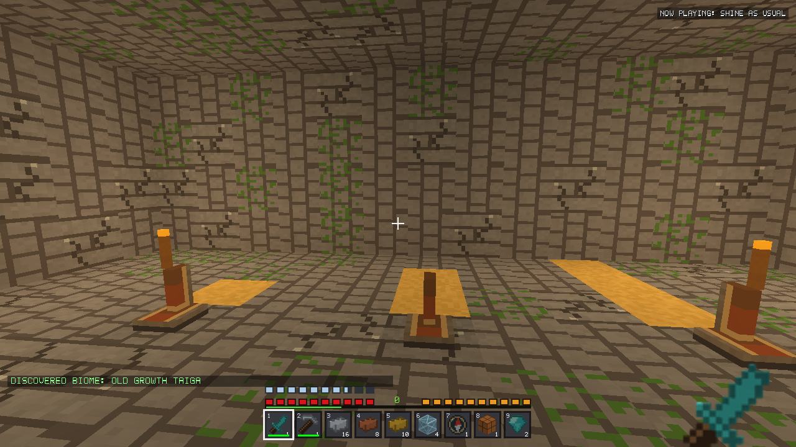
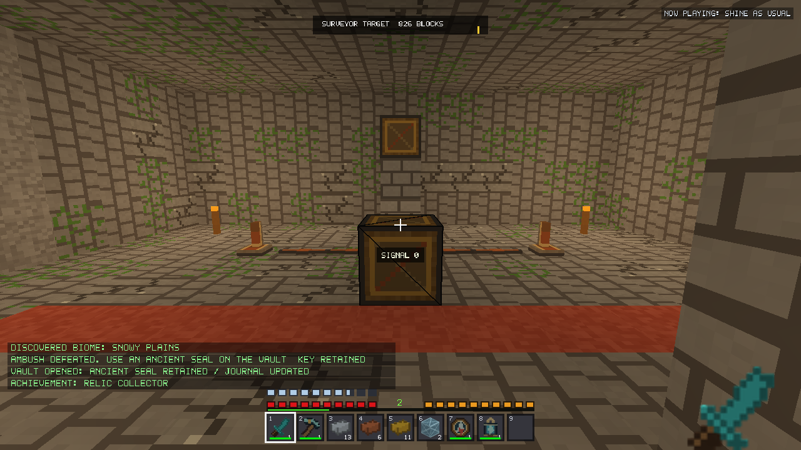
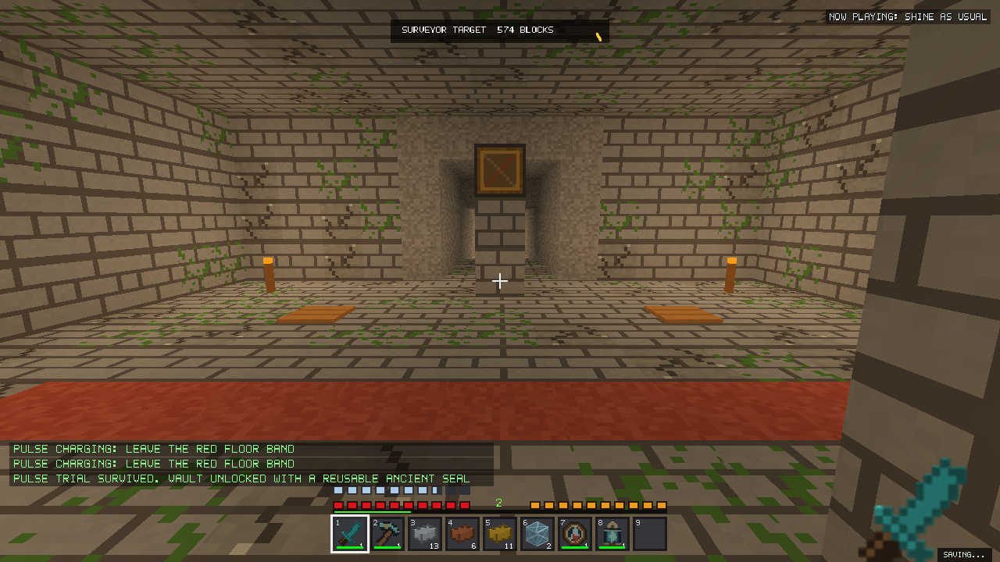
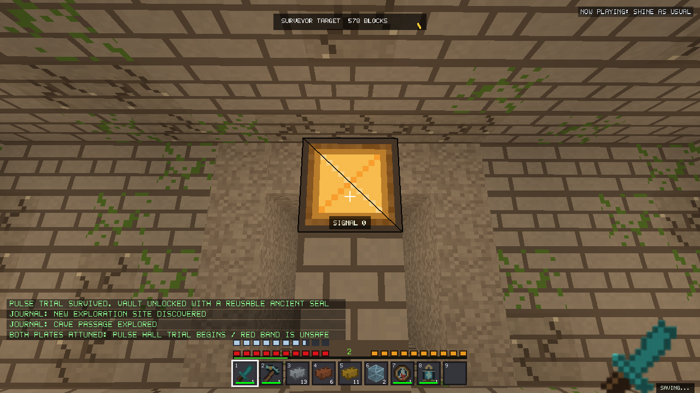
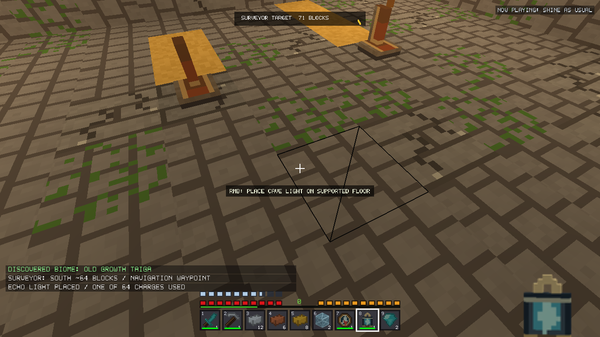
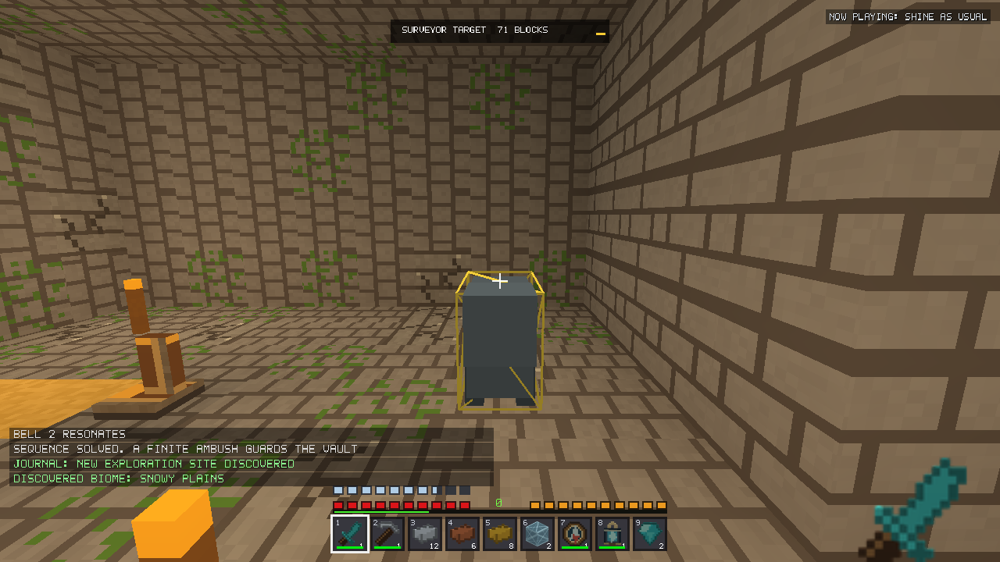
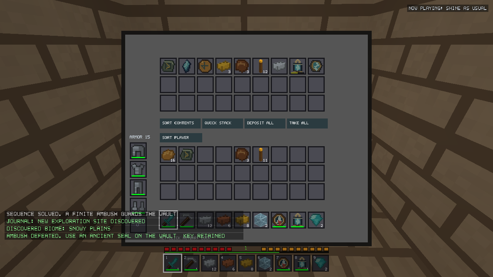
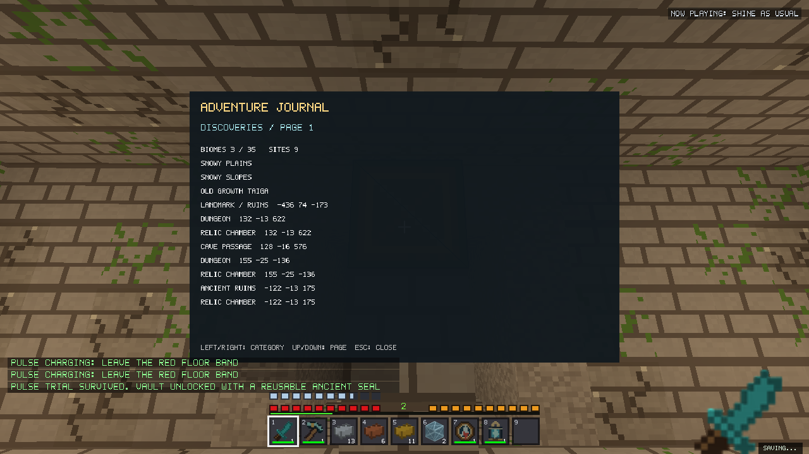
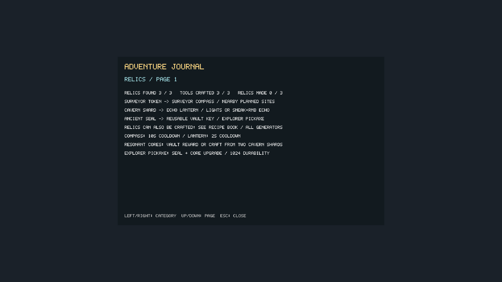
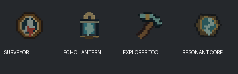

# Voxel Frontier v2.19.0 — Exploration & Relics validation

Local candidate; not committed, published, installed, or tested against real player
worlds. Every native driver creates a fresh temporary working directory, and all
launchers set a separate marked test profile. Failed fixtures are retained.

## Baseline and scope

Starting source: released v2.18.1,
`a910ec8a22b537038b99cb95be2dbc7cbb841d2d`. There were no tracked modifications.
Unrelated attachment, IDE and Python-cache directories were preserved. The source
archive, original executable, standalone demo, driver and fingerprints are frozen
under `build/v2190-validation/baseline/` before edits.

Original full SHA256:
`803431c91b0bccd4024cfd8d39b14e5125c83d5bbf1334017315d5820ce27b86`.
Original demo SHA256:
`c6eb1cb1e33caa6fc744b7484acfeb8039199bcc88a091e654ba86a493d4f74f`.

The audit read the exploration, V23, engine-optimization and automation validation
reports and traced underground/surface planning, loot ownership, registries,
crafting, navigation, live input, saves, snapshots and finite structure mobs.
No historical terrain algorithm, hostile billboard definition/art/AI, packed vertex,
mesher, LOD, occlusion or streaming-worker policy is replaced.

## Connected progression and costs

An accessible V24 relic cache supplies one of each original relic, torches, food
and modest metal resources. The cache is outside the vault, even in one-room
layouts. The player combines relics with ordinary acquired resources to craft
navigation/caving tools, solves the chamber, completes its challenge, uses a
reusable Seal to open finite treasure, and obtains a Resonant Core for an optional
rare pickaxe upgrade. Existing V1–V23 worlds retain their original loot and can
use existing relics, original V19+ loot sources, or the paid fallback recipes for
all tools, the journal and achievements. Pre-V19 terrain/loot is not retrofitted.

| Item | Crafting-table ingredients | Behavior and limits |
|---|---|---|
| Surveyor Compass | Surveyor Token, Compass, 2 Copper, 2 Iron, 1 Gold | 96 successful surveys; 10 s cooldown |
| Echo Lantern | Cavern Shard, Torch, 2 Iron, 2 Glass, 1 Gold | 64 lights or short-range echoes; 2 s cooldown |
| Resonant Core | 2 Cavern Shards, 2 Copper, 2 Gold, 1 Iron | Vault reward or paid legacy-world crafting path; stacks to 16 |
| Ancient Explorer Tool | Ancient Seal, Resonant Core, Iron Pickaxe, 2 Diamonds | Iron-tier pickaxe with 1,024 durability; normal mining/combat/ownership |

Paid acquisition also works in pre-structure worlds: a Surveyor Token costs a
Compass, four Gold and four Paper; a Cavern Shard costs a Diamond, four Copper
and four Glass; an Ancient Seal costs two Diamonds, four Gold and three Books.
No relic/tool decomposes back into these ingredients, so there is no crafting
resource loop. Looted relics still avoid those costs. Crafting masks record both
original relics and the three tools, separately from merely obtaining them.

The Recipe Book is authoritative for shaped layouts, quantities, missing
resources, autofill and batch transactions. Tool ingredients use legal one-item
stacks; two upgrades are tested with two autofills rather than an illegal two-tool
grid stack. Failed crafts leave all ingredients and metadata untouched.

Surveying reads at most a bounded resident site index and 25 cached regional
plans within 768 blocks. It performs no generation, distant chunk loading or map
pixel reveal. Visited underground regions are excluded; actual entrance proximity
records their discovery. Successful use reports cardinal bearing/approximate
distance and selects a normal waypoint. Full waypoint lists retain bearing
feedback. A failed survey costs no wear and has a two-second retry cooldown.

The Echo Lantern leaves an ordinary, persistent Torch above a solid loaded floor.
Sneak+RMB instead probes four cardinal directions through at most twelve loaded
cells each, reporting a three-cell supported air opening. Hidden openings are
preferred over already open space; no ore identities, distant chunks or noise
fields are inspected. It consumes one charge on a successful echo; failed probes
cost no wear. This is charged illumination/awareness, not a moving light or ore
scanner. Placement
is verified before charging wear. Its light uses the existing emitter/lighting
system. Both tools work in either hand, honor main-hand/shield priority, break
correctly and share per-world cooldowns across swapping, replacement and reload.
Creative retains cooldowns but does not consume durability. The pickaxe consumes
a Seal through an explicit crafting recipe; opening a vault never consumes one.

## Journal and discovery

Default shortcut **J**, configurable through the existing binding/settings system.
Left/right or Tab changes Discoveries / Challenges / Relics / Achievements;
up/down pages twelve entries at a time; Escape closes. UI uses the existing scale
and text renderer. The world continues simulating while the journal is open.

- A 35-bit biome mask, relic and actual-crafting masks, discovered locations,
  puzzle/challenge counters and completed achievements persist per world.
  Original relic crafting and tool crafting have distinct progress bits.
- Discovery requires actual player proximity/interaction. Generating or streaming
  a chunk only populates a bounded candidate index; it grants no discovery or XP.
- Ordinary site proximity uses nine chunk-index lookups and cached nearby plans
  twice per second. No procedural plan is built by discovery or surveying.
- Cave passages use coarse 64×16×64 location cells, reducing repeated entries
  while retaining separate underground levels. Coordinates are approximate areas.
- Hidden achievement names remain absent until completed. Biome milestones at
  1/5/15/35 grant 2/4/6/8 XP once; collecting all three relics grants 6 XP once.
  First Survival vault access grants 8 XP once. No item ownership is created by
  achievement notifications.
- Location storage is bounded at 4,096 records and 2,048 chamber records. Masks
  continue working at the location cap; no old identity is recycled or rewarded
  again. Paging bounds work to the requested portion of the journal.

## V24 rules and puzzles

V24 is the default only for new worlds. Saved generator fields retain their values.
`LatestGeneratorVersion` coordinates constructor clamps, CLI, creation, decoding and
UI labels. Invalid versions above the current maximum still fail decoding.

V24 uses the unchanged V23 terrain/climate/river/cave/density/vegetation branches
and its own underground planner/cache. Historical V23 still uses exactly its
previous V21-layout planner. V24 enlarges the accepted final dungeon/ruin room
inside the existing region/reservation envelope, then adds an immutable chamber
before chunk clipping. No historical random stream is consumed by the addition;
independent coordinate/seed salts choose the archetype and treasure.

Stage order remains terrain/materials → decoration/entrance cleanup → protected
surface structures → underground rooms/corridors/foundations → V24 chamber
content → existing shoreline/air trimming. Plans are seed/world-coordinate based,
canonical and immutable, clipped into chunks, with the existing dry-cave approach,
foundations, region margins and surface-structure reservations. No loaded-world
state influences generation.

| Chamber | Intended actions | Finite challenge |
|---|---|---|
| Three Bells | Use levers left to right, following one/two/three yellow terracotta inlays; incorrect order resets with feedback | Two existing voxel Pillager guards, spawned once |
| Divided Current | Activate both sides of the visible wire/AND-gate circuit | Ten-second telegraphed pulse trial |
| Pulse Hall | Step onto both pressure plates | Ten-second telegraphed pulse trial |

A corner vault leaves the central corridors and all controls accessible. Opening
its gate exposes a player-sized route to the chest. The original finite container
is the sole item owner. The Seal can be carried in inventory, offhand, cursor or
crafting slots; it is a reusable key. Creative can open the container without
claiming Survival XP.

Pulse trials have four 1.5-second lamp warnings followed by a strike on the visibly
red floor band. Leaving the band avoids damage; a strike deals 3 damage, not
instant death. The source lever and powered lamp use normal automation and block
light. Trial timers advance only with a living eligible player inside the fully
loaded chamber. Retreat, missing boundary terrain or missing trial mechanisms
pause progress. Timers resume from saved simulation ticks, independent of render
FPS. Sneak-placement against mechanisms retains the ordinary building action.
Restoring missing controls is supported; no puzzle block is regenerated over
player edits. Mining remains a sandbox bypass, including recovering chest contents.
A destroyed chest never rerolls or recreates its reward.

The ambush adds an ownership tag to ordinary persistent voxel Pillagers; their
existing AI, collision, combat and rendering are reused. The four original hostile
billboard mobs are untouched. Two spawns are admitted atomically with finite
markers and population bounds. Dying/dead guards cannot keep a challenge alive.
Retreat/unloading does not respawn the group. Exactly-once marker, progress and
claimed-state ownership is captured with the same checkpoint.

## Loot and persistence

Original collectible IDs/art and every historical weighted table remain unchanged.
Only V24 plans emit the appended RelicSupplies/RelicVault table values, with
independent RNG. A vault has finite relics, modest gold/food/torches, a Resonant
Core, 1–2 iron/rare diamonds, and an occasional half-used Echo Lantern; existing
rare equipment additions retain their independent stream. No chest is rerolled
on opening, emptying, destruction, chunk reactivation or reload.

The world header remains version 3. Optional **ERL1** follows AUT1 and stores
masks, cooldowns, bounded discovery records and stable region-keyed chamber
progress/timers/outcomes. The maximum ERL1 payload is 104,484 bytes. Missing ERL1
means empty state. Optional **ENC1** in the mob component stores one uint64 tag
per saved mob only when tagged guards exist. Original mob files without it retain
their codec behavior. No new journal/loot sidecar is written independently.

Writer/loader bounds match. Invalid masks, counts, coordinates, duplicate keys,
record truncation, impossible progress flags/timers, invalid encounter tags, or
puzzles attached to pre-V24 worlds fail before state commit. Live encounter tags
are checked against their chamber state on Game load/save. Failed saves preserve
the previous verified checkpoint and report failure.

The immutable world snapshot owns a value copy of all ERL1 records; the immutable
mob snapshot owns all ENC1 tags. No raw mutable World/Game pointer crosses to the
background encoder. Metadata, terrain edits, containers, player/inventory, mobs,
travel, AUT1, BDP1 and exploration share the existing transaction. Hashes,
manifest generations, atomic replacement, rollback journals, verified previous
checkpoint recovery, one pending/coalesced save and session reservations remain.
Generated V24 automation retains canonical terrain state before registration,
so an untouched generated device also satisfies AUT1's placement validation.

## Validation and native evidence

The tracked native fixture is `tests/stability/adventure.cpp`. Before final
packaging, focused tests covered production Recipe Book transactions, failed
craft conservation, actual RMB hand/wear/priority/breakage, global cooldowns,
discovery deduplication and all 35 mask bits, bounded storage, truncation without
partial mutation, real AND routing, plates, finite combat, reusable keys, one-time
XP, emptied chests, immutable ERL1/ENC1 saves, abandoned checkpoint staging and
checksum verification. Final run totals and full/demo results are listed below.

Native V24 tests use seeds **20260917, 123456789, 42**, all three archetypes,
positive/negative coordinates, canonical plan cells, control/treasure walking
proofs, unchanged V23 terrain fields, 1/2/4/8 parallel callers in reversed request
order, unmodified generated-device save/load, and 50 deterministic Survival spawns.
Full V23 exact-byte exports and the original historical tests remain separate.

The native Survival route starts with a documented established-world common
resource kit, iron armor and a diamond sword. Every relic/core comes from a real
finite generated container. Recorded fixture teleports connect distant sites;
room walking, workbench placement, RMB opening, tool use, normal combat/cooldowns,
plate/switch use, journal input, crafting transactions and checkpoint reload use
production systems. This is a controlled native playthrough, not a claim of an
unassisted first-spawn mining expedition or every possible seed being playable.
No demonstration platforms or replacement terrain are used in captures.

<!-- FINAL_RESULTS -->
Final packaged validation: **13 final-hazard-functional groups, 9 final-hazard-generation groups, 20 final-hazard-release groups**, all passed. **1,326 historical records** and **495 complete V23 reference files per variant** match. Full/demo V24 deterministic tests and 50-spawn cohorts pass.

All 135 embedded resources per variant match source bytes; 991 protected files, the original mob-AI region and original renderer bodies are unchanged. All 361 original previews/mappings remain exact; four new entries bring coverage to 365 with unchanged 6,062,080-byte GPU atlas storage.

The final focused relic suite passes **213 assertions in full / 144 in demo**. V24 generation passes **89,652 / 89,646** checks respectively. Each variant validates 50 new V24 spawn seeds. The native route passes 863 assertions at each RD8/16/32 with 30 Hz simulation, 338 at 60 Hz and 146 at 15 Hz. These are fixture assertions, not counts of independent gameplay sessions.

All 48 exact-resolution journal combinations (three resolutions, four scales, four categories) pass 101 native OpenGL offscreen checks with zero GL errors. The desktop clamps requested large windows: window captures named `journal-1920` are 1920×1061, and `journal-2560` are 1924×1061. **Exact 1920×1080 and 2560×1440 images below are journal-only offscreen targets**, not native gameplay window captures. No 1440p gameplay-performance certification is claimed.

Native captures (procedural V24 seed 20260917):





















[Evidence index](exploration-v2190/summary.json), [embedded assets/source protection](exploration-v2190/package-assets.json), [raw regression logs](exploration-v2190/native-regression-logs.zip).
The [source fingerprint](exploration-v2190/source-fingerprint.json) identifies the uncommitted implementation against the frozen baseline; the archive retains the two expected pre-fix hazard failures as reproduction evidence.

<!-- /FINAL_RESULTS -->

## Performance method

Matched baseline runs use the frozen original v2.18.1 executable and identical
V23 scenes, seeds, coordinates, RD8/16/32, SD8, Low LOD, Auto occlusion, 1280×720,
AA/VSync off and uncapped rendering. Forest, structures and Survival/gameplay
scenes are repeated in alternating process order. Raw data retain geometry,
resident counts, CPU/process RAM, asynchronous GPU times and frame percentiles.
V23 scenes provide identical generation; new V24 content is measured separately
and is not presented as identical baseline geometry.

The native V24 route also records active ambush/trap/walking work at each selected
RD. Its 15/30/60 Hz simulation schedules intentionally wait for the frame interval; reported
frame percentiles include that limiter. Work excludes limiter waiting, and GPU
queries are read only after availability, never by waiting on a result. Working
set and game terrain allocator capacity are sampled, not Task Manager total VRAM.
Checkpoint capture and complete latency are recorded separately. Desktop results
are not integrated-GPU/physical low-end certification.

Validation hardware: Intel Core i7-14700F, Radeon RX 9060 XT, 32 GiB RAM.
The repeated matrix and final-package canary retain separate executable hashes.
Requested larger native windows are constrained by the desktop; exact-size journal
tests use OpenGL offscreen targets and are labeled separately from gameplay.

## Integration findings corrected during validation

- Untouched generated V24 automation initially lacked the saved canonical terrain
  record required by AUT1 placement validation. Registration now retains those
  generated states before activation; unmodified generated-device reloads pass.
- A single-room chamber could otherwise place its only key behind the vault.
  Every V24 room now has a separate accessible finite supplies chest. Native
  walking proofs cover controls and the unlocked treasure approach.
- Relic use now reserves the correct hand before shield handling. Actual RMB
  fixtures verify offhand charges, shared cooldowns, breakage and main-hand use.
- Puzzle-coordinate interception now also verifies the current block type and
  respects Sneak-placement. A replacement barrel opens normally after a lever is
  mined; placing against a lever consumes only the placed block, not puzzle input.
- Review found Divided Current's pulse hazard lacked the red warning floor used
  by Pulse Hall. A production-plan regression reproduces the missing band before
  the fix. Both V24 pulse archetypes now mark the same nine-block danger strip;
  old V1–V23 plans never enter this template branch. A second reproduction reset
  damage invulnerability between strikes and confirmed that unmarked tiles at
  the ends/edges were also affected. Damage now matches the nine marked cells
  exactly; both adjacent-floor safety cases pass without relying on invulnerability.
- The original native route's ordinary Windows sleep overshot target cadence.
  The fixture now uses the same high-resolution timer as the game. Superseded
  runs remain available; final tables report actual cadence, not requested FPS.

The original crafting self-test assumed two tools could share one ingredient
slot. It now performs two legal one-tool autofills and still verifies both outputs
and material conservation. No inventory validation was weakened.

<!-- PERFORMANCE_RESULTS -->
Two matched process repeats, medians of scene/phase summaries; worst is the maximum across runs. These aggregate percentiles are not pooled raw-frame percentiles. **Small differences are not speedup claims.**

| RD | Mean ms old/new | p95 | p99 | p99.9 | Worst | GPU ms | Max RAM MiB old/new |
|---:|---:|---:|---:|---:|---:|---:|---:|
| 8 | 0.380 / 0.382 | 0.466 / 0.471 | 0.658 / 0.670 | 1.032 / 1.059 | 4.394 / 4.696 | 0.172 / 0.173 | 343.012 / 346.176 |
| 16 | 0.610 / 0.613 | 0.709 / 0.715 | 0.913 / 0.918 | 1.276 / 1.321 | 3.767 / 4.455 | 0.405 / 0.406 | 415.039 / 415.301 |
| 32 | 1.449 / 1.448 | 1.661 / 1.692 | 1.841 / 1.858 | 2.329 / 2.496 | 4.344 / 7.301 | 1.259 / 1.259 | 703.641 / 680.078 |

Raw phase CSVs retain CPU use, residency/triangle counts, frame tails, GPU samples and camera focus. See the [matched run method](exploration-v2190/matched/method.json). Native V24 limiter/work/GPU/save CSVs are linked through the evidence index. There is no physical low-end hardware certification or universal worst-frame guarantee.

The repeated matrix predates final V24-only control-type/Sneak-placement guards, hints and pulse-floor visibility/boundary corrections. Its executable fingerprint is retained in the method file; it is not mislabeled as the final package. A separate one-repeat gameplay canary uses the exact final packaged production executable (see [canary method](exploration-v2190/package-canary/method.json)):

| RD | Mean ms old/new | p99 | Worst | CPU % old/new |
|---:|---:|---:|---:|---:|
| 8 | 0.293 / 0.289 | 0.465 / 0.482 | 7.400 / 7.180 | 7.329 / 7.738 |
| 16 | 0.500 / 0.500 | 0.599 / 0.611 | 3.199 / 3.080 | 3.943 / 4.669 |
| 32 | 1.340 / 1.369 | 1.508 / 1.588 | 13.771 / 3.131 | 2.733 / 2.306 |

Native V24 route measurements (actual high-resolution limiter; work excludes waiting):

| RD / target Hz | Phase | Actual mean FPS | Mean / p99 / worst work ms | Mean GPU ms | Peak sampled RAM MiB |
|---|---|---:|---:|---:|---:|
| 16 / 30 | ambush | 29.77 | 3.028 / 4.588 / 5.171 | 3.877 | 415.1 |
| 16 / 30 | pulse-trial | 29.73 | 2.052 / 6.623 / 7.165 | 8.943 | 420.0 |
| 16 / 30 | walking | 29.74 | 3.331 / 7.108 / 7.516 | 3.277 | 395.6 |
| 32 / 30 | ambush | 29.76 | 5.624 / 7.507 / 8.965 | 3.945 | 445.4 |
| 32 / 30 | pulse-trial | 29.73 | 5.307 / 8.581 / 9.464 | 3.904 | 529.0 |
| 32 / 30 | walking | 29.73 | 5.325 / 7.820 / 9.065 | 3.646 | 467.6 |
| 8 / 15 | ambush | 14.94 | 2.125 / 4.362 / 4.963 | 4.315 | 354.7 |
| 8 / 15 | walking | 14.94 | 1.871 / 4.373 / 5.480 | 3.470 | 342.0 |
| 8 / 30 | ambush | 29.73 | 1.153 / 4.283 / 4.798 | 1.740 | 354.9 |
| 8 / 30 | pulse-trial | 29.72 | 0.854 / 3.467 / 19.059 | 12.945 | 365.2 |
| 8 / 30 | walking | 29.72 | 1.328 / 4.524 / 5.308 | 1.372 | 350.9 |
| 8 / 60 | ambush | 58.52 | 0.956 / 3.587 / 3.655 | 0.997 | 354.4 |
| 8 / 60 | walking | 58.98 | 0.822 / 3.626 / 3.845 | 1.063 | 343.5 |

GPU time includes submitted rendering/driver scheduling and is asynchronous; it must not be subtracted from CPU work. This new-content route has different geometry from the V23 baseline. Earlier `native-final-*` runs used an oversleeping ordinary Windows sleep; they remain in build evidence but are superseded for cadence/performance claims. The test harness now uses the same high-resolution timer as the production game; no production frame-pacing code was changed.

| RD / target Hz | Prior pending-save wait ms | Request ms | Immutable capture ms | Complete new checkpoint ms | Snapshot KiB |
|---|---:|---:|---:|---:|---:|
| 16 / 30 | 18.789 | 1.453 | 0.030 | 15.552 | 37.4 |
| 32 / 30 | 18.723 | 1.450 | 0.034 | 14.925 | 39.1 |
| 8 / 15 | 0.000 | 0.839 | 0.037 | 14.843 | 32.3 |
| 8 / 30 | 19.110 | 1.415 | 0.033 | 14.517 | 37.4 |
| 8 / 60 | 0.000 | 0.954 | 0.044 | 13.997 | 31.9 |

Any older pending autosave is explicitly drained before measuring a fresh immutable capture, with that wait reported separately. Capture uses the actual checkpoint status instrumentation; a coalesced queue request is never labeled as a capture. These small route checkpoints are not representative of a long-established world with extensive edits.

Local packages (installer built, never executed):

- `VoxelFrontier-v2.19.0-Windows-Setup.exe`: 71,601,102 bytes; SHA256 `907f7ce45847e7e3e98adefe3eedea96793bd4a7d364664d696d24735058ff71`.
- `VoxelFrontier-v2.19.0-Windows-Standalone.exe`: 77,357,056 bytes; SHA256 `3c37accc411848f6523efc7652ecd43d471f8d73c017bd2c80aadfe5b48df8f7`.

<!-- /PERFORMANCE_RESULTS -->

## Remaining limits

- Three chamber archetypes and two encounter designs ship in this candidate.
  A new Guardian entity, fourth hidden-passage puzzle, satchel, climbing system,
  moving lantern light and ore scanning were intentionally not added.
- The Surveyor sees bounded already-computed regional plans/resident sites, not
  every structure across arbitrary unloaded terrain. It can legitimately report
  no target, charging no durability. Waypoint and journal capacities remain finite.
- Large-coordinate float movement precision, RD64 driver stalls and manual-save
  latency retain their documented prior limits. There is no coordinate or renderer
  migration. Existing soft terrain-memory targets remain soft.
- Generated mechanisms share the existing 100,000-device limit. Overloaded/missing
  boundary circuits pause or respond later; no offline challenge production occurs.
- A finite multi-seed sample and native playthrough do not prove every possible
  dungeon/terrain intersection or hours-long Survival balance. Installer upgrade
  execution is excluded because installing/modifying the real game is unauthorized.

## Reproduce locally

```powershell
python tools/generate_relic_assets.py
python tools/generate_item_thumbnails.py
./package_release.ps1 -BuildJobs 4
python tools/run_relic_fixture.py --mode tests --output build/fresh-relic-tests
python tools/run_relic_fixture.py --mode generation --output build/fresh-v24
python tools/run_relic_fixture.py --mode route --fps 30 --rd 8 --output build/fresh-native-route
python tools/validate_relics_v2190.py --phase functional --output build/fresh-functional
python tools/validate_relics_v2190.py --phase generation --output build/fresh-generation
python tools/validate_relics_v2190.py --phase release --output build/fresh-release
python tools/benchmark_relics_v2190.py --phase scenes --repeats 2 --output build/fresh-matched-scenes
```

Use the bundled Python path if `python` is unavailable. Full/demo driver CMake
configuration follows `tests/stability`; demo uses matching demo production
objects and `-DDEMO=ON`. All output directories must be new to preserve evidence.
No commit, push, tag, publication or installation is part of these commands.
