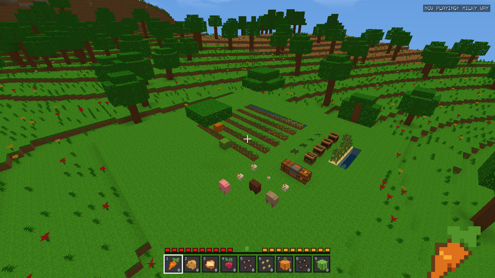
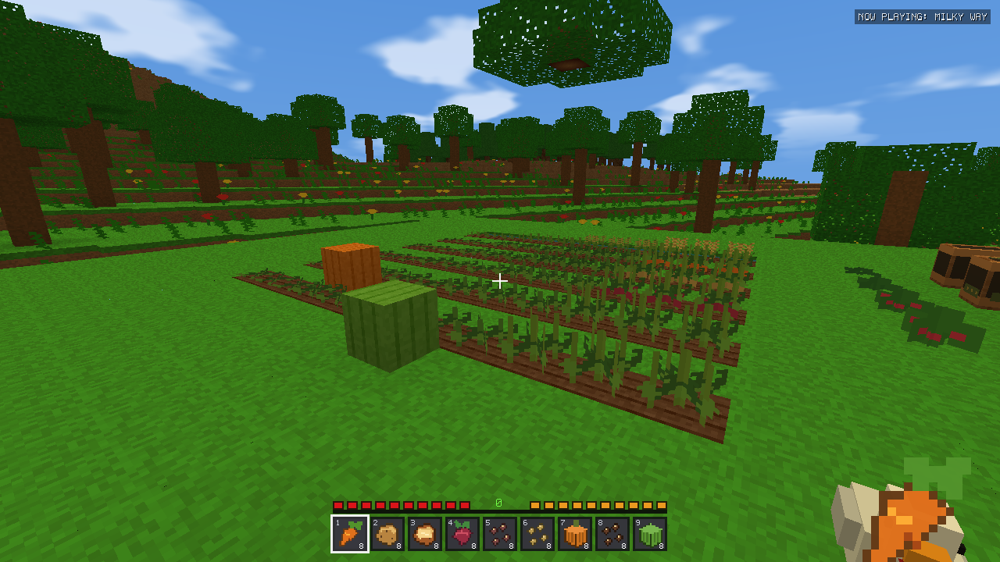
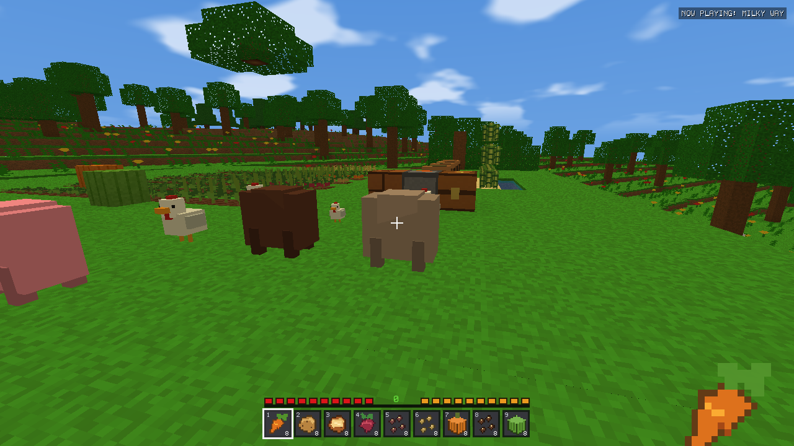
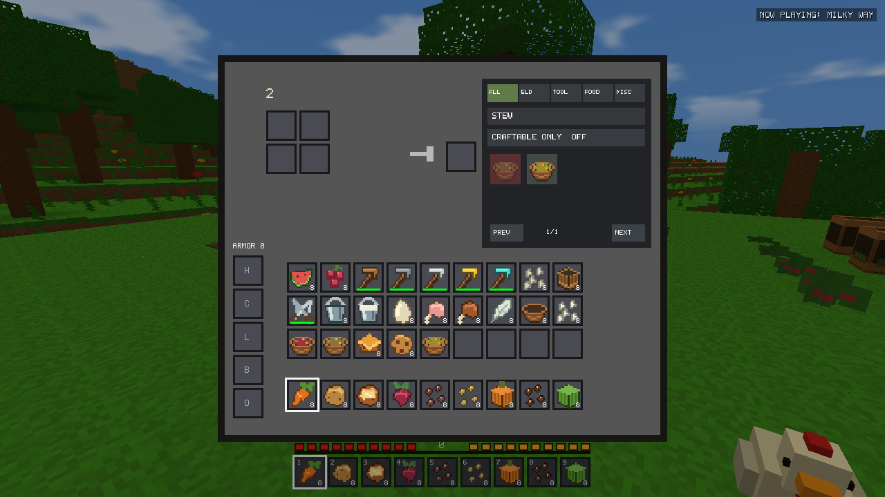

# v2.15.0 Farming, Food & Survival validation

Validated build based on published v2.14.3 (49900db). Publication approved by the user
on 2026-10-17. The user's installation and real saves were untouched during testing.
All fixtures use disposable profiles; installer testing uses a separate AppId.

## Baseline audit and ID allocation

The registry plan was documented before editing. Both registries use uint8_t.
Historical Block IDs 0–166 (Count 167) and Item IDs 0–173 (Count 174) are retained.
Reserving a representable Count leaves 88 block IDs and 81 item IDs initially.

| Additions | Appended IDs | Representation |
|---|---|---|
| Carrot, Potato, Baked Potato, Beetroot, Beetroot Seeds, Pumpkin Seeds, Pumpkin, Melon Seeds, Melon, Melon Slice, Sweet Berries | Items 174–184 | Existing inventory stacks |
| Wood, Stone, Iron, Gold, Diamond Hoe | Items 185–189 | Existing durability |
| Bone Meal, Composter, Shears, Bucket, Milk Bucket, Egg, Raw Chicken, Cooked Chicken, Feather, Bowl, Sugar, Beetroot Soup, Mushroom Stew, Pumpkin Pie, Cookie, Vegetable Stew | Items 190–205 | Existing inventory stacks |
| Carrot, potato, beetroot, pumpkin stem, melon stem | Blocks 167–186 | Four stages each |
| Pumpkin, melon | Blocks 187–188 | Fruit |
| Berry bush | Blocks 189–192 | Four stages |
| Composter | Blocks 193–197 | Five fill states |

Final Count: Item 206 and Block 198. There are 49 item and 57 block IDs remaining
before the maximum representable Count. Static assertions protect the byte limit.
No historical ID is reordered or reused; retired animal type 3 remains retired.

Original item pixels 0–173 and world texture tiles 0–105 remain byte-identical.
32 original 16×16 icons and 37 world materials are appended. Tiles 106–136 cover
new crops/fruit/composter states; 137–140 give wheat distinct growth art; 141–142
give dry/wet soil visible furrows. Atlas width remains within OpenGL 3.3 limits.
Existing material/vertex packing is retained.

## Existing architecture reused

- Chunk block indexes, saved edits, lighting and crossed-plant meshes.
- Item definitions, recipes, Recipe Book matching/search/autofill/batch output,
  furnace cooking, containers, hotbar/offhand ownership and equipment durability.
- Passive cuboid animals, visibility/navigation, active-distance scheduling,
  population caps, natural despawning and persistent-livestock flags.
- The v2.14.3 immutable checkpoint capture, asynchronous commit coalescing,
  manifest checksums, journals, rollback, verified recovery and session reservation.
- Existing 120Hz simulation, packed/indexed meshes, GPU pages, streaming, LOD,
  occlusion, scene-only antialiasing, weather and audio controls.

Generator V22 remains current. No V23, new geological feature, climate/biome
change, hostile sprite/model replacement or renderer rewrite is introduced.

## Crop growth and environmental rules

Wheat and each farmland crop have four stages. Carrots and potatoes plant their
own produce; beetroot and both stems use separate seeds. Berry bushes accept
grass, dirt, podzol or coarse dirt. Stage 2/3 berries can be right-click harvested
for 2/3 berries, returning the bush to stage 1. Breaking young crops returns
planting material. Ripe carrots/potatoes yield 2–4; beetroot yields 1–2 plus two
seeds; ripe wheat yields 1–2 wheat and 2–3 seeds. Melons yield 3–5 slices.

Each stage needs approximately 28–40 active seconds, selected by a deterministic
position/seed hash. Wet soil gives a 1.4× growth multiplier. Sky light multiplied
by actual daylight/weather, or block light, must reach 9. Torch-lit underground
farms work; unlit surface crops pause at night. Check cadence adds bounded delay.

Bone Meal advances one or sometimes two stages. Mature stems produce fruit only
on the natural timer, preventing an instant fruit/seed/compost refund loop.
Fruit needs a free neighboring block over suitable soil, and each stem supports
only one adjacent fruit. When neighboring chunks are unavailable, stems wait:
an unloaded neighbor may already contain their fruit. Occupied blocks are never
overwritten. Harvested fruit permits another natural fruit cycle.

Sugar cane grows upward on its existing water-adjacent support to three blocks,
with a 70-second cycle. It respects ceilings, bounds and missing chunks. Mushrooms
make one spreading attempt per 180 active seconds in dark conditions over
suitable soil; a 5×3×5 neighborhood allows at most four mushrooms. There is no
unloaded terrain generation or global fungal scan.

Farmland hydrates from water, including flowing water, within four horizontal
blocks at soil level or one block above. Exposed rain also hydrates it. Drying
waits when relevant neighboring chunks are unavailable. Irrigation removal
changes wet soil to dry soil without destroying supported crops. Missing/invalid
soil clears plants consistently without awarding an automatic harvest. Both
farmland states drop dirt. Ordinary walking never tramples fields.

Five hoe tiers use 60/132/251/33/1561 durability. Legacy shovel tilling remains
available. Tilling requires a clear block above and top-face use. Creative tools
do not wear. Composters accept four loose organic items per Bone Meal, with five
visible fill states stored in normal block edits. Container meals are rejected
to preserve bowls/buckets. Invalid actions give brief contextual feedback without
consuming supplies.

### Bounded simulation

Chunk-owned sorted farm indexes are built in the existing indexing pass and
updated only on membership changes. Every two seconds, farming discovers active
positions from these indexes. A deadline queue processes at most 64 cells per
120Hz step and normally revisits cells every four seconds. No full-volume crop
discovery scan is used. Meshes change only when actual block state changes.

Saved stages survive unloading/restarts. Partial timers restart; there is no
offline catch-up. Chunk residency identities prevent borrowing time across an
unload/reload. Negative Y, distant coordinates, support removal and chunk borders
are covered by production-linked tests.

## Animal behavior and resources

- Cows/sheep follow wheat. Pigs follow carrots, potatoes or beetroot. Chickens
  follow wheat, beetroot, pumpkin or melon seeds within existing eight-block
  visibility/navigation rules. Ordinary wandering and obstacle checks remain.
- Adults enter love mode for 30 seconds. Pairing creates one offspring and sets
  300-second cooldowns on both parents. Parents/offspring become intentionally
  persistent. Refeeding an already loving animal does not consume another item.
  Babies grow for 1,200 active seconds and cannot breed. Breeding stops at 64
  nearby passive animals within 16 blocks, preventing runaway dense pens.
- Adult sheep yield two wool through shears, which have 238 durability. Sheared
  sheep use a close-cropped palette. Wool regrows after 180 active seconds on
  grass; suitable wheat feeding can shorten the remaining timer. The final use
  of shears still awards the harvest before the tool breaks.
- Adult cows provide milk at most once per 60 active seconds. Capacity is checked
  on an inventory copy before committing an exchange. A single bucket can be
  replaced in its owned slot even with a full inventory. Creative milking retains
  its bucket. Drinking milk returns the bucket.
- Chickens have four health, original small cuboid bodies/heads/wings/legs,
  beaks/combs/eyes, idle wing motion, walking steps and smaller chicks. Adult eggs
  arrive every 300–599 active seconds; chicks never lay eggs. Adult drops include
  chicken meat and a feather, with cooked meat while burning. Four original
  synthesized effects use the existing passive sound category.
- One quarter of eligible passive selections become chickens using a position
  hash. No extra RNG draw or changed hostile-selection stream is added. Existing
  passive caps, spawn-chunk reservations, active simulation and despawning remain.
  The four billboard mobs' sprites, definitions, rendering, AI, animations,
  combat and spawn rules are retained.

## Food, recipes and saturation

All new items are in the Creative catalog. The existing Recipe Book supports
their names, categories, searching, autofill and batch crafting. New hoes use two
tier ingredients and two sticks; shears use two iron; buckets use three iron.
Bowls use three plank-family ingredients and composters use seven planks. Sugar
crafts from cane, pumpkins craft into four seeds, slices into melon seeds, and
nine slices craft a placeable melon. Cooking uses the existing furnace.

| Food | Hunger | Saturation | Source/recipe |
|---|---:|---:|---|
| Carrot | 3 | 3.6 | Crop |
| Potato | 1 | 0.6 | Crop |
| Baked Potato | 5 | 6 | Smelt potato |
| Beetroot | 1 | 1.2 | Crop |
| Melon Slice | 2 | 1.2 | Fruit |
| Sweet Berries | 2 | 1 | Bush |
| Raw Chicken | 2 | 1.2 | Adult chicken |
| Cooked Chicken | 6 | 7.2 | Smelt chicken |
| Beetroot Soup | 6 | 7.2 | Five beetroot + bowl |
| Mushroom Stew | 6 | 7.2 | Red mushroom + brown mushroom + bowl |
| Vegetable Stew | 8 | 10 | Carrot + potato + beetroot + bowl |
| Pumpkin Pie | 8 | 4.8 | Pumpkin + sugar + egg |
| Cookie | 2 | 0.4 | Two wheat + berries produces six cookies |
| Milk | 2 | 0 | Cow + bucket |
| Bread (existing) | 5 | 6 | Existing recipe |
| Apple (existing) | 4 | 2.4 | Existing drops |
| Raw meats (existing) | 3 | 1.8 | Existing drops |
| Cooked beef/pork (existing) | 7 | 11.2 | Existing recipes |
| Cooked mutton (existing) | 7 | 9.6 | Existing recipe |

Hunger stays 0–20. Saturation is bounded by current hunger. Four exhaustion
points first consume saturation, then hunger. Walking/sprinting/swimming cost
.08/.32/.20 per active second; normal/sprinting jumps .05/.20, mining .025 per
block, and successful melee .10. At hunger ≥18, regeneration restores one HP
per four seconds and costs three exhaustion. Starvation deals one HP per four
seconds. Full-hunger eating is refused. Bowls/buckets replace their owned held
stack atomically; Creative eating retains owned items. No extra HUD bar is added.
Legitimate Survival health, hunger and saturation survive mode changes/reloads.

### Acquisition in old worlds

Grass and fern harvests have a deterministic one-in-eight chance to select wheat
seeds, carrot, potato, beetroot seeds, pumpkin seeds, melon seeds, berries or cane.
Thus already explored terrain supplies the new planting stock in every historical
generator. Harvesting, crafting and livestock provide renewable progression.
Existing saved/looted chests are never regenerated.

## Save format and integrity

There are no new sidecar files. Optional `NUT1`, a 16-byte player-component tail,
stores saturation, exhaustion and regeneration timing. Old players default to
min(5, hunger) saturation and zero exhaustion/timer, retaining health/hunger/XP.
Optional `HUS1` in the mob component stores one sheared byte and four floats per
record: resource, wool, love and breeding timers. Chicken appends animal type 10;
billboard types 6–9 retain their identities. Existing `PST1` flags remain
authoritative; missing old husbandry data receives safe defaults.

Readers validate lengths, tags, counts, finite values and bounds in temporary
state. Writers enforce identical invariants. Invalid extensions neither partially
mutate live state nor replace a valid save. Everything remains inside
`Game::saveAll` and its complete checkpoint: metadata, inventory, player, world,
entities and navigation. Background changes coalesce into fresh snapshots.
No direct metadata writer, checksum bypass, recovery relaxation or session-lock
change was introduced. Tests include feeding, eating, planting, full containers,
invalid extensions, background mode changes, death, reload and old saves.
New builds load older saves; forward loading of the new extensions by v2.14.3
is not supported. Its strict readers refuse those newer records.

## Test workflow and evidence scope

The first full-game candidate passed 11 suites and 663 exact historical chunks.
Subsequent checks caught and fixed shovel-use priority, dry-farmland drops,
mature-stem fertilizer refunds and fruit decisions at unloaded boundaries. New
tests distinguish coordinate checks from natural growth: darkness and the revised
growth duration invalidate the old assumption that one unlit 19-second call
should advance wheat. Final results below come from the final packaged candidate.

```powershell
tools/run_farming_validation.ps1 -Visual -Benchmark
tools/run_stability_regressions.ps1 -SkipBuild -IncludeDemo
tools/run_farming_benchmarks.ps1
tools/test_stability_installer.ps1
```

Drivers switch to fresh temporary folders before initialization. Installer tests
use a unique AppId and disposable installation/profile, verify original production
registration, then uninstall only that fixture. The original v2.14.3 executable
is retained with its published SHA-256 before rebuilding. Crop CPU tests also
retain the original farming source with only class/include names changed.

## Limitations and deferred features

- Cake, poisonous potatoes, trampling, water/lava bucket transport and machinery
  are deferred. Buckets are complete livestock/food containers in this release.
- Partial crop timers restart on session load; saved stages and productive animal
  timers persist. There is no unloaded growth or offline production.
- Overloaded active fields can have longer scheduling intervals. Work/debt stay
  bounded; no unlimited catch-up or synchronous volume scan is introduced.
- Passive locomotion/collision is retained. Chickens use the original
  vertex-colored cuboid pipeline with an original model/palette, rather than
  introducing a textured-animal renderer. Feathers are collectible materials;
  no unrelated bow/arrow feature is added.
- Population benchmarks measure current-candidate CPU scaling. They do not claim
  a matched old-engine livestock speedup. Large-field geometry has not been
  compared against an independently instrumented old renderer.
- No physical low-end-hardware certification, physical power-loss test or
  multi-hour soak is claimed. Existing native Windows replacement diagnostics
  and verified recovery remain; the intermittent lock's cause is not claimed fixed.
- RD64 was not extended: this update changes farming and animals, not terrain
  geometry or the high-distance renderer. RD8–32 is the measured gameplay range.

<!-- measured-evidence -->

## Final measured results

- **257 farming assertions**, plus production Game/checkpoint/subsystem regressions.
- **20 Release suites passed**: 11 full-game and 9 stateless-demo suites.
- **663 historical chunks matched exactly in each variant**, covering generators 1–22.
- The isolated v2.14.3 → v2.15.0 installer upgrade verified payload hashes, retained fixture saves, loaded legacy worlds, removed only the test registration, and left production registration unchanged.
- Original background music and boowomp files remain unchanged; startup indexes all 24 songs.
- Local packages are listed with hashes in [validation.json](farming-survival/validation.json). The JSON records the pre-publication validation snapshot.

### Foreground comparison

Published v2.14.3 versus this candidate, same seed 123456789, SD8, LOD Low, occlusion Auto, fixed 74° FOV, AA/VSync off, identical native gameplay path. Two runs per RD, alternating order. Each run contains stationary, rotation and editing phases with Survival, weather, existing billboard enemies and equipment. Values below are **medians of six phase summaries**, not pooled frame percentiles; worst is the maximum phase stall. Short samples do not establish small FPS speedups.

| RD | FPS old/new | Mean ms old/new | p95 ms old/new | p99 ms old/new | Worst ms old/new |
|---:|---:|---:|---:|---:|---:|
| 8 | 3709.78 / 3713.76 | 0.27 / 0.27 | 0.40 / 0.40 | 1.29 / 1.29 | 6.80 / 7.08 |
| 16 | 2548.07 / 2482.80 | 0.39 / 0.40 | 0.52 / 0.60 | 1.41 / 1.47 | 7.05 / 16.04 |
| 32 | 1112.45 / 1102.03 | 0.90 / 0.91 | 1.03 / 1.05 | 1.19 / 1.25 | 6.18 / 7.39 |

| RD | RAM MiB old/new | Terrain live MiB old/new | Terrain capacity MiB old/new | CPU % old/new |
|---:|---:|---:|---:|---:|
| 8 | 292.1 / 294.1 | 31.4 / 31.4 | 40.0 / 40.0 | 8.66 / 8.37 |
| 16 | 352.1 / 351.9 | 129.7 / 129.7 | 152.0 / 152.0 | 5.45 / 5.75 |
| 32 | 566.0 / 567.0 | 548.1 / 548.1 | 632.0 / 632.0 | 4.71 / 4.49 |

Minimum focus/visibility: 100.00% / 100.00%. Terrain figures are engine live ranges and allocated buffers, not total driver/Task Manager VRAM. Budgets remain soft targets. Raw geometry, draw, generation, mesh, upload and GPU timings are retained in [foreground.csv](farming-survival/foreground.csv).

### Crop CPU work

Identical mature/growing wheat fields, three repeats. Original v2.14.3 farming source is retained in the test tree with only its class/include renamed. This compares crop-update work against the same world lookup, not an old/new GPU or whole-game benchmark. Timings are per 120Hz update; no proportional FPS improvement is claimed.

| Crops | Growing mean ms old/new | Mature mean ms old/new | New mature p99 ms |
|---:|---:|---:|---:|
| 100 | 0.0052 / 0.0010 | 0.0051 / 0.0010 | 0.0039 |
| 1000 | 0.0239 / 0.0043 | 0.0231 / 0.0043 | 0.0151 |
| 10000 | 0.2280 / 0.0396 | 0.2324 / 0.0397 | 0.0890 |

### Passive populations and timing

Current-candidate mixed cow/pig/sheep/chicken populations, three repeats. These are CPU scaling measurements, not a matched old-engine animal-speedup claim.

| Animals | Mean ms | p99 ms | Worst ms |
|---:|---:|---:|---:|
| 10 | 0.0005 | 0.0043 | 0.1574 |
| 50 | 0.0015 | 0.0182 | 0.0957 |
| 100 | 0.0028 | 0.0371 | 0.1254 |
| 200 | 0.0154 | 0.0731 | 0.2053 |

10/15/20/30/60/120 FPS schedules each execute 18,000 fixed steps and reach the same mature stage. Production Game tests also verify those rates and recover one-second frame-spike debt. [Timing evidence](farming-survival/timing.csv).

### Actual in-engine views

These are staged player-built farms rendered by the actual engine in an isolated Survival world, not concept art.









### Interpretation and additional integration checks

Host: Intel i7-14700F (28 logical processors), Radeon RX 9060 XT, 31.84 GiB RAM. This is not low-end hardware certification.
Foreground results are similar on this host, with measured median FPS declines of about 2.6% at RD16 and 0.9% at RD32, essentially unchanged RD8, and one 16.04ms maximum RD16 phase stall. These short runs do not establish attribution or a statistically reliable FPS improvement; the declines/stall remain reported rather than hidden. No renderer rewrite or quality reduction was used.
Each crop sample contains exactly N crops and N farmland cells. An earlier fixture left 10,000 empty tilled cells in the smaller cases, measuring additional soil work absent from the old wheat updater. That setup was corrected; large empty tilled fields still legitimately incur soil-simulation work. The final paired CPU table uses the corrected workloads.
A further RD8 production Survival traversal passed walking, weather, maps, equipment, boating and checkpoint reload. Its real 10/15/20/30/60/120 FPS pacing samples kept wall/simulation accounting within one fixed step. The traversal deliberately injects 500ms pauses, so its roughly 511–513ms worst frames must not be presented as spontaneous renderer stalls. [Traversal measurements](farming-survival/survival-rd8.csv), [pacing evidence](farming-survival/timing-rd8.csv).
