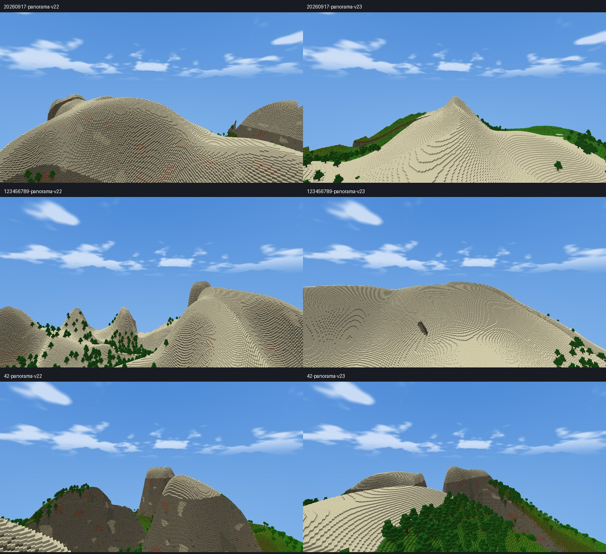
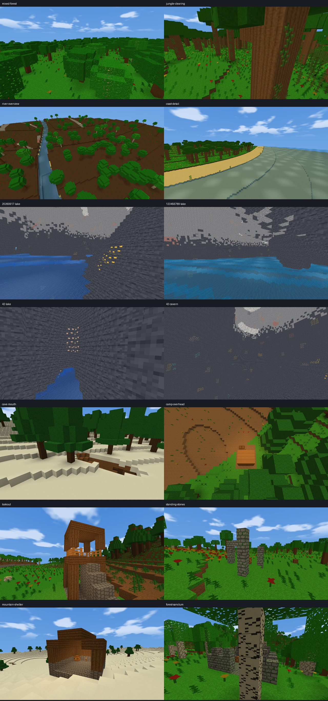

# Generator V23 validation — v2.18.0

Work and tests used isolated profiles; no real saved world or installation was
modified. The owner approved committing and publishing v2.18.0 on 2026-10-28.
The retained `summary.json` and `final-sanity.json` describe the completed
pre-publication validation snapshot, including its then-unpublished state.

## Baseline and scope

The starting working tree was v2.17.0 commit
`4a030c07de64013673fe5918b9bdc1b497d9afb5`, with no tracked modifications.
No local v2.17.1 implementation was present. Existing untracked attachment, IDE,
and Python cache directories were left alone. The original full/demo executables,
source archive, SHA256 fingerprints, and fresh historical hash/CPU baselines were
preserved under `build/v23-validation/baseline/` before implementation.

The runtime changes concern V23 generation and its version integration. All 35
biome definitions, texture assignments, item/block registrations, save layouts,
player physics, fluids, automation, and hostile billboard implementation/assets
are retained. The renderer change is one world-creation label displaying the
latest generator. Packed/indexed meshes, LOD, occlusion, lighting, and streaming
algorithms are not replaced.

## Version isolation

`GeneratorVersion.h` defines the latest version and legal saved range. World
construction, CLI validation, default/reset creation, decoding, and the creation
label accept V23. A loaded world's recorded version wins over the new-world
default. Invalid stored versions fail before active state is committed.

Historical algorithms stay on their existing branches. V23 uses a separate
terrain module, version-gated vegetation/entrance changes, and appended structure
template kinds. No historical noise seeds, material IDs, or template indices move.
The saved generator uses the existing world header field; no save extension or
migration is necessary.

Surface structure planning is reset to the loaded version. A separate V23
underground planner cache reuses the V21 layout rules against V23 terrain, so a
cached V22 plan cannot supply V23 placement. Native-column and entrance caches are
seed/version keyed. The unchanged V22 river cache can be shared because V23 uses
the identical continental drainage potential.

## Generation stages and rules

1. V22 coast/continental fields and geographical drainage potential remain the
   foundation. V23 adds no radial starter island or origin-specific terrain mask.
2. `TerrainExpansion::height` combines connected medium-scale ridges, coherent
   regional relief, erosion-dependent sharp/rounded profiles, foothills,
   escarpments, and eroded elevated grasslands. A pointed ridge profile avoids
   prematurely flattening summits. The inherited smooth height shoulder stays
   below the natural ceiling.
3. Existing V22 river valleys/channels and lake sinks take precedence over relief.
   Strictly descending graph edges and continuous junction geometry are retained.
   This is a drainage-potential graph, not global hydraulic erosion.
4. Climate keeps the existing macro temperature/humidity fields and altitude
   cooling. V23 habitat wavelengths are broader than V22's fine selector, with
   compatible forest/open, woodland-species, jungle/sparse-jungle, and taiga
   variations. Rare-ocean, frozen, and mushroom eligibility remains geographical.
5. The existing 4×8×4 density lattice supplies V23 chamber, tunnel, noodle and
   pillar fields. Two independent horizontal samples per cached column define
   compact vertical shaft patches, gated into chamber windows. A protected roof
   skin and slope-dependent recesses
   attach terrain caps to uphill mass. Carving is three-dimensional. Strong
   aquifers create rare lakes, with water surfaces capped below Y8 entrance
   landings. Existing ore curves and world-coordinate rolls are unchanged.
6. Region-planned cave approaches must meet a real native cavity. V23 additionally
   checks a three-block walking ribbon at block intervals to reject narrow pits.
   A 52-block candidate grid compensates for stronger safety rejection; rejected
   and accepted plans are cached. No artificial bridges or decorative dead-end
   entrance rooms are inserted.
7. Vegetation uses world-space candidates and canopy halos. Woodland density
   creates clearings and denser patches; compatible oak/birch mixing, occasional
   taller trees, varied canopies, stumps, podzol/coarse-dirt patches, and clustered
   ground plants reuse existing materials. Thick roots respect every occupied
   support/reservation cell. Trunks intersecting an entrance are rejected before
   final bore cleanup, and bare stone does not receive grass/flower carpets.
8. Decoration is followed by final entrance-mask cleanup. Surface structures
   are then placed with reserved footprints and
   short foundations. Existing underground layouts then apply their protected
   room/corridor/loot plans.
   Shoreline plants and compact upper-air trimming retain their established
   final generation stages; surface water was filled with the terrain volume.

World bounds remain Y=-64..319 for modern generators, sea level Y64, natural
content through Y256. Historical generator height bounds are unchanged.

## Landmarks and ownership

| Design | Native contents and integration |
|---|---|
| Wilderness camp | Small timber shelter, campfire, log seating, modest treasure |
| Lookout | Timber platform, railings, solid two-wide stair approach, storage |
| Standing stones | Irregular mossy/cracked monoliths, broken lintel, treasure |
| Mountain shelter | Stone foundation, spruce shelter, crafting table and storage |
| Forest sanctum | Damaged masonry enclosure, open doorway, cobweb and treasure |

These replace some small-site design choices rather than adding an independent
unbounded placement pass. Biome/height selects suitable designs. The existing
128-block small-region lattice, major-center exclusions, footprint checks, slope
limit, height ceiling, and eight-block entrance/underground reservations keep
plans apart. Floors use the highest accepted footprint support and short
foundations rather than burying entrances. Templates clip their deterministic
world cells into each chunk, including loot markers.

New template connectors also check the outside approach against the actual first
floor/stair height. Sites requiring more than a one-block jump are rejected, and
a two-block planning halo protects entry clearance across chunk borders. Native
post-decoration body clearance and solid support under every new torch are tested.

Loot uses the existing modest Ruin table and stable salts. All 27-slot inventories
remain owned by the original container/checkpoint systems. New landmarks add no
new mobs, recurring encounters, or independently simulated block entities.

## Reproductions and rejected prototypes

- Initial broad ridge shaping looked too rounded in native screenshots. Its
  pointed crest and regional escarpment profile were refined before acceptance.
- A coarse entrance check missed a one-column pit. The real 30 FPS walk stopped
  at approximately `(542.3,95,-1256.7)` instead of reaching its native junction.
  Dense walking-ribbon rejection corrected the failed route. Reproduction traces
  and final walks are retained; no player-physics workaround was applied.
- A surface-layer branch association in the first patch allowed soil to overwrite
  top material. It was corrected before packaging. Canonical grass assertions and
  the complete historical hash gate now cover the case. All affected runs were
  isolated fixtures; existing worlds were never opened or written.
- A targeted Mushroom Fields fixture reproduced ordinary oak stumps in the rare
  habitat. Stumps now exclude mushroom-style vegetation; 64 fixture chunks check
  that ordinary logs/leaves cannot leak into this habitat.
- A real camp at `(-577,97,-3907)` required a four-block entrance jump despite a
  valid foundation footprint. Connector-aware approach validation now rejects
  that plan. The selected accepted sites pass post-decoration entry checks.
- Two new template lights were above air rather than supported blocks. Lookout
  and shelter torches now sit directly on their floors. The exact support check
  failed before the correction and passes for the accepted templates.
- Evaluating both historical and expanded density curves repeated work and was
  rejected. V23 now evaluates one density curve. A 4,096-entry direct-mapped
  thread-local cache reuses exact lattice nodes for sparse V23 floor probes.
  All six cached field values are checked against the original sampler, including
  negative chunk halos and changing seeds/versions. Collisions only recompute
  entries; no pointers to world objects survive. Added capacity is approximately
  160 KiB per calling thread, independent of explored distance.

- The first shaft prototype used one narrow 3D scalar band, which creates empty
  sheets rather than compact shafts. Matched RD8/16 measurements exposed excessive
  mesh growth. Paired horizontal fields replaced it, retaining the sampled large
  chambers while reducing the same RD8 recovery mesh from 6,997,464 to 4,948,260
  index vertices and live buffers from 144,614,256 to 102,264,040 bytes (about 29%).
  These geometry counts are deterministic; a one-run FPS difference is not used
  as a general speedup claim. The rejected executable and measurements remain in
  `build/v23-validation/before-shaft/` and `accepted-performance/`.

## Validation and measurements

### Feature disposition

| Area | Disposition and scope |
|---|---|
| V23 framework | Implemented; new-world default, saved-version isolation, no save-format migration |
| Relief and landforms | Implemented ridges, pointed/eroded profiles, plateaus, cliffs and passes; height and native visual checks |
| Exposed overhang expansion | Unverified/deferred; the conservative support envelope did not produce a qualifying showcase in the bounded probe |
| Biomes and climate | Implemented broader compatible habitat patterns; all 35 biomes retained; rare-biome eligibility/rarity largely preserved rather than reweighted |
| Caves and lakes | Implemented wider chambers/networks, paired-field shafts, pillars and rare low aquifers; connectivity evidence is local, not global |
| Accessible entrances | Implemented denser candidate plans with native-cavity and dense supported-walk checks |
| Surface landmarks | Implemented five designs through the existing bounded regional planner and persistent loot ownership |
| Vegetation | Implemented clustered woodland, clearings, mixed compatible species, canopy variation, supported stumps and ground patches; fallen logs deferred |
| Drainage and coastlines | Existing V22 continental/drainage graph retained and integrated with new relief; no hydraulic-erosion or coast-network rewrite |
| Compatibility | Full/demo historical hashes, save/checkpoint and gameplay suites pass in isolated fixtures |
| Performance | Measured extra generation/geometry cost, with rejected thin-sheet cave prototype corrected; occasional frame tails and RD64 streaming limits remain |

<!-- measured-results -->
Evidence: [summary and package hashes](generator-v23/summary.json), [all Release suites](generator-v23/release-suites.csv), [full historical records](generator-v23/historical-full.csv), [demo historical records](generator-v23/historical-demo.csv).

- **1,326 historical records match**: 663 in each packaged variant.
- **20 full/demo suites passed on the final paired-shaft build**, including native checkpoint, async-save and recovery stress.
- Preserved focused assertions: automation 689, building 4,774, creative-ui 3,474, qol 1,389, farming 261, stabilization 375.
- V23 exact-byte comparisons cover repeat/reverse order, 1/2/4 concurrent callers, seed/version cache changes, negative halos, all six cached density fields, natural heights and surface materials. All generator IDs 1–23 survive save/reload and unexplored-chunk checks; invalid 24 is rejected without partial mutation.
- Final full generation validation passed **24,187 checks**, demo **24,095**; ecosystem validation passed **1,302**. Demo automation passed **660 assertions**, retaining stateless operation and disabled privileged commands.
- **50/50 V23 Survival spawn seeds** passed native collision checks; all 50 observed a planned cave mouth within 600 blocks. All five landmark designs were tested in three seeds, with modified and broken treasure chests surviving reloads. **24 real-physics entrance walks** at 30/60 FPS reached native junctions, all ending at 20 HP (maximum fall event about 0.033 HP).

### Geography and exploration

Three-seed mean at 46,080 blocks; each map has 512×512 samples.

| Measurement | V22 | V23 |
|---|---:|---:|
| Non-ocean area (%) | 54.83 | 54.83 |
| Biomes present | 35 | 35 |
| Area-weighted biome region (km²) | 0.632 | 0.659 |
| Area in ≤2-pixel biome regions (%) | 20.88 | 14.81 |
| Area above Y160 (%) | 2.57 | 3.06 |
| Mushroom Fields (%) | 0.366 | 0.367 |
| Ice Spikes (%) | 0.259 | 0.262 |

V23 reduces tiny sampled fragments while keeping broad climate regions and all 35 biomes. The sampled biome count near spawn is similar; the connected-route analysis below separately measures accessibility. Forests become more clustered/mixed rather than uniformly denser.

| Spawn measurement | V22 | V23 |
|---|---:|---:|
| Median initial search (ms) | 70.24 | 201.77 |
| Maximum initial search (ms) | 163.10 | 249.58 |
| Median cave-mouth distance (blocks) | 174.71 | 126.19 |
| Mean land-sampled biome types within 1,200 blocks | 15.20 | 15.04 |
| Median longest spawn-biome ray (blocks) | 240.00 | 256.00 |

[Spawn rows](generator-v23/spawns.csv), [vegetation counts](generator-v23/vegetation.csv), [cave-volume counts](generator-v23/caves.csv), and [physical walks](generator-v23/walks.csv) retain the individual results. Cave volumes use 48×48×144-block windows selected from 32 requests per seed/version; the first two seed pairs share coordinates, while the third pair selects different largest sampled windows. These are local component measurements, not a global connectivity proof.

The additional **coarse connected-route model** uses a 37×37 grid at 64-block spacing, excluding water and edges exceeding eight blocks of relief over a 16-block interval. It is more conservative than counting nearby biomes, but does not replace full collision/pathfinding. [Individual routes](generator-v23/route-accessibility.csv).

| Connected-route measurement (50 seeds) | V22 | V23 |
|---|---:|---:|
| Mean biome types in connected region | 8.84 | 13.56 |
| Minimum biome types | 1 | 2 |
| Single-biome connected regions | 4 | 0 |
| Median nearest other-biome route (blocks; reachable seeds) | 64 | 64 |

### Generation cost

Same 96 distributed chunk coordinates per version across three seeds; two warm repeats each. Sampling/analysis is outside each generation timer.

| Mean request time | V22 | V23 |
|---|---:|---:|
| Cold (ms) | 5.249 | 8.227 |
| Warm (ms) | 3.404 | 3.681 |

Cold requests pay supported-entrance planning; warm requests amortize region caches. Initial spawn and cold-generation regressions are real costs, not speedups.

### Native streaming comparison

Intel i7-14700F (28 logical CPUs), Radeon RX 9060 XT. Seed 20260917, 1280×720, SD8, LOD Low, occlusion Auto, uncapped, VSync/AA off. Common streaming fixture disables weather in both builds; it is separate from the Survival/weather/equipment/boat traversal. No render-distance reduction is used. One matched pair at RD8/16 and two at RD32 (reversed second order) use identical absolute stationary, 8× flight and teleport paths. The table uses medians where repeated for after-flight recovery, not pooled frame percentiles.

| RD | FPS V22 / V23 | Mean ms | p99 ms | RAM MiB | Live terrain MiB |
|---:|---:|---:|---:|---:|---:|
| 8 | 5941 / 4336 | 0.168 / 0.231 | 0.879 / 0.603 | 272.1 / 279.0 | 76.6 / 97.5 |
| 16 | 2151 / 1615 | 0.465 / 0.619 | 0.608 / 0.776 | 335.0 / 345.2 | 276.0 / 323.1 |
| 32 | 598 / 547 | 1.671 / 1.827 | 1.891 / 2.046 | 607.0 / 598.1 | 1048.5 / 1101.5 |

[Complete phase rows](generator-v23/streaming.csv) include worst stalls, CPU utilization, generation/mesh throughput, upload time, queue state, recovery and GPU-buffer capacity. V23 scenes contain different geometry: any FPS difference is a content cost, not an isolated renderer speedup. Streaming has no p95/GPU timer field; the separate foreground gameplay fixture records them and its actual scene coordinates. Terrain memory is engine-owned live/capacity accounting, not Task Manager total VRAM. `terrain_vertices` in streaming is resident index references, not visible submitted vertices.

**Regressions and outliers:** mean RD8/16 recovery time rises with the extra geometry; RD32 rises about 9% across the two pairs. Isolated recovery stalls remain: V23 39.82 ms at RD8 and 90.34/142.91 ms at RD32; V22 also recorded 26.49/166.43 ms at RD32. These tails remain unresolved; they are not excluded from the CSVs. All RD8/16/32 recovery and final teleport queues settled. No general FPS or frame-pacing improvement is claimed.

### Foreground gameplay and stress coverage

The existing foreground gameplay fixture ran with rain, equipment, entities and editing; all 18 phase rows report 100% focused/visible. Its scene chooser selected **different locations**: V22 `(-7678.5,70.01,-8190.5)` Stony Shore, V23 `(256.5,111.01,-8191.5)` Plains. These numbers are quality/stability evidence, **not matched-location speedups**. [Full data](generator-v23/gameplay.csv) includes GPU samples, CPU, RAM, submissions, mesh and upload timing.

| RD, stationary | Mean ms V22 / V23 | p95 ms | p99 ms | GPU ms |
|---|---:|---:|---:|---:|
| 8 | 0.225 / 0.209 | 0.300 / 0.296 | 0.791 / 0.753 | 0.132 / 0.119 |
| 16 | 0.507 / 0.357 | 0.623 / 0.508 | 0.818 / 0.771 | 0.421 / 0.260 |
| 32 | 1.307 / 0.980 | 1.450 / 1.113 | 1.526 / 1.267 | 1.226 / 0.888 |

A separate production Survival traversal covered RD8/16/32, weather, equipment, maps, boats, collision-safe walking, 10/15/20/30/60/120 FPS buckets, 500 ms interruptions and checkpoint reload. Its capped timing buckets test behavior, not maximum FPS. Those surface/gameplay fixtures preceded the final underground shaft correction; the complete final Release and generator suites were rerun afterward.

**Brief current-only RD64 stress:** after five seconds of flight and ten seconds of recovery, 11719 chunks were resident, 71 generation / 2 mesh / 1 upload jobs remained, and recovery did not settle. Live terrain was 3708.8 MiB against 4224.0 MiB capacity; RAM 1496.5 MiB. Teleport worst frame was 302.66 ms with 302.46 ms peak retirement. This exposes a high-distance retirement/streaming limit in this candidate; no matched V22 RD64 run was made. This is not low-end certification. [All stress rows](generator-v23/rd64-stress.csv).

### Native visual inspection

The retained PNGs are direct conversions of native renderer screenshots. All V23 surface and cave images use the final runtime. The V22 reference panoramas predate the final V23-only shaft correction; historical chunk hashes verify that their generator branch is unchanged. [Camera arguments and image/binary fingerprints](generator-v23/native-images.json) identify every view. Lake/cavern captures use a test-only fullbright flag to expose geometry; surface views use ordinary lighting. No structures were manually assembled for these images.

Visual findings: connected ridge silhouettes, mixed tree canopies/clearings, open landmark approaches and genuine large underground lake chambers are visible. Close cavern walls still have blocky geological bands; broad exposed overhangs were not verified. Coastal outlines intentionally retain V22 geography. The maps show broader compatible habitat shapes rather than a complete continental rewrite.

| Seed | 4,096 blocks | 15,360 blocks | 46,080 blocks | Plan distribution |
|---|---|---|---|---|
| 20260917 | [Compare](images/generator-v23/20260917-4096-comparison.png) | [Compare](images/generator-v23/20260917-15360-comparison.png) | [Compare](images/generator-v23/20260917-46080-comparison.png) | [Structures/caves](images/generator-v23/20260917-distribution.png) |
| 123456789 | [Compare](images/generator-v23/123456789-4096-comparison.png) | [Compare](images/generator-v23/123456789-15360-comparison.png) | [Compare](images/generator-v23/123456789-46080-comparison.png) | [Structures/caves](images/generator-v23/123456789-distribution.png) |
| 42 | [Compare](images/generator-v23/42-4096-comparison.png) | [Compare](images/generator-v23/42-15360-comparison.png) | [Compare](images/generator-v23/42-46080-comparison.png) | [Structures/caves](images/generator-v23/42-distribution.png) |

Each comparison includes native sampled biomes, elevation, temperature/humidity and waterways. Gold/pink plan markers are bounded surveys rather than a claim that every point of interest is shown.

### Windows packages

- `VoxelFrontier-v2.18.0-Windows-Standalone.exe` — 76,962,304 bytes; SHA256 `17366780e18af4686eb2b5fba6ae8d67ba210c163ebc897b4c9aad882dd391ae`.
- `VoxelFrontier-v2.18.0-Windows-Setup.exe` — 71,553,841 bytes; SHA256 `8b0b6ba95b1355bdf5c02bdadffb5de78f728ee85e844f046484aca1c3900d89`.

Both executables embed the unchanged 361-item, 640×2368 preview atlas (SHA256 `4b910fecaa9f4f6f5f99336da40d7be82bc5bbd231cd3dc0264efd50ad6ac03d`). Installer creation was tested; the installer was not run and no real installation was changed.

## Reproduction tools

- `tools/run_generator_v23_validation.ps1`: exact bytes, worker counts/orders,
  seed/version cache isolation, height/material checks, all generator save IDs,
  50 paired spawn seeds, landmark persistence, cave volumes and physical walks.
- `tools/build_expansion_previews.py <audit maps directory>`: native biome,
  elevation, climate, waterway and plan-distribution comparisons and statistics.
- `tools/capture_generator_v23.ps1 -Sites <csv>`: unmodified native generated
  landscapes with camera provenance. Optional diagnostic fullbright runs only
  inside the isolated test driver; it does not place lighting or edit terrain.
- `tools/benchmark_generator_v23.ps1`: frozen V22/new V23 native fixtures with
  identical seed/settings and alternating run order. Streaming uses identical
  absolute camera paths. Gameplay fixture scene coordinates are recorded and
  must be checked before interpreting its FPS comparison.
- Existing automation, inventory/building/UI, farming, checkpoint, full/demo and
  historical-hash regressions remain part of release validation.

## Limits

V23 adds generation and geometry costs; it is not a renderer speedup. Cold entrance
planning is measurably more expensive than V22. Main-thread spawn selection stays
bounded but can take longer. RD64 is a brief memory/streaming stress case, not a
low-end gameplay recommendation. Only the available development PC is measured;
no physical low-end PC is available for certification.

Maps sample 512×512 points: narrow channels, tiny habitats, and cave mouths can
fall between samples. Connected areas are clipped to map borders. Biome-neighbor
counts and straight rays are not exact on-foot travel times. The 50 seeds establish
observed spawn safety/proximity, not guarantees for every seed.

Cave volume connectivity and walking approaches are tested locally. No claim is
made that all caves in an infinite world connect to one network or that every
possible isolated voxel artifact has been disproved. Underground diagnostic
fullbright captures expose real geometry; they do not represent ordinary cave
lighting. No manually built house/platform is used as generated-landscape evidence.

Expanded **exposed overhangs remain unverified**. The conservative slope/roof
envelope supplies 3D recess shaping while protecting connected surface mass, but
a bounded three-seed cliff probe found no qualifying exposed undercut with its
20-block sightline. This is recorded as a limitation, not a delivered showcase or
a proof that no smaller recess exists. Further exposed-overhang work needs a
directional support envelope and additional visual validation; it is deferred
instead of weakening the connected-roof rules late in this update. Fallen logs
are also deferred; V23 includes supported stumps without inventing misleading
horizontal log geometry.

The existing large-coordinate movement/targeting precision limit remains. V23
tests distant procedural sampling without attempting a coordinate migration.
