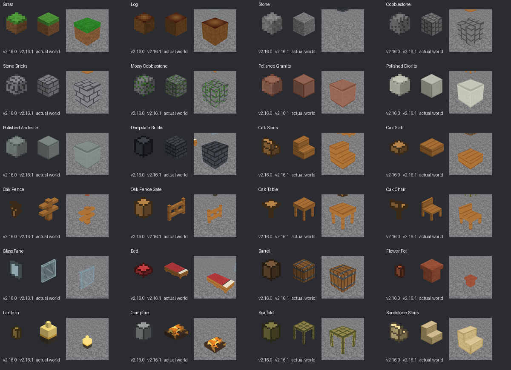
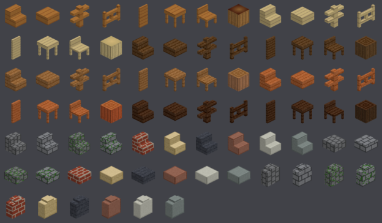
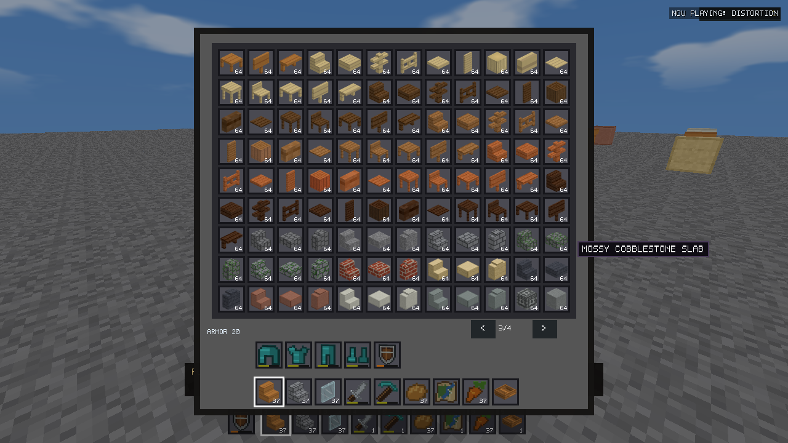
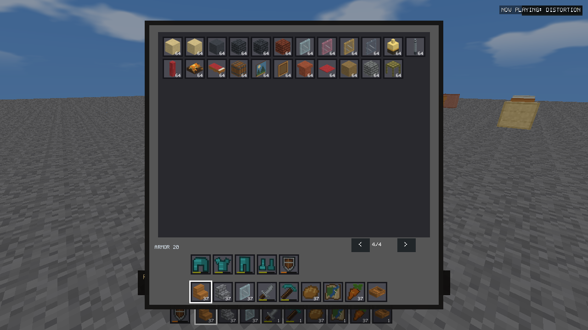
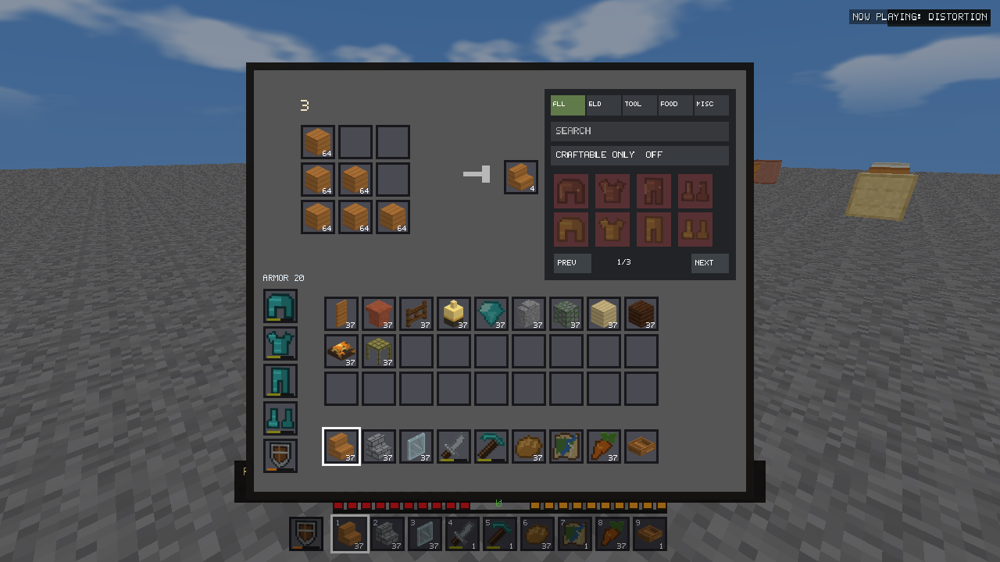
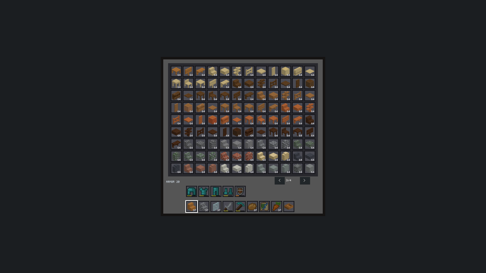
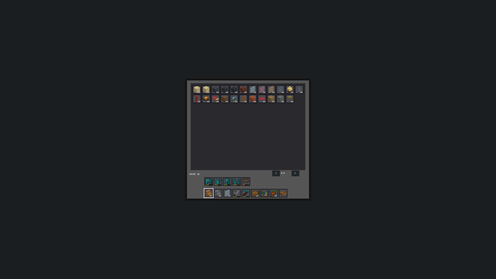
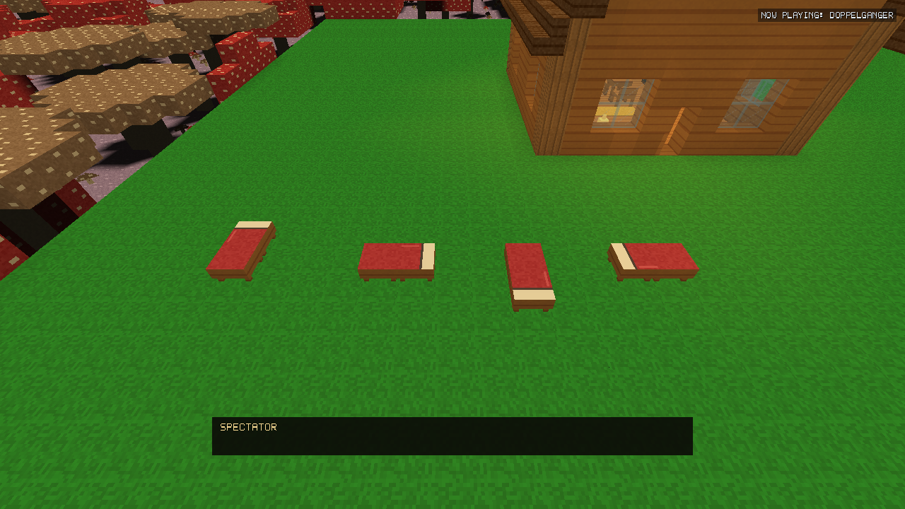
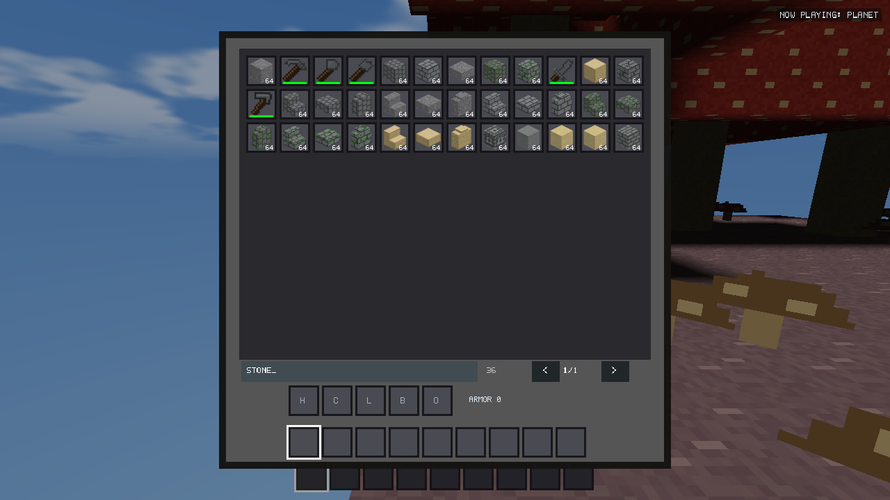

# Inventory Icon & Visual Clarity validation — v2.16.1

Validation performed locally on October 18 and 21, 2026. Publication was approved
on October 22, 2026. All executable tests used isolated profiles; the installer fixture used
its own AppId and workspace directory. The real installation and player saves were
not modified.

## Root cause and audit

The runtime atlas already used 64-pixel cells, but its content was predominantly
16-pixel art resized fourfold. Building additions were drawn as small, average-color
polygons, cropped/centered into 16 pixels, then enlarged. Enlarging these source
images could not recover material patterns, genuine steps or furniture geometry.

Reviewed `InventoryUI.cpp`, `Definitions.cpp`, `BuildingContent.inc`, the building
asset generator, `generate_inventory_textures.py`, and the crafting, biome,
underground, exploration, equipment, transportation, farming and weather asset
paths. All inventory-family renderers and item sprites share `itemSpriteUv()` and
`itemTexture_`. The old 16-pixel files remain authoring inputs, not the runtime
preview output. Stable sprite indices are preserved; they are not assumed to equal
item IDs. This matters for historical registry gaps and high IDs.

## Architecture

`tools/generate_item_thumbnails.py` invokes `StabilityDriver --icons-export`.
Its isolated OpenGL authoring implementation lives in `tests/stability/icons.cpp`
(`IconTest::model` centralizes representative states and unusual-object framing).
It uses production Release objects, including:

- `World::buildMesh` for all placeable geometry, face UVs and material tiles.
- `buildingBoxes` through that mesher for v2.16.0 multi-box shapes.
- Existing door halves and bed head/foot states for complete miniatures.
- Representative connected states for fences, walls and panes.
- `Transportation::appendModels` and the actual boat texture for six boats.
- Extruded pixel silhouettes for tools, equipment, food, resources and flat objects.
  Each occupied source-art pixel contributes a shallow model, with its real color
  and face lighting. Edible roots/seeds are items rather than juvenile crop blocks.

No block material is replaced with an average color. The block atlas is read from
the initialized renderer, including its embedded extension tiles. Plants use the
terrain mesher's crossed planes and UV orientation. Preview lighting is neutral;
weather and local biome tint do not change inventory identity.

Authoring creates one reusable 128×128 framebuffer, depth buffer, streaming vertex
buffer and shader on the GL context thread, then releases them. This code belongs
to the offline driver and is not linked into the shipped game. The only runtime
icon change is sampling the baked atlas with linear filtering. The existing UI
shader, batches and stable-ID UV lookup remain in use.

### Camera, alpha and filtering

- Orthographic camera: 45-degree azimuth, 30-degree elevation, oriented toward
  the exposed steps/front of representative furniture.
- Consistent top/side directional lighting; shape bounds determine framing.
- Actual world texels are sampled nearest during authoring, with the same repeat
  and face-UV conventions as the world renderer.
- Render at 128×128; alpha-correct supersampled reduction produces 64×64 output.
- Occupied bounds are framed within 56 pixels, centered without stretching. Small
  objects receive bounded silhouette framing rather than becoming invisible.
- Transparent gutters, edge RGB extension and half-texel UV insets prevent
  neighboring-cell bleed and dark alpha fringes.
- The item texture uses linear sampling at runtime. World texture filtering and
  world texel resolution are unchanged.

The sole shared world-model polish is the gate's visible rails/posts. Its closed
collision box and open/close/placement semantics are identical to v2.16.0. No other
world geometry or gameplay changes were made for this update.

### Outputs and maintenance

- `assets/item_icons_expansion.png/.rgba`: runtime 640×2240 atlas, 64px cells.
- `assets/inventory_previews/*.png`: individual high-resolution previews.
- `assets/inventory_previews.json`: ID/cell/model/bounds metadata and fingerprints.
- `assets/inventory_art_source.rgba`: original authored item silhouettes for baking.

The native exporter automatically iterates the registry. Future unusual items may
add one centralized preview exception. Rerun the baker after material/model or
source-art changes. Older generators still author legacy source files; they must
be followed by the baker. Packaging verifies source/output SHA-256 fingerprints
and rejects stale or overwritten atlas output. No JSON or individual PNG loading
occurs in gameplay. GPU raster results were repeatable on this machine; identical
pixels across different GPU drivers are not promised or required for world saves.

## Visual comparisons

The supplied grass cube and staircase guided the camera, readable faces and
textured shape presentation. The following sheet compares v2.16.0 art, the new
preview and a crop from the actual in-engine placed object. The world images use
normal perspective/world lighting, so they are not expected to be pixel-identical
to studio-lit orthographic thumbnails.



Complete contact sheets: [before](icon-visuals-v2161/before-contact.png),
[after](icon-visuals-v2161/after-contact.png). Numbers refer to stable item IDs;
[coverage and model categories](icon-visuals-v2161/coverage.csv) map them to names.

### Recognition check without names

Inspected this sheet at the actual 44-pixel icon scale. Wood families, stair/slab
silhouettes, fence/gate rails, furniture legs, mossy stone, brick patterns, panes,
beds and barrels are substantially easier to identify. This is an agent visual
inspection, not an independent human usability study.



Remaining close pairs include Stone/Andesite, similarly dark deepslate finishes,
and some smooth/cut stone surfaces. Their historical world textures were not
arbitrarily recolored to manufacture contrast. Tooltips remain useful for these
pairs. Non-block items retain the authored pixel detail of their source art; the
new pipeline adds geometry, framing, coverage and lighting, not invented high-detail
food or anatomical armor models. Chains, pots and lamps reflect the stylized
geometry actually available in the game.

## Actual UI checks

All four Creative pages and inventory, equipment/offhand, hotbar, crafting/Recipe
Book, barrel, furnace and cursor previews were captured and inspected. 27-slot
barrels and chests use the same existing renderer. The 44×44 slots and 108 catalog
entries per page are unchanged. Count/durability/selection overlays retain their
original placement and remain readable. No new UI scaling option was added; the
existing interface uses fixed-pixel slots.

- **1280×720:** native running-game window and normal world/UI rendering.
- **1920×1080 / 2560×1440:** exact-size offscreen GL targets using the same native
  UI methods. Windows limited this desktop's window client height to 1061 pixels,
  so these are explicitly not claimed to be full-height foreground screenshots.








The native Creative interaction fixture still checks every item with left/right/
shift-click, held right dragging, tooltips and blank cells: **2,440 assertions**.
The new atlas has **347 unique ID/cell mappings, zero missing/black previews, zero
clipped bounds, and no exact duplicate images**. Every individual image matches
its runtime atlas rectangle, and the raw resource pixels match the PNG exactly.

## Performance

Hardware: the existing i7-14700F / Radeon RX 9060 XT test machine. No physical
low-end machine was available; OpenGL 3.3 remains the baseline. No low-end FPS
speedup is claimed.

The controlled A/B fixture uses the same Release UI renderer, original v2.16.0
atlas/nearest sampler versus v2.16.1 atlas/linear sampler, identical resolution,
items and settings. Three alternating-order repetitions, 20 warmup frames and
200 measured frames per operation. Offline `glFinish` includes completed GPU work;
normal gameplay does not acquire these waits. These are UI draw/first-open/page
costs, not whole-game frame times or button-input-to-display latency measurements.

| Operation | v2.16.0 ms | v2.16.1 ms |
| --- | ---: | ---: |
| Atlas file read/upload, once | 5.281 | 5.575 |
| Inventory open + UI frame | 0.220 | 0.219 |
| Dense Creative UI frame | 0.349 | 0.355 |
| Alternating Creative pages | 0.303 | 0.287 |

Values are medians of three run means. [Raw repetitions with p95/p99/worst](icon-visuals-v2161/ui-benchmark.csv)
show normal variation; the small differences do not justify speedup claims or more
tuning. Atlas creation is outside inventory opening. Current native fixture
initialization was 391ms in one run, including window/renderer/audio initialization;
this is not a matched original-executable startup comparison.

| Resource/cost | Result |
| --- | --- |
| Atlas dimensions, before/after | 640×2240 RGBA8, unchanged |
| GPU atlas storage, before/after | 5,734,400 bytes / 5.47 MiB, unchanged |
| Added inventory FBOs/model passes | None at runtime |
| Native baking, all 347 models | About 85ms on this machine |
| Complete authoring/export | About 5 seconds; not runtime/startup work |
| Full executable | 76,464,128 bytes, +4,096 bytes |
| Standalone executable | 76,307,456 bytes, +4,096 bytes |
| Compressed installer | 71,460,929 bytes, +966,934 bytes (about 1.4%) |

Original/new packaged UI smoke workflows also passed in fresh profiles. Single-run
peak working sets were approximately 337.3 / 277.5 MiB, respectively. These include
asynchronous world streaming and other gameplay state; they are **not** evidence
that icons saved 60 MiB. The atlas allocation is exactly unchanged. End-to-end cold
startup, extended-session RAM and low-end GPU benchmarking were not repeated as
part of this focused icon update. No new per-frame model work or inventory scan
was introduced. [Raw package memory samples](icon-visuals-v2161/packaged-ui-memory.csv).

## Regression and package evidence

- Native building: **4,603 assertions**, 1,736 valid states, recipes and persistence.
- Farming/Survival statistics: **260 assertions** passed.
- Creative production interactions: **2,440 assertions**, all four pages.
- Full/demo Release regressions: **20/20 passed**, including UI, commands,
  Survival, fluids, weather, transport, optimization and applicable reset/Spectator
  paths; demo profiles produced no persistent world/navigation files.
- Native subsystem, Game/checkpoint integrity and original-save fixture passed.
- Historical generated chunks: **663 full + 663 demo**, V1–V22, exactly match the
  v2.16.0 evidence. [Hash proof](icon-visuals-v2161/historical-hashes.json).
- All historical material pixels and stable IDs are unchanged; the four hostile
  sprites are byte-identical. AI/spawning/animation sources are unchanged.
- Both binaries' embedded RCDATA 100 atlas resources are byte-identical to the
  final generated atlas. [Embedded-resource proof](icon-visuals-v2161/embedded-previews.json).
- Isolated v2.16.0→v2.16.1 installer upgrade passed, retained saves, verified the
  payload and cleaned its own registration. Production installation registration
  was unchanged. [Installer proof](icon-visuals-v2161/installer-check.json).

[Coverage checks](icon-visuals-v2161/coverage-checks.json),
[full/demo results](icon-visuals-v2161/regressions.csv),
[checkpoint checks](icon-visuals-v2161/checkpoint-regressions.log),
[local package checksums](icon-visuals-v2161/SHA256SUMS.txt).

## Follow-up: bed texture orientation

Final full/demo Survival, optimization and UI checks passed **6/6** ([results](icon-visuals-v2161/bed-regressions.csv)). All **1,326 historical chunk hashes** match v2.16.0 ([evidence](icon-visuals-v2161/bed-historical-hashes.json)).

The user's north/east/south screenshots exposed a separate UV issue. Placement
and the paired head block already respected facing, but top UVs used world axes.
The new production-mesh assertion reproduced this: north passed and east failed.

Bed top UVs now sample in the bed's inverse-rotated local frame. Pillow and blanket
artwork follow the actual head direction. Side materials, geometry, collisions,
placement, sleeping, respawning, block IDs and save formats are unchanged. Existing
beds are corrected when their chunks are meshed; no edits or migration are needed.

All **64 additional mesh checks** passed (four directions × four colors × head/foot
× positive/negative chunks). The complete building suite passed **4,667 assertions**.
The visual fixture placed four red beds with distinct directions in the same yard:



[Reproduced failure](icon-visuals-v2161/bed-before.log),
[passing building suite](icon-visuals-v2161/bed-after.log),
[in-engine capture run](icon-visuals-v2161/bed-visual.log).

A pre-existing desktop-cursor race in the barrel test surfaced during this run.
The fixture now uses the same focused GLFW virtual cursor as the Creative tests,
retaining all assertions; no production input logic was changed. The canonical
north-facing inventory thumbnail remains pixel-identical. Both packages were
rebuilt locally, with refreshed checksums and embedded-resource verification.

## Follow-up: hand ownership, packaging and Creative search (October 21)

Final follow-up validation passed **4,731 building assertions** (including 64
new right-click ownership checks), **3,355 Creative UI assertions**, and **260
farming assertions**. All **20 full/demo Release suites** passed with isolated
profiles, including demo statelessness checks ([results](icon-visuals-v2161/followup-regressions.csv)).
All **1,326 historical chunk hashes** match ([evidence](icon-visuals-v2161/followup-historical-hashes.json));
[checkpoint recovery checks](icon-visuals-v2161/followup-checkpoints.log) also passed.
Both packages were rebuilt and their embedded atlas verified. Earlier installer
upgrade proof and repeated UI timing samples predate this follow-up; no new
performance gain is claimed. The installer source and atlas pixels are unchanged.

### Tool ownership and shield priority

`GameBuilding.cpp` passed an offhand item into the action but always wore the
selected stack. Axe primary-use classification was also missing, and shield
priority did not test the targeted log action. A shared target-aware selector now
prefers an eligible main-hand axe/shovel, then an eligible offhand tool. The same
selection suppresses blocking for that action. Wear and break feedback use the
acting hand; queued equipment break feedback is not duplicated. Shields still
block with an axe selected when its target has no stripping action.

The regression fixture injects right mouse button edges and holds through
`updateEquipmentInput` and `handleUseAction`, rather than calling `buildingUse`
alone. It covers six log families, both hands, Survival/Creative, shield priority,
held-button repeat prevention, one-durability breakage, main-hand precedence,
and mixed axe/shovel hands. No block/item/save IDs or generator code changed.

### Required preview manifest

`package_release.ps1` now fails before CMake if the preview manifest is absent.
Existing SHA checks continue to reject stale inputs and missing outputs. The new
`tools/test_preview_packaging.ps1` runs the real entry point in a temporary
checkout-shaped fixture and verifies all three rejection cases, retaining the
fixture without touching the checkout's real assets.

### Creative search

Click the search field below the catalog and type part of an item name. Search
is case-insensitive; results retain registry order and page within the existing
108-slot, 44-pixel grid. Backspace edits, Ctrl+A clears, Enter ends typing, and
Escape first ends typing before closing the inventory on another press. Empty
queries show all 347 items; empty results show a message and no ghost slots.
The result count and page indicator update with the filter. Search is session UI
state and does not alter saves or item ownership.

Only query changes scan names. Rendering and input share the cached result list;
filtered click/drag indices are mapped back to the authoritative catalog before
ownership operations. Tooltips use the same displayed list. Typing Q cannot drop
owned items, and typing E cannot close inventory. The armor label was moved into
free space beside the equipment slots after inspecting the actual in-game view.



Evidence: [tool/building checks](icon-visuals-v2161/followup-building.log),
[Creative UI checks](icon-visuals-v2161/followup-creative.log),
[packaging rejection cases](icon-visuals-v2161/preview-packaging.json).

## Reproduction

Use a Python environment with Pillow for authoring; installed players require no
Python or authoring tools.

```powershell
python tools/generate_item_thumbnails.py
python tools/generate_item_thumbnails.py --check
python tools/check_inventory_previews.py
./package_release.ps1 -BuildJobs 4
./tools/test_preview_packaging.ps1
./tools/run_building_validation.ps1 -SkipBuild -Output build/v2161-validation/building-regressions
./tools/run_stability_regressions.ps1 -SkipBuild -IncludeDemo -Output build/v2161-validation/regressions
./build/v2161-validation/driver/Release/StabilityDriver.exe --icons-ui <absolute-output-directory> <absolute-original-v2160-rgba-atlas>
python tools/verify_embedded_previews.py build/installed-release/Release/VoxelFrontier.exe dist/VoxelFrontier-v2.16.1-Windows-Standalone.exe
```

Rebuild the driver after production resources change. All driver runs create
unique temporary profiles. Creative name search was added in the October 21
follow-up. Unrelated world, rendering, save or gameplay changes remain excluded.
The tested local packages were approved for the v2.16.1 release on October 22, 2026.
