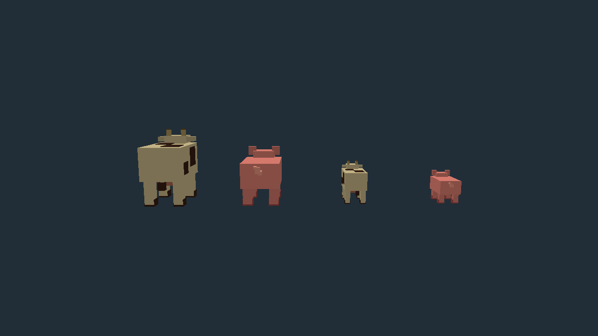
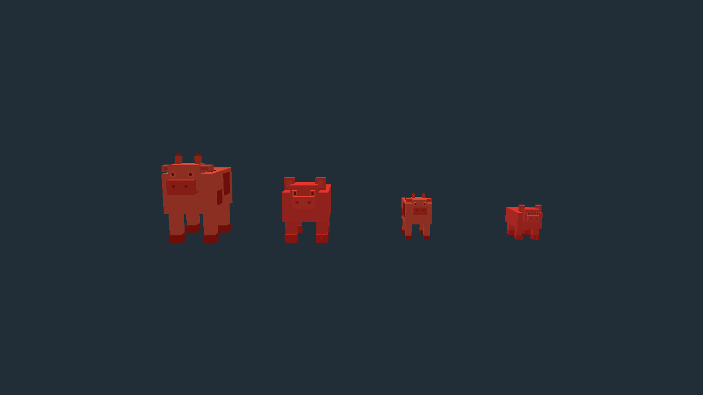
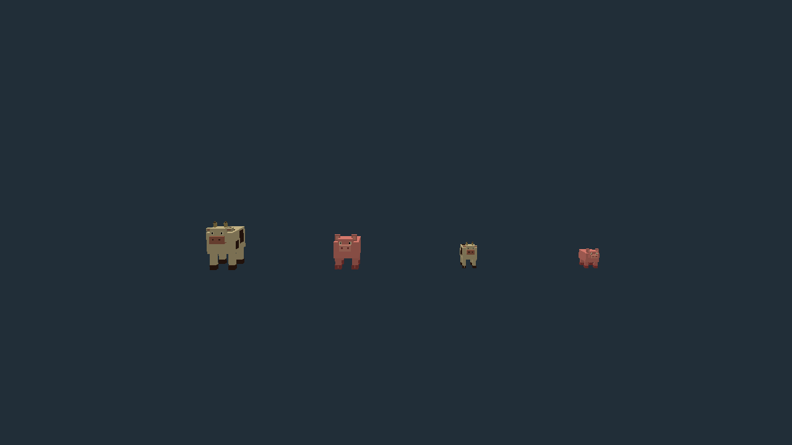
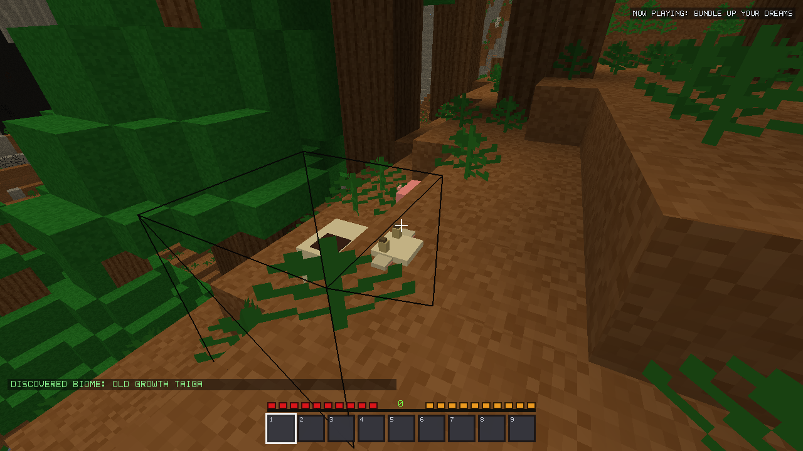
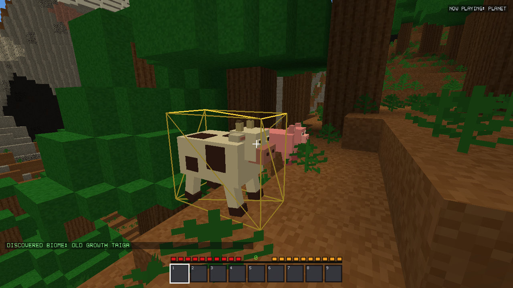

# Pig and cow visuals / movement — v2.20.1 follow-up

Latest follow-up: [passive spawn balance](PASSIVE_SPAWNING_v2.20.1.md) supersedes
this stage’s package fingerprints. Models and movement remain as recorded.


## Scope and baseline

Built on the existing **uncommitted v2.20.1 village candidate**, not a reset to
released v2.20.0. Git HEAD remains `48f751131a5a5d430fdbb4ce5b2dcba5a7aee6c1`;
that commit alone does not describe either local candidate. Relevant original
source files, executables, working-tree status and hashes are frozen under
`build/v2201-livestock/baseline/`. Existing uncommitted village work, unrelated
review files, IDE state and attachments were preserved.

The user's follow-up explicitly authorizes changing pigs and cows. Earlier
village-stage statements about preserving their original six-part models are
superseded by this report. Sheep, chickens, pillagers and all four original
hostile billboard models/AI remain unchanged.

No commit, push, publication, installation or real-save access occurred. Tests
used disposable marked profiles; the installer was compiled but never executed.

## Original models and new appearances

Previously pigs/cows shared the same unrotated animal torso, offset head and four
static cuboid legs; only color distinguished them. Their bodies did not turn
with their heading and legs did not stride with actual displacement.

`include/LivestockModel.h` now builds two original voxel silhouettes through the
existing shared instanced entity renderer:

- **Pig (28 parts):** stockier pink body, separate head, protruding broad snout,
  nostrils, eyes, ears with inner coloring, split hooves and stepped curled tail.
- **Cow (38 parts):** taller cream/brown body, asymmetric coat patches, separate
  muzzle, eyes, ears, horns, cloven hooves, udder and a swaying tufted tail.
- Piglets and calves use the existing 0.55 young-animal scale, consistently applied
  to body, head, limbs, markings and accessories about their feet.
- Existing hurt tint and death shrink/timing remain. No downloaded textures,
  new item IDs, source artwork changes or new GPU resources per animal exist.







These turntables are native OpenGL captures of controlled states, not edited art
or unscripted gameplay. An additional real generated-terrain capture exercises
the actual simulation and world rendering below.

The shared muzzle/head side planes initially overlapped on the cow. Native
inspection exposed the resulting stripes; insetting the muzzle fixes that
coplanar overlap. Eyes/nostrils/coat patches are shallow geometry with separation.

## Motion and collision

The three existing presentation floats are generalized from village-only names
to `modelYaw`, `modelMotion`, `modelClock`; no persistent fields or save extension
are added. The villager model retains its same pose values and rendering path.

- Gait advances by actual grounded travel distance, with different stride lengths
  for pigs/cows. Opposite diagonals alternate; legs stop while idle/blocked.
- Body and every accessory rotate together. Exponential turning/speed smoothing
  works at different simulation cadences, with wrapped bounded angles/clocks.
- Subtle breathing, idle sniffing and tail movement do not imply fake resource
  production. Airborne legs tuck instead of cycling against an invisible floor.
- Selection bounds follow adult/baby proportions and rotated model extents;
  head/side targeting and outlines now cover the visible animals.

The initial in-world capture exposed the old center/below-block movement's poor
handling of rising terrain. A pig/cow-only `LivestockMovement.h` sweep now checks
body clearance, resolves axes in bounded substeps, handles gravity and performs
supported one-block jumps rather than embedding the body in the step. It uses
loaded chunks only; unloaded terrain is a barrier. Fences, walls and closed
fence gates are not treated as climbable steps. Existing navigation still chooses
routes; its population limits, foods, speeds and flee behavior are retained.

The initial fence probe expected stopping before a block cell's edge. An isolated
fence post is inset: the trace correctly stopped at local Z=1.073, without crossing
its collision geometry. The assertion was corrected to allow that inset while
retaining per-frame no-solid-overlap checks. No real fence escape is claimed from
that initially over-strict probe. A separate enclosure guard prevents step jumps
onto fence/wall/gate pieces.




`src/Survival.cpp` only applies the new builder/sweep to Pig and Cow. Other animals
keep their existing geometry/locomotion. Diets, breeding, growth duration, milk,
drops, health, inventory ownership and farming transactions are not redesigned.
Existing villager instancing also batches livestock, so limbs do not add separate
per-animal draw calls or VBOs. Renderer/shaders themselves were not changed by
this follow-up.

## Verification

| Check | Result |
| --- | --- |
| New full-game livestock checks | 3,024 assertions passed |
| New demo livestock checks | 3,015 assertions passed |
| Existing village full/demo checks | 1,842 / 1,836 assertions passed |
| Existing functional suites | 15 passed, including farming, combat/subsystems, game, checkpoint, building, automation, inventory/QOL and exploration |
| Windows Release smoke suites | All 20 passed |
| Historical generator hashes collected by Release suite | All 1,326 matched |
| Embedded resources | 135 per variant matched source assets |
| Protected files / item previews | 1,002 unchanged protected files; all 365 previews unchanged |

Coverage includes actual simulation updates at 15/30/60/120 FPS, grounded strides,
idle/blocked motion, smooth turning, a short stall, adult/baby scale, head/side
rays, hurt/death rendering, save/reload and byte-identical mob saves before/after
changing presentation state. Collision probes check every frame across full
blocks, half slabs, fences and two-block walls, plus unloaded terrain rejection.
Native GL cohort checks exercise 1/10/30/60 animals using the shared batch.

The existing distant-passive test assumed six parts per cow. Its expected full
output was updated to 5,001 x 38 parts for the authorized new model, retaining
both exact full preparation coverage and empty distance-filtered output.
Observed average CPU preparation in that fixture was 2.594 ms for all 5,001 cows
versus 0.021 ms when culled before building parts (20 repetitions). This is a
CPU-only observation, not an FPS or integrated-GPU certification.

The full V23/V24 exact-fixture and 50-seed generation cohorts were not repeated
for this localized follow-up. Their prior village-stage evidence is retained;
terrain/generation sources are still protected byte-for-byte, and all historical
hashes were rechecked. No generator algorithms or IDs changed.

[Summary](livestock-v2201/summary.json),
[focused logs](livestock-v2201/focused-final-logs.zip),
[functional logs](livestock-v2201/functional-final-logs.zip),
[Release logs](livestock-v2201/release-logs.zip),
[source fingerprints](livestock-v2201/source-fingerprints.json),
[package assets](livestock-v2201/package-assets.json),
[preview checks](livestock-v2201/preview-check.json),
[baseline](livestock-v2201/baseline.json).

## Packages and reproduction

Both local Windows Release packages were rebuilt. They supersede the earlier
village-stage v2.20.1 binaries; no installer was run. The demo remains stateless.

- `build/installed-release/Release/VoxelFrontier.exe`: 77748736 bytes; SHA-256 `417ba3d2b685291dc07191121878def5a038ca6925ae2db17c029f565a13814b`.

- `dist/VoxelFrontier-v2.20.1-Windows-Setup.exe`: 71640728 bytes; SHA-256 `0bc25a110a72117a883713e44fc1689d3d0abc39729812933262f92e6d6be878`.

- `dist/VoxelFrontier-v2.20.1-Windows-Standalone.exe`: 77467648 bytes; SHA-256 `fd2c7e3a98914c2adb6e1088ab2bdc86fc35930354c345e985606721366c04e5`.

Checksums: [SHA256SUMS.txt](livestock-v2201/SHA256SUMS.txt).

With matching production-object drivers built as described in AGENTS.md:

```powershell
python tools/run_livestock_validation.py --output build/fresh-livestock-focused
python tools/validate_village_polish.py --phase functional --output build/fresh-livestock-functional
python tools/validate_village_polish.py --phase release --output build/fresh-livestock-release
python tools/verify_village_polish_packages.py
python tools/check_village_polish_previews.py
```

The native test implementation is `tests/stability/livestock_native.inc`.
Preview authoring uses the bundled workspace Python with Pillow. Packaging still
requires a current inventory_previews.json manifest; all icon pixels remain exact.

## Practical limits

This is procedural voxel animation, not per-hoof inverse kinematics or a new
pathfinding/swimming system. Small visual overhangs on irregular terrain are
possible. Existing navigation remains best effort. The body sweep uses conservative
adult locomotion dimensions for young animals, and does not teleport creatures
already saved inside solid blocks out of them. No new animal sounds, unique coat
variants, gait persistence or full-body death/ragdoll animation is introduced.
No exhaustive multi-hour or low-end GPU performance certification is claimed.
The earlier village candidate's unrelated deferred features remain deferred.
