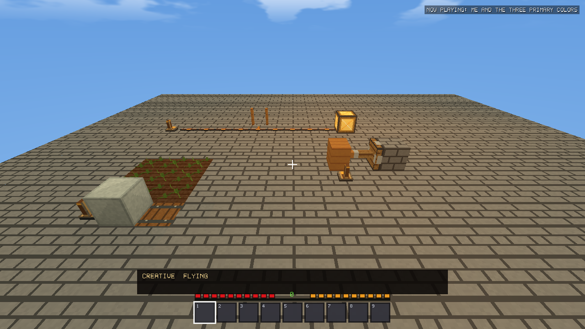
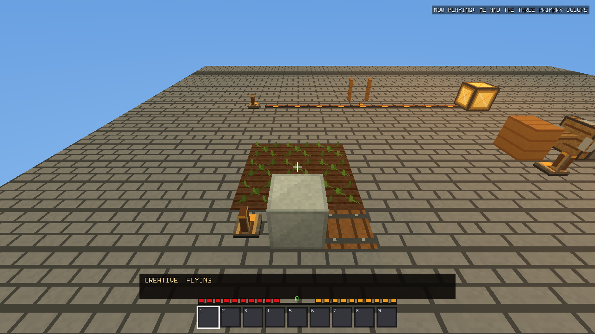
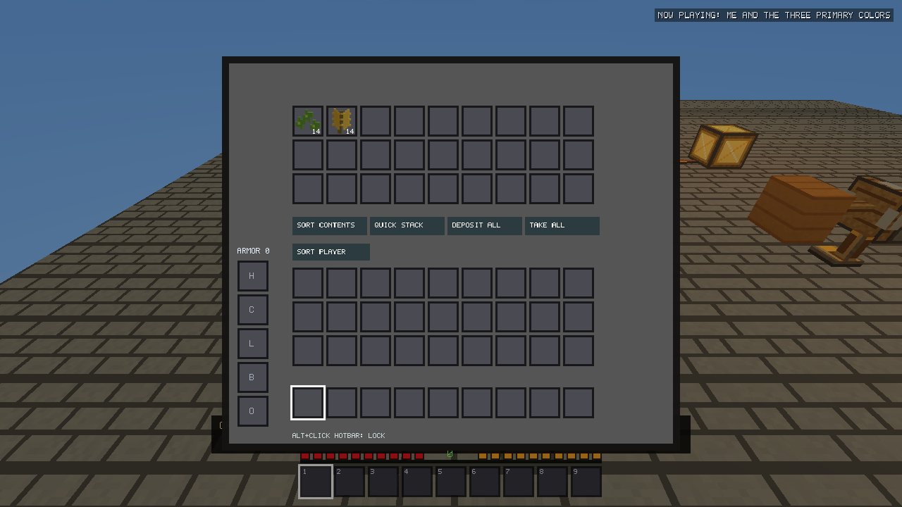
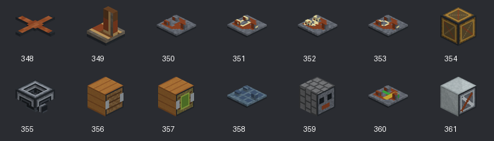

# Logic & Automation validation — v2.17.0

For the final v2.17.0 stabilization fixes and current package checksums, see
[prerelease fix validation](V2170_PRERELEASE_FIX_VALIDATION.md). The original
implementation and benchmark evidence below is retained for comparison.

Implementation and validation, October 26, 2026. Prerelease publication approved by the user. No installed
game, real saved world, or real profile was modified. Every native fixture creates
a unique temporary working directory; packaged tests use explicitly isolated profiles.

## Devices, controls and recipes

Fourteen item IDs and fifteen block IDs are appended after v2.16.2. Piston Head is
an internal, non-dropping block, with no catalog item or recipe. Existing numeric
IDs remain fixed; signal levels, orientation and device options use properties.

| Item | Recipe / cost | Use |
|---|---|---|
| Power Wire ×8 | Copper Ingot + Coal | Floor wiring; horizontal branches and one-block slopes |
| Lever | Stick above Cobblestone | RMB toggles a persistent source |
| Repeater | Torch, Wire, Torch above three Stone | Rear input; front output; RMB cycles 1–4 ticks |
| AND Gate | Repeater, Wire / Wire, Stone | Both side inputs required |
| OR Gate | Wire, Repeater / Wire, Stone | Either side input required |
| NOT Gate | Torch above Wire above Stone | Rear input, inverted front output |
| Powered Lamp | Glass/Torch/Glass, Wire/Copper/Wire, Glass/Torch/Glass | Adjacent signal enables existing block light |
| Hopper | Five Iron Ingots around a Chest, funnel shape | Pull above; push through the nozzle |
| Piston | Three planks, Cobble/Iron/Cobble, Cobble/Wire/Cobble | Power extends; unpowered retracts |
| Sticky Piston | Sweet Berries above Piston | Pulls one eligible block on retraction |
| Daylight Sensor | Three Glass above Wire/Copper/Wooden Slab | Sky light multiplied by daylight |
| Observer | Cobble/Glass/Cobble above Wire/Iron/Wire | Rear block-state change produces a front pulse |
| Crop Sensor | Wheat/Carrot above Wire/Glass | Detects mature crops in its front field |
| Automatic Harvester | Three Iron, Wire/Hopper/Wire, Cobble/Iron/Cobble | Harvests to storage below; RMB toggles paid replanting |

The authoritative shapes/counts are in `craftingRecipes()`. Existing Recipe Book
manual, autofill and batch tests cover all recipes. Equipment, maps, sorting,
Creative search/categories/favorites and cursor ownership retain their existing paths.

## Signal rules and timing

- Automation advances at **10 Hz** inside the existing 120 Hz fixed simulation.
  Render FPS does not set the circuit clock. Fractional time is retained.
- Lever/button/plate sources output 15. The first wire receives 15; each subsequent
  wire loses one level. There is no signal through arbitrary solid blocks.
- Wires branch and connect over single-block slopes with appropriate headroom.
  Freestanding vertical wire towers and quasi-connectivity are not implemented.
- Gates/repeaters/observers output only through their front. AND/OR take left and
  right inputs; NOT/repeaters take their rear input. They restore output to 15.
- Repeater delays are 0.1–0.4 seconds under normal load, on both edges. Changing
  input before the delay completes restarts the delay (inertial behavior).
- Buttons pulse for 0.5 seconds. Plates use actual player/mob intersection volumes;
  Spectator and dead players do not press plates. Loose items/boats do not press them.
- Observers emit a two-tick pulse for supported rear **block-state** changes. They
  do not monitor inventory contents. Crop sensors sample at most twice per second;
  daylight sensors once per second.
- Doors, trapdoors and gates follow power edges, with multiple sources combined by
  maximum strength. A manual change remains until the next power edge. Legacy door
  IDs are normalized to one device identity without changing the stored blocks.
- Lamps reuse the existing emitter index and block-light solver, never a parallel
  lighting engine. Only state changes enqueue mesh/light work.

F3 shows device count, queued work, processed work, simulation time and targeted
output/state. Contextual hints expose available RMB actions and repeater delay.
Placement ghosts use the actual new building boxes and materials.

## Update architecture and bounds

`Automation` is main-thread owned. Chunk registration uses a compact local index
built alongside existing farm/emitter/building indices. Edits notify a fixed local
neighborhood. Sorted dirty positions and scheduled deadlines have deterministic
ordering. Signal waves read before their staged writes; oversized waves retain
progress between ticks. Up to 2,048 timed events, 2,048 weighted evaluation work units, and 512
staged state writes are processed per tick. Hoppers, harvesters and pistons reserve
extra work units for their bounded scans/movement. Unknown/unloaded ports retain their state; no distant chunks are generated.

Revision tokens invalidate staged changes after a device is replaced or manually
changed. Chunk deactivation pauses device deadlines, including neighboring boundary
ports. Simulation-distance reconciliation resumes resident devices. Cycles remain
bounded, with queued work and overload ticks retained rather than recursive updates
or dropped ownership. Large networks can incur extra propagation latency.

Registration is capped at 100,000 devices per world. Placement previews reject a
new device beyond capacity. Deferred queues are bounded by registered devices.
Sound work is limited to two nearby automation sounds per tick. Existing click,
block/mechanism and pickup samples are reused; no audio subsystem is replaced.

## Ownership and machinery

Hoppers reuse the existing **27-slot container inventory and UI**. This deliberately
keeps sorting/bulk transfers and persistence on one ownership implementation. Each
unlocked hopper performs at most one item operation every four logic ticks (0.4 s),
pushing first, otherwise pulling. Fuel enters furnace sides, smeltable inputs enter
from above, and only output can be extracted below. Full/unavailable destinations
leave the source untouched. Powered hoppers stop their own operations; incoming
transfers from another device remain possible. Fixed-size pointer arrays avoid
per-operation heap allocations. There is no dropped-item pickup feature yet.

Pistons preflight a bounded replacement set, checking expected blocks, loaded chunks,
height, push count and player/mob/boat clearance. At most twelve blocks move; sticky
pistons pull one. Complete supported block states move with their type. Block entities,
other automation devices, Bedrock, fluids and attached decorations are excluded.
Supports with dependent crops/decorations are conservatively immovable. No entity
pushing/crushing is performed. The entire main-thread replacement completes before
save capture or simulation resumes. Lighting, meshes and derived connections then
use the existing update paths. Blocked movement retries at a bounded half-second interval. Retraction checks the
closing base volume as well as the pull destination. Movement is instantaneous;
cosmetic animation is deferred.

Harvester fields are three blocks forward and one block either side at the device's
height. Crop sensors also inspect the level below, permitting mounting above a
harvester. One mature crop is harvested per four powered ticks. Wheat, carrots,
potatoes, beetroot, pumpkins, melons, ripe berries and upper sugar-cane blocks use
`FarmingSystem::harvest`. Replanting reserves a real seed/root from harvest or storage;
berries regrow from their existing bush and cane bases remain. Stem blocks are not
harvested. Outputs go atomically into a supported container immediately below;
insufficient capacity cancels the harvest. Unloaded machines perform no offline work.

## Save compatibility and checkpoints

The world file keeps its existing version-3 block-state/container codec and adds an
optional **AUT1** tail. Sorted records contain position, stable device type, pending
delay, target/input and observed block state. Runtime queues, pointers and GPU data
are reconstructed. Missing extensions initialize empty; chunks register old devices
on activation. Invalid types, coordinates, duplicate positions, counts, truncated
records and invalid block states fail before active world state is swapped.

Hopper inventories remain in the existing container section. Piston blocks and moved
states remain ordinary terrain edits. The world snapshot therefore contains ownership,
machinery and delays together. `Game::saveAll` captures on the main thread before
background commit; no automation worker touches mutable inventories. Manifest checks,
journaling, previous-checkpoint recovery and session reservation are retained.
No checkpoint component or metadata is written outside the coordinated transaction.

Both Release variants retain their existing persistence policy. The demo simulates
all devices in memory while suppressing persistent world/navigation files.

## Visuals

Thirty original 16×16 off/on texture tiles are appended, preserving all historical
world texels. All 361 registered items have cached 64×64 previews through the native
model-export pipeline. No per-item thumbnail rendering occurs when inventory opens.
The expanded world atlas still fits the packed terrain material byte (217 < 255).
Actual native screenshots and icon coverage evidence are linked below.

## Regression and performance evidence

### Native simulation and gameplay

The dedicated suite passes **689 assertions**, including attenuation,
branching/slopes, gate truth tables, repeaters, finite buttons, actual plate volumes,
clocks, rapid observer changes, queued pulses across reload, powered/manual doors,
existing light propagation, bounded 3,000-node waves, 10–240 FPS stepping, negative-Y
pistons/legacy slabs, loaded/unloaded boundaries, block-state preservation, full
containers, furnace routing, map identity/durability, hopper cycles, paid replanting,
sugar-cane bases, malformed extensions and coordinated background checkpoints.
Actual production RMB paths test lever, repeater, button and hopper interactions.

A 100-farm fixture harvested 900 mature crops into storage, paying replanting seeds.
Dense hopper cycles conserve total item counts. Fixture crash diagnostics stay in
the test driver only. A development capture failure came from inconsistent
incremental objects after a class-layout edit; a clean production rebuild and
relinked driver resolved it. The renderer/LOD implementation was not changed.

Final full/demo packaged suites passed **20/20**. All **1,326 historical chunk
hashes** (663 per variant, all generators V1–V22) exactly match the archived
historical evidence. The demo-linked native driver passed **660 automation
assertions** and wrote no persistent game components. Focused regressions also
passed **4,774 building**, **3,474 Creative UI**, **1,389 QOL** and **260 farming**
assertions. The catalog remains four pages, now with 361 items.

Both final Windows packages embed the exact source preview resource, SHA-256
`4b910fecaa9f4f6f5f99336da40d7be82bc5bbd231cd3dc0264efd50ad6ac03d`.
All 361 assignments are valid/visible, with no exact duplicate thumbnails. Source
fingerprints and all three missing/stale manifest rejection cases passed. Package
SHA-256 values were verified against `dist/SHA256SUMS.txt`. No installer was executed.

[Full automation](logic-v2170/automation.log),
[demo automation](logic-v2170/demo-core.log),
[packaged results](logic-v2170/regressions.csv),
[historical hashes](logic-v2170/historical-hashes.json),
[checkpoint recovery/stress](logic-v2170/checkpoints.log),
[stability subsystems](logic-v2170/subsystems.log),
[icon coverage](logic-v2170/icon-coverage.json),
[embedded resources](logic-v2170/embedded-previews.json),
[package checksums](logic-v2170/SHA256SUMS.txt).

### CPU and scalability measurements

Median of **three runs**, each with 300 measured 10 Hz updates after settling.
Distributed sources activate the connected network throughout its area; this is
not a single source powering only a small corner. Values are per logic update,
not per render frame, and are desktop measurements.

| Components | Idle mean | Toggling mean | Toggling p99 | World file |
|---:|---:|---:|---:|---:|
| 100 | 0.0001 ms | 0.042 ms | 0.154 ms | 4,089 B |
| 1,000 | 0.0031 ms | 0.190 ms | 0.763 ms | 40,089 B |
| 10,000 | 0.0510 ms | 1.228 ms | 2.494 ms | 400,089 B |

10,000 continuously toggled components build queue backpressure: processing remains
bounded while propagation becomes slower. This is a documented stress limit, not
instantaneous network convergence. No elapsed gameplay time or inventory ownership
is discarded. Each stored automation record costs 24 bytes plus the 8-byte extension
header, independently of existing terrain edits and container records.

| Other workload | Mean/update | p99/update | Serialized world |
|---|---:|---:|---:|
| 10,000 hoppers in active cycles | 0.471 ms | 1.076 ms | 3,220,089 B |
| 500 piston machines / 1,000 components | 0.231 ms | 1.433 ms | 56,089 B |
| 100 farms / 900 initially mature crops | 0.051 ms | 0.418 ms | 98,889 B |

Those system fixtures are separate CPU workloads, not simultaneous full-render
measurements or a simulation of accelerated natural crop growth. Raw single-world
serialization ranged from about 1–34 ms across these fixtures. It is distinct from
complete transactional checkpoint latency below.

### Matched native Survival traversal

The archived v2.16.2 Release driver and current Release use seed 123456789, identical
settings, camera/control schedule, rain, equipment, maps and boat transitions.
RD8/16/32 each passed with 100, 1,000 and 10,000 connected components plus sixteen
hoppers, eight piston machines and a crop farm. The baseline has no automation.
Simulation distance is 8, LOD Off, occlusion Auto, AA Off, VSync Off in **both** builds.
At RD8, parts of a large network can fall outside simulation residency normally.

The 20-second walking test deliberately cycles 10/15/20/30/60/120 FPS caps and injects
a 500 ms stall. The 15-second boat phase targets 60 FPS after a distant teleport,
which suspends the remote circuit. Thus aggregate frame percentiles include the
intentional caps/stall and cannot establish maximum FPS. A five-second warmup and
ongoing streaming do not certify fully settled RD32/64 residency.

Size sweep: mean measured render/simulation work per walking frame (excluding
limiter wait), recorded before the final piston support/cap refinements:

| RD | v2.16.2 | +100 components | +1,000 | +10,000 |
|---:|---:|---:|---:|---:|
| 8 | 0.585 ms | 0.887 ms | 1.141 ms | 2.082 ms |
| 16 | 0.869 ms | 1.096 ms | 1.336 ms | 2.435 ms |
| 32 | 2.627 ms | 2.956 ms | 3.156 ms | 4.590 ms |

The final frozen code was then rechecked at 1,000 components:

| RD | Final mean work/frame | Final complete checkpoint | RAM snapshot |
|---:|---:|---:|---:|
| 8 | 1.022 ms | 28.20 ms | 268.8 MiB |
| 16 | 1.209 ms | 25.56 ms | 341.0 MiB |
| 32 | 3.218 ms | 28.69 ms | 582.7 MiB |

[Final six walking/boat rows](logic-v2170/final-traversal.csv). The test machine
has an Intel i7-14700F (28 logical processors) and AMD Radeon RX 9060 XT, with a
Parsec display adapter also present; this is not a physical low-end-PC certification.

This is added functionality and measured overhead, **not an FPS optimization or
speedup claim**. Walking-phase p99 stayed about 100.3–100.5 ms because the schedule
includes a 10 FPS segment. Complete asynchronous save/capture/wait measured about
23–34 ms in these walks; ten-thousand-component snapshots added roughly 6–9 ms to
the baseline in these runs. Working-set snapshots ranged about 270–611 MiB. They
are process RAM samples, not peak RAM or dedicated game VRAM measurements.
A separate brief RD64 traversal with 1,000 components passed; it is a streaming
stress run, not a fully resident 64-distance performance guarantee.

The expanded icon atlas uses 6,062,080 RGBA bytes (320 KiB above v2.16.2). World
textures add 30 KiB. No new render pass, live thumbnail rendering or terrain vertex
format is introduced. Terrain buffer capacity in the raw CSV is the game's own
allocator capacity, not Task Manager's total graphics memory.

[Method and pinned baseline](logic-v2170/benchmark-method.json),
[CPU repeats/medians](logic-v2170/performance-summary.json),
[system fixtures](logic-v2170/automation-systems.csv),
[all 24 traversal rows](logic-v2170/traversal-results.csv),
[brief RD64 run](logic-v2170/rd64-brief.csv).






These are actual native game captures, using an isolated elevated test platform;
the platform is a fixture, not generated terrain.

## Remaining limits

- No comparator, dropped-item suction, entity pushing, piston animation or arbitrary
  block-entity movement. These are intentionally excluded rather than ownership-unsafe.
- No offline production. Circuits with missing ports hold state and resume when the
  relevant terrain is loaded; an overloaded network may respond later than its nominal delay.
- Only supported one-block wire slopes are available; there is no solid-block
  conduction or Minecraft-specific quasi-connectivity.
- Existing 27-slot inventories are reused for hoppers. Furnace extraction is output-only.
- Sign/container/bed/frame ownership is never moved by pistons.
- Separate GPU timer/per-pass meshing throughput attribution and an hours-long soak
  were not measured. Frame/work, memory, streaming and checkpoint evidence is provided.
- Physical low-end hardware is unavailable; measured desktop results are reported
  without claiming unverified low-end FPS or performance improvements.

## Reproduce

```powershell
./tools/run_automation_validation.ps1
python tools/generate_automation_assets.py
python tools/generate_item_thumbnails.py
python tools/check_inventory_previews.py
./tools/run_automation_benchmarks.ps1 -AllSizes
./package_release.ps1 -BuildJobs 4
./tools/run_stability_regressions.ps1 -SkipBuild -IncludeDemo -Output build/v2170-validation/regressions
```

Final local artifacts are `dist/VoxelFrontier-v2.17.0-Windows-Setup.exe`,
`dist/VoxelFrontier-v2.17.0-Windows-Standalone.exe` and `dist/SHA256SUMS.txt`.
The user approved committing, pushing, tagging and publishing v2.17.0 as a prerelease. The actual installation and saved worlds remain untouched.

The demo core can be repeated after packaging with:

```powershell
cmake -S tests/stability -B build/v2170-validation/demo-driver -G "Visual Studio 18 2026" -A x64 -DDEMO=ON -DBASE=C:/Users/Win/Documents/Codex/Voxel/Codex-Minecraft/build/standalone-demo-release
cmake --build build/v2170-validation/demo-driver --config Release
./build/v2170-validation/demo-driver/Release/StabilityDriver.exe --automation-demo build/v2170-validation/demo-core
```
