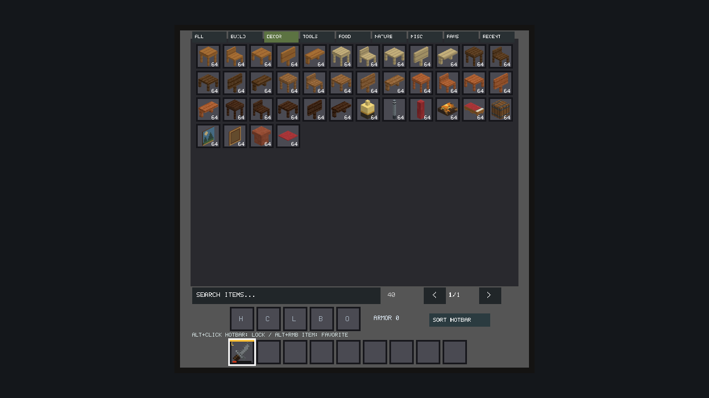
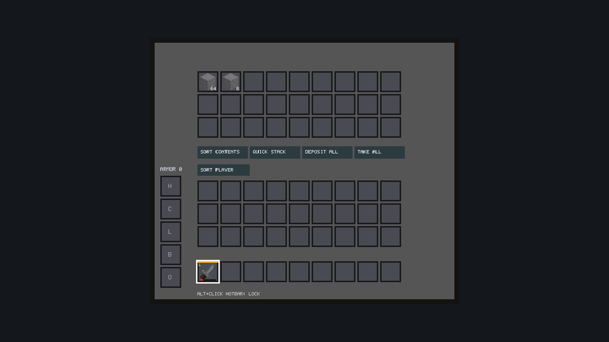
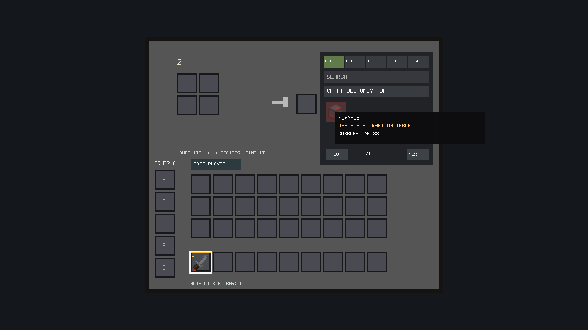
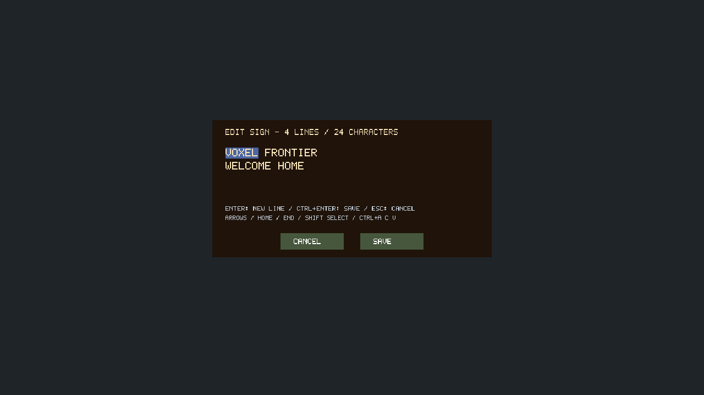
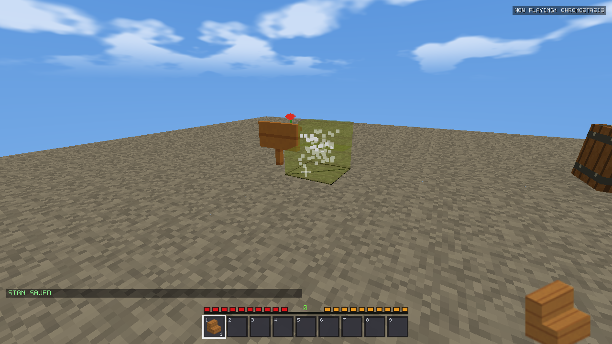
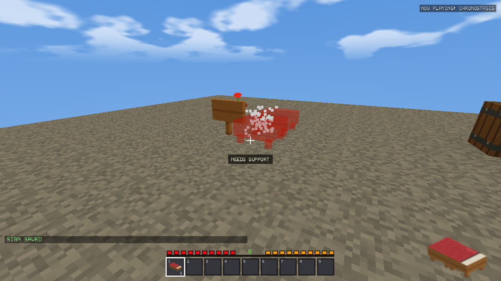
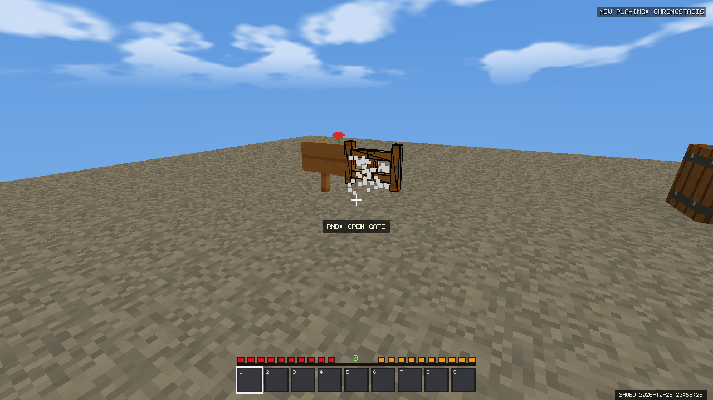
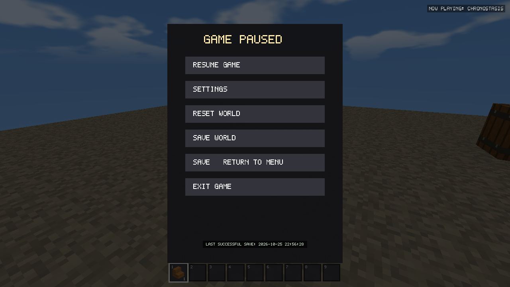
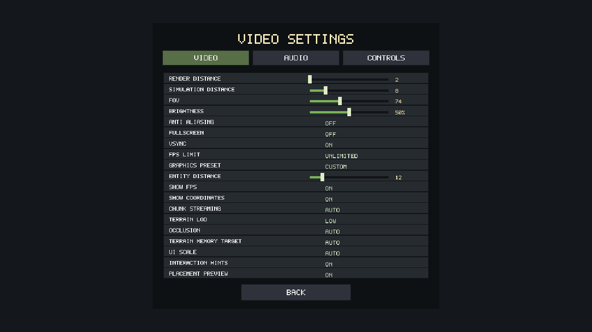

# Quality of Life validation — v2.16.2

Validation performed October 25, 2026; publication approved October 26, 2026. The real installation and
player worlds were not modified. Native fixtures create unique temporary profiles;
packaged full/demo checks use workspace test profiles. Clipboard fixtures restore
the previous clipboard contents, including when an assertion fails.

## Implementation

### Inventory ownership and bulk actions

`QualityOfLife.cpp` implements bounded sorting and container transfers over the
existing inventory and 27-slot container arrays. Sorting orders by shared category,
material/type, identity and durability, then groups compatible partial stacks.
Merge rules preserve item identity and refuse durable-item merging. Every moved
stack retains all four fields: item, count, durability and identity.

Quick Stack snapshots the container's existing stack types, fills matching stacks,
then uses available slots for those same types. It cannot bootstrap an unrelated
item family during the operation. Deposit All and Take All stop at available
capacity; remaining items stay with their original owner. Cursor stacks, equipment
and crafting grids are excluded. No dropped-item operations are involved.

Hotbar locks protect both sources and destinations from sorting, bulk buttons,
shift transfers, quick equipping and double-click gathering. Individual deliberate
clicks, drops, normal pickups, offhand swapping and crafting retain their existing
rules. Empty locked slots remain reserved during bulk withdrawals. The HUD and
inventory display a gold lock strip; inventory slots also display an L.

Locks are a validated nine-bit mask appended to `VXINV8`. V4–V7 loaders are
retained; missing masks initialize empty. Invalid masks and truncated records fail
transactionally without partially replacing the active inventory. This is the
only per-world save extension. It participates in the existing checkpoint.

### Hints and placement

Hints query current targets, held-hand selection, block state, inventory contents
and safe bed exits. Gate/door state, daytime respawn versus nighttime sleep,
displayed-item removal, signs, barrels, chests, crafting, stripping and shovel
paths receive appropriate prompts. Sneak uses the configured binding; RMB is the
engine's existing secondary-action input. Hints hide while editing signs, using
navigation, chatting, in Spectator or without an applicable target.

New building placement and its ghost share `Game::placementPlan`. The plan handles
orientation, hinges, stair neighbors/corners, slab halves/merging, paired beds and
doors, double paintings, support, loaded collision data, player/entity clearance
and world height. It performs no world writes. Confirmed placement applies the
plan only when valid. Historical door/slab/log/attachment previews mirror their
existing orientation rules; ordinary blocks retain the existing gameplay path.

The preview uses actual building boxes, block geometry and world atlas tiles;
plants use their crossed planes. Green/red tint distinguishes valid/invalid
placement. Reasons include Needs Support, Space Occupied, Terrain Loading and
Player/Entity in the Way. Geometry uploads are cached by block states and world
positions. One lazily created VAO/VBO and one GL 3.3 program are reused, with depth
testing and no depth writes. No new terrain meshing, workers or chunk generation
is performed for a preview. Its bounded buffer is at most about 34 KiB for two
maximal building models. The world, mob and terrain shader paths are preserved.

### UI, Creative navigation and crafting

UI rendering and mouse input share a logical-pixel transform. Auto targets about
720 logical pixels vertically; Small/Normal/Large request 0.85/1.0/1.5 scale and
are capped to available space. Inventory, catalog, containers, crafting, tooltips,
HUD, navigation, sign controls and menus use the same transform. The existing
44-logical-pixel slots and all four unfiltered catalog pages remain.

The Creative catalog shares six categories with sorting: Building, Decoration,
Tools & Equipment, Food, Plants & Nature, Miscellaneous. Favorites and Recent are
additional views. Search combines with each view, keeping the established item
index mapping for clicks, right-drag and tooltips. Favorites and up to 24 recent
selections persist in existing global preferences, outside world checkpoints.
The demo keeps them in memory only. A favorite gesture owns RMB until release,
preventing a held click from accidentally picking an item after the filter moves.

Recipe tooltips report missing ingredient quantities, distinguish a required
3x3 table from unavailable ingredients, and identify blocked grids/inventory
space. Table-only recipes are visible but unavailable in the 2x2 book. Feedback
works on copies; failed autofill/preview operations do not consume materials.
Craftable/unavailable coloring and existing search, batch crafting and autofill
remain. The configurable Recipes Using Item shortcut (default U) filters recipes that
accept the hovered/selected item;
pressing it again, or choosing a category, clears that ingredient filter. Its action
is appended to existing controls; valid old bindings retain their indices. The
label follows the selected binding. Mouse-wheel paging works in the Creative
catalog with the same scale transform and clamped page limits.

### Signs and save feedback

The sign editor preserves the four-line, 24-character-per-line ASCII format.
It supports selection, insertion, deletion, multiline movement, clipboard
sanitization and held arrow/delete/backspace repetition. Overlong paste is
rejected as one operation. Enter inserts a newline; Ctrl+Enter or Save commits;
Escape/Cancel leaves the stored text unchanged. Selection and blinking caret use
the same scaled coordinates as the text.

Save feedback observes existing checkpoint queue/commit results. It never treats
queuing as success. Failed commits retain the last success timestamp, with bounded
existing retry behavior. Pause shows the last successful checkpoint time, restoring
the verified manifest timestamp on load. Legacy saves without a manifest acquire
a time after their first successful coordinated save. Checksum verification,
journaling, recovery, session reservation and asynchronous snapshot coordination
are unchanged. The demo explicitly displays Session Only instead of disk success.

## Controls

| Action | Control |
|---|---|
| Sort player/storage | Sort Player / Sort Contents buttons |
| Matching deposit / all deposit / all withdrawal | Quick Stack / Deposit All / Take All |
| Lock/unlock hotbar slot | Alt + left click on that slot |
| Favorite/unfavorite catalog entry | Alt + RMB on that entry |
| Find recipes using an item | Hover inventory item and press the configured key (default U); repeat to clear |
| Creative pages | Page buttons or mouse wheel |
| Change scale / toggle hints / toggle ghost | Video Settings |
| Sign selection | Shift + arrows or Ctrl+A |
| Sign copy/paste | Ctrl+C / Ctrl+V |
| Sign editing | Arrows, Home/End, Backspace/Delete; Enter inserts newline |
| Commit/cancel sign | Ctrl+Enter or Save / Escape or Cancel |

## Visual evidence

All requested UI resolutions were rendered by the real OpenGL UI into exact-size
offscreen targets: 1280×720, 1920×1080 and 2560×1440. Physical window limits on this
desktop prevent a full-height 1440p window. Native world/preview/hint/pause captures
use the actual 1280×720 game window. Scaled virtual-cursor clicks were also tested
at all three dimensions and all four scale choices.











The evidence directory includes matching 1080p and 1440p captures. Panels, counts,
durability, lock strips, selection and sign controls were visually inspected.

## Regression evidence

- **1,375 focused QOL assertions**: 200 deterministic randomized ownership fixtures,
  repeated sorting/transfers, protected sources/destinations, map identities,
  durability, V7 migration/V8 roundtrip/corruption rejection, input scaling,
  categories, favorites/recent, held favorite gestures, preview/placement equality,
  four stair corners and historical door hinges, sign clipboard/control input,
  and successful/coalesced/failed production saves.
- **4,731 building**, **3,355 Creative interaction**, **260 farming** assertions.
- **20/20 full/demo packaged suites passed**, including commands, fluids, Survival,
  weather, reset/world switching, menus, transportation, UI and demo statelessness.
  All **1,326 historical chunk hashes** match v2.16.1 across all generators 1–22.
  [Packaged results](qol-v2162/regressions.csv),
  [hash evidence](qol-v2162/historical-hashes.json),
  [checkpoint recovery](qol-v2162/checkpoints.log).
- Both Windows packages embed the byte-identical 347-item v2.16.1 atlas:
  `d541c2cf98ceb7e05945a603f6d432109fe865bae6009ec85e4a39880d304cd2`.
  Coverage checks confirm stable item/block IDs, unchanged terrain tiles and all
  four billboard sprites. Preview manifest rejection checks remain enabled.

[Focused log](qol-v2162/qol.log), [building](qol-v2162/building.log),
[Creative](qol-v2162/creative.log), [farming](qol-v2162/farming.log),
[icon checks](qol-v2162/icon-coverage.json),
[embedded resources](qol-v2162/embedded-previews.json),
[packaging guards](qol-v2162/preview-packaging.json).

## Performance

Controlled UI harness comparison: archived v2.16.1 driver versus current v2.16.2,
same atlas pixels, 1280×720, three repeated runs per operation, 20 warmup and 200
measured frames per run. Values are medians of run means, with GPU completion
included. CSV atlas labels identify the artwork; comparisons use only the
`atlas=v2161` rows in each executable. These measure the UI, not whole-game FPS
on a low-end machine.

| Operation | v2.16.1 | v2.16.2 |
|---|---:|---:|
| Inventory open/render | 0.195 ms | 0.247 ms |
| Dense Creative page | 0.512 ms | 0.658 ms |
| Creative page switch/render | 0.326 ms | 0.520 ms |
| Atlas read/upload once | 4.968 ms | 5.400 ms |

The added buttons/labels cost about **0.05–0.20 ms** in this fixture. This is a
measured UI overhead, not a speedup; atlas-load differences concern identical
bytes and are not attributed to new art. The atlas remains **5.47 MiB**. There is
no per-item 3D rendering, UI-open GPU readback or per-frame framebuffer allocation.

The settled RD2 preview scene measured 0.353 ms with preview Off and 0.353 ms On
(medians of three 120-frame means). Run variation dominates that difference, so no
speedup is claimed. Cached previews add one small draw; they do not generate chunks.
The bounded inventory action fixture ran 2,000 sort/transfer iterations in 0.919 ms;
randomized full-inventory conservation is tested separately. These figures are
desktop measurements and do not certify performance on physical low-end hardware.

[Performance summary](qol-v2162/performance-summary.json),
[baseline UI](qol-v2162/baseline-ui-benchmark.csv),
[current UI](qol-v2162/current-ui-benchmark.csv),
[preview runs](qol-v2162/preview-frames.csv),
[inventory fixture](qol-v2162/inventory-performance.csv).

## Remaining limits

- Supported sign text remains ASCII, four lines × 24 characters. Selection uses
  keyboard navigation; mouse-drag text selection and undo/redo were not added.
- Recent means recently selected/placed catalog items, bounded to 24; this is a
  preference, not an inventory or persistent item owner.
- UI scale is capped on smaller windows to prevent clipping; Large may therefore
  be constrained below its requested factor. 4K behavior follows the same transform
  but no physical 4K display was available for inspection.
- The ordinary legacy placement path remains intact. New building confirmation
  shares the preview plan; representative historical door/slab/attachment previews
  mirror existing rules rather than rewriting those gameplay systems.
- No low-end physical PC was available. This update adds the measured UI cost
  above; no whole-game FPS improvement is claimed.

## Reproduce

```powershell
./tools/run_qol_validation.ps1 -SkipBuild
./tools/run_stability_regressions.ps1 -SkipBuild -IncludeDemo -Output build/v2162-validation/regressions
python tools/generate_item_thumbnails.py --check
python tools/check_inventory_previews.py
./tools/test_preview_packaging.ps1 -Output build/v2162-validation/preview-packaging.json
./package_release.ps1 -BuildJobs 4
python tools/verify_embedded_previews.py build/installed-release/Release/VoxelFrontier.exe dist/VoxelFrontier-v2.16.2-Windows-Standalone.exe
```

Local artifacts: `dist/VoxelFrontier-v2.16.2-Windows-Setup.exe`,
`dist/VoxelFrontier-v2.16.2-Windows-Standalone.exe` and `dist/SHA256SUMS.txt`.
Publication approved by the user October 26, 2026. The real installation and saves remain untouched.
