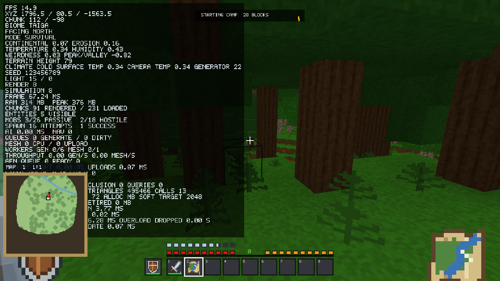
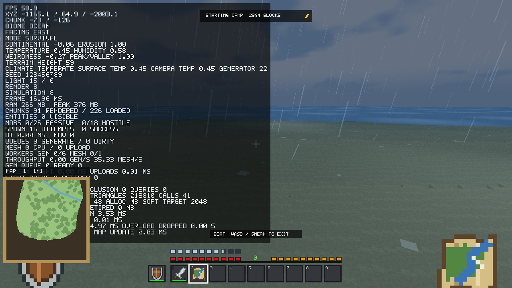

# v2.14.2: Stability, Reliability & Performance

Implementation and validation, 2026-10-17. Publication approved by the user for v2.14.2.
The starting revision is `2951413` (v2.14.1). The supplied
[audit](AUDIT_v2.14.1.md) was read before changes. Reproductions, save fixtures,
benchmarks and installer checks use isolated temporary/workspace profiles.
The user's installed game and real world saves were not upgraded or repaired.

## Results at a glance

- All eight P1 defects were reproduced against the original production objects.
  New tracked tests cover their corrected production paths.
- Existing corrupt sidecars refuse writable loading. Healthy worlds remain
  selectable. Recovery copies a verified previous checkpoint into a separate world.
- Death saves include terrain and containers; legitimate health/hunger survive reload.
- Unloaded terrain blocks ordinary movement; distant teleportation uses asynchronous
  streaming. Spectator retains noclip. Far-distance arithmetic uses 64-bit products.
- Simulation uses a bounded 120 Hz accumulator, with raw frame-time reporting.
  Negative-Y/far crops, partial-block targeting and finite numeric validation are covered.
- Autosave commit work moves to one worker after immutable capture. Capture and
  serialization remain on the main thread. This is a partial improvement.
- Matched rendering measurements show broadly similar performance, **not a proven
  general FPS or memory improvement**. Shared-page retirement stalls remain.

## All 25 audit findings

Fixed means the reproduced defect has a targeted correction and regression.
Improved means meaningful work is complete with a remaining scope limitation.
Deferred means the existing design was retained after inspection/measurement.
Unresolved means the reported problem still needs a safe demonstrated fix.

| # | Finding | Status | Evidence and remaining scope |
|---|---|---|---|
| 1 | Invalid sidecars silently become defaults | **Fixed** | Real Game rejects existing invalid inventory/player/mob files, preserves their exact bytes, and disables saves until all components load. Missing legacy sidecars remain supported. |
| 2 | Death save mixes checkpoints | **Fixed** | Real Game edits Air to Stone, changes inventory, dies, saves and reloads the same terrain/inventory generation. Death position and normal respawn state are retained. |
| 3 | Reload heals Survival stats | **Fixed** | Mode initializes before player decode; actual Game reload preserves health 13 and hunger 10. |
| 4 | Writer can create unloadable mob/drop state | **Fixed** | Shared limits of 100,000 mobs/drops, stack/ID/durability checks, legal splitting and finite admission. 5,001 cows and 5,001 drops roundtrip through Game. This is not a practical performance guarantee at the codec maximum. |
| 5 | Corrupt world hides healthy worlds | **Fixed** | Per-entry errors retain unavailable rows and healthy worlds. R twice within five seconds creates a separate recovered world when a complete backup exists. No automatic overwrite recovery. |
| 6 | Falling through unloaded chunks | **Fixed** | Non-Spectator collision neighborhood and swept movement boundaries require loaded columns. Velocity/fall distance reset while waiting. Actual `/tp` destination waits safely. |
| 7 | Far chunk-distance overflow | **Fixed** | Streaming, unloading and simulation promote deltas/products; far teleport test unloads origin. |
| 8 | Coordinate sentinel disables simulation limit | **Fixed** | Explicit center-valid state; origin is inactive after moving to X=1,600,016.5. |
| 9 | Crop coordinate aliasing/negative Y | **Fixed** | Full coordinate key/hash; crops grow at Y=-10 and X=2,097,154 without aliasing. |
| 10 | Invisible full-cell slab targeting | **Fixed** | Ray selection uses actual partial geometry; empty upper half of lower slab misses. Deliberate plant selection boxes remain. |
| 11 | Nonfinite settings | **Fixed** | Finite defaults before clamping; malformed suffixes rejected. NaN camera/audio fixture passes. |
| 12 | Partial/nonfinite binary loads | **Fixed** | Decode/validate before state assignment; strict IDs/counts/lengths/coordinates. NaN mob, truncated player, invalid inventory and Infinity navigation fail without partial mutation. Valid high-altitude player/drop saves remain supported. |
| 13 | Main-thread autosave work | **Improved** | Single immutable staged checkpoint commits asynchronously; success/failure polled and reported. Main-thread capture, serialization and precommit verification still cost time. |
| 14 | Teleport retirement stalls | **Unresolved** | Profiling localizes a large sample to shared-page trim/destruction (18.29 ms), with 34.85 ms worst teleport frame. No speculative allocator rewrite; no claim that GPU synchronization is proven. |
| 15 | Farming scan spikes | **Improved** | Incremental discovery inspects at most 512 cells per step; tracked crops persist through unloading. Total discovery work is amortized, not eliminated; discovery after loading can be delayed. |
| 16 | Moving-camera occlusion proofs | **Deferred** | Traversal confirms zero occlusion savings while moving. Exact-matrix fail-visible behavior retained; temporal reprojection needs independent correctness work. |
| 17 | Elapsed time lost below 20 FPS | **Fixed** | Production Game tests at 10/15/20/30/60/120 FPS and a one-second spike. Double running world-clock accumulator also passes a complete 20-minute cycle. Explicit overload policy below. |
| 18 | LOD only removes decorations | **Deferred** | No rock/cave/water silhouette simplification added. Existing packed/indexed meshing and LOD remain; no claim of full geometric terrain LOD. |
| 19 | All loaded animals become persistent | **Improved** | New PST1 flag extension preserves actual persistence and negative baby ages. Old files lack the flag: conservatively retain old persistent behavior to avoid deleting pets/bred animals. |
| 20 | Global entity traversal/preparation | **Improved** | Distance filter before passive cuboid/drop sprite emission avoids distant geometry allocation. Simulation collections still have global traversal; billboard AI/sprites/animation untouched. |
| 21 | Global furnaces and reverted edits | **Deferred** | No unsafe history compaction against guessed generation. Active-container indexing and historical-generator compaction require dedicated evidence. Existing edits preserved. |
| 22 | Map lifetime cap | **Fixed** | At pressure, reclaim only records absent from player/craft/cursor/equipment, saved containers, drops and active view. Identities remain monotonic; referenced IDs never recycled. The simultaneous live-record cap remains 128. |
| 23 | Stale simultaneous sessions | **Fixed** | Lifetime per-world reservation acquired before recovery/load, released on unload/crash. Same-process and real child-process conflicts tested. Metadata reread under reservation. Older binaries do not honor this new reservation. |
| 24 | GPU budget mistaken for hard cap | **Improved** | F3 explicitly labels SOFT TARGET and shows live/reserved usage. Occupied pages cannot be forcibly shrunk; RD64 remains expensive. |
| 25 | Missing negative/Survival tests | **Improved** | Tracked production-path driver, full/demo scripts, foreground Survival walking/boating/weather/equipment/maps and installer checks. No CI service, physical low-end run or multi-hour soak established. |

**Classification: 15 Fixed, 6 Improved, 3 Deferred, 1 Unresolved.**
The original intermittent unowned Windows replacement error is additionally unresolved;
the save safeguards below are verified, rather than a claim its native cause disappeared.

## Save integrity and recovery

`checkpoint.manifest` (`VXMAN1`) records a monotonic generation plus component names,
byte lengths and FNV-1a checksums. Checksums detect accidental damage; they are not
cryptographic authentication. The existing `VXCHECK1` journal coordinates rollback.
Staged files and the journal receive durable flushes before replacements. The previous
complete checkpoint is retained as `.checkpoint-old` files, including unchanged
components during metadata-only saves. A new manifest is part of the same transaction.

Loading verifies recovery and the manifest before entering writable play. Invalid
inventory/player/mob/navigation state cannot become an empty state and overwrite the
original. Legacy worlds without manifests still use their original decoders; successful
saving adds checkpoint metadata. No generator or item/block IDs are migrated.

Select an unavailable world in Play and press **R twice within five seconds** to copy
the last verified complete backup into a new `Recovered ...` world. When no verified
backup exists, recovery reports failure and preserves the original. Keep external
backups: one retained generation cannot repair arbitrary historical/disk damage.

A per-world lifetime file reservation prevents two cooperating clients from loading
writable stale state. Locks expire with process handles, not a timestamp guess. A lock
error can also mean access denied; diagnostics say so rather than assuming another game.
Older clients cannot be forced to honor a lock protocol they do not implement.

Autosaving captures/stages one coherent live state on the main thread. Only immutable
staged files cross the worker boundary. Manual saves, world switching and shutdown
wait for the outstanding commit. A queued save is not displayed as completed success.
Failures report stage/path/native error, retain recoverable data and use three bounded
frame-deadline retries (50/200/800 ms); production code never sleeps between retries.
Settings are independently saved preferences, outside the world transaction.

Tests include deliberate Windows delete locks, rejected serialization, 400 concurrent
record writes, 200 paired checkpoint commits, child `_Exit(77)` between replacements,
restart rollback, asynchronous immutable capture and simultaneous process reservations.
These demonstrate tested failure handling. Native errors 5/1175 previously observed
without a known lock owner remain unexplained; antivirus involvement is not established.
Process termination is not proof of power-loss durability on every disk/filesystem.

## Simulation and physics policy

Each rendered frame contributes its actual elapsed time to a 120 Hz accumulator.
At most 32 simulation steps execute per rendered frame, with up to two seconds of
carried debt. Isolated one-second spikes recover; ordinary 10+ FPS loses no elapsed
time. Sustained overload beyond two seconds explicitly drops excess debt, shown in F3.
This prevents an unbounded spiral; it does not promise hard real-time simulation under
arbitrary overload. Input edges and streaming maintenance remain once per rendered frame.

World time advances in double precision and publishes the existing float interface;
`/time` assignment is respected. Terrain/world building bounds remain Y=-64..319,
natural generation Y<=256. Saved player coordinates allow high-altitude Spectator use.
Drop/boat velocity validation is distinct from position validation and permits normal
freefall while rejecting malformed finite impulses.

## Measurements and methodology

Host: i7-14700F, Radeon RX 9060 XT, 32 GiB RAM, Windows; Release, 1280x720,
VSync/MSAA off, simulation distance 8, seed 123456789. Identical render settings,
LOD/occlusion disabled for the matched matrix. Two repeats per scene/RD, alternating
old/new order; all samples report 100% focused and visible. No graphics setting was
lowered to create a comparison. Original v2.14.1 executable SHA-256:
`741d9f1ed8d4c534eb202c202ec3af9356aca5008100316cfd3c8451769b1bcd`.

The retained 72-row [matrix](stability/performance.csv) was collected before final
world-clock/menu/validation refinements, which do not change renderer/meshing paths.
Each table value averages per-phase/run statistics; p99 values are **not pooled
percentiles**. Very high uncapped FPS in tiny scenes is not representative of every
Survival session. Differences near measurement noise are not speedup claims.

| Scene/RD | Mean ms old/new | p99 ms old/new | RAM MiB old/new |
|---|---:|---:|---:|
| Gameplay/8 | 0.2715 / 0.2656 | 0.7661 / 0.7552 | 297.9 / 292.0 |
| Gameplay/16 | 0.4070 / 0.4065 | 0.6876 / 0.6906 | 351.2 / 352.0 |
| Gameplay/32 | 0.9812 / 0.9752 | 1.1283 / 1.1160 | 566.8 / 567.8 |
| Ocean/8 | 0.2458 / 0.2448 | 0.5812 / 0.5659 | 317.8 / 288.8 |
| Ocean/16 | 0.4444 / 0.4458 | 0.5878 / 0.6283 | 355.8 / 355.3 |
| Ocean/32 | 1.1975 / 1.1966 | 1.3679 / 1.3754 | 575.3 / 573.7 |

Ocean RD16 p99 regressed in this sample; there is insufficient evidence of a
repeatable source-level regression or a general memory reduction. GPU numbers are
terrain buffer capacity/live bytes, not whole-process VRAM or Task Manager attribution.
Per-phase FPS, p95/worst, CPU and buffer figures are in the matrix/summary.

The focused RD32 flight/teleport profile records 0.208 s queue recovery after a short
8x Spectator flight; worst teleport frame 34.85 ms, detach 1.40 ms, retirement 18.30 ms.
Retirement's large sample is page trimming/destruction (18.29 ms), not fence polling.
This is localization, **not a verified reduction** against the previously reported
37-63 ms stalls. Detailed [retirement samples](stability/retirement.csv) are retained.

Microbenchmarks are narrow: 5,001 distant passive animals produce 30,006 cuboids
without prefiltering versus zero with filtering (roughly 0.167 vs 0.0064 ms preparation).
Twenty forced farming discovery calls average roughly 0.004 ms with a 512-cell bound;
the baseline's full forced scans averaged 1.62 ms in this run. Those calls perform
different amounts of discovery work; this is reduced spike size, not equal-work throughput.

Foreground Survival traversal uses production update/render/input, rain, armor/shield,
a progressive map, compass/waypoint, natural entities, walking and a mounted boat.
Walking deliberately cycles 10/15/20/30/60/120 FPS and injects a 500 ms frame; boating
targets 60 FPS with the same spike. Resulting p99/worst include these imposed delays.
This tests correctness at low FPS on this host, not physical low-end CPU performance.
Final traversal CSVs report elapsed/simulated time, debt, active CPU work, save capture,
total save latency, RAM, terrain capacity and distance. Screenshots show actual Taiga
walking and Ocean boating; they are not labeled as river evidence.

Final traversal results (deliberately paced, with injected spikes):

| RD/phase | Distance m | RAM MiB | Mean active CPU work ms/frame | Save capture / total ms |
|---|---:|---:|---:|---:|
| 8 walking | 55.89 | 268.2 | 1.17 | 5.23 / 24.98 |
| 8 boat | 15.71 | 267.1 | 1.48 | 4.62 / 21.61 |
| 16 walking | 55.87 | 337.4 | 1.34 | 4.70 / 22.23 |
| 16 boat | 15.66 | 329.1 | 1.92 | 3.99 / 19.55 |
| 32 walking | 55.89 | 593.5 | 2.36 | 5.66 / 21.00 |
| 32 boat | 16.10 | 557.7 | 5.32 | 4.98 / 24.86 |

Across all 18 walking timing buckets, the maximum unaccounted elapsed time after
carried debt is 0.0000061 seconds. The 30 FPS bucket includes the intentional 500 ms
spike and therefore averages about 25 FPS. An earlier run observed a 22.98 ms save
capture / 43.10 ms total: these final smaller samples do not remove the scaling limit.

The final unpaired RD16 rendering smoke measured 0.413-0.459 ms mean frames and
0.552-0.618 ms p99 across stationary/rotation/editing. It is a stability check, not
another paired speedup result. Brief RD64 ocean stress passed with 12,853 loaded
chunks, about 1,394 MiB working set and **3.33 GiB terrain capacity** (2.89 GiB live).
Mean frames were 3.95-4.18 ms in this isolated scene. This confirms the soft target
is not a hard cap; it does not establish RD64 suitability on low-memory devices.





## Regression/build evidence and reproduction

See [evidence index](stability/README.md) and [machine-readable summary](stability/validation.json)
for final results, hashes and traversal tables. Both installed/full and stateless-demo
Release builds are packaged locally; setup and standalone checksums are retained there.
All 663 historical generator chunk records (versions 1-22) match for each variant.
No terrain/noise, block/item registry, billboard sprites/AI or new generator was added.

```powershell
# Uses fresh isolated fixtures. Requires matching full/demo Release builds.
./package_release.ps1
./tools/run_stability_regressions.ps1 -SkipBuild -IncludeDemo
./tools/run_stability_benchmarks.ps1
./tools/test_stability_installer.ps1
# Foreground Survival traversal (one graphical process at a time):
./build/v2142-validation/driver/Release/StabilityDriver.exe --traversal 8 C:/temp/vf-traversal
```

The tracked driver creates a new temporary working directory before initialization;
it cannot open the caller's current game profile. Explicit `VOXEL_FRONTIER_DATA_DIR`
overrides no longer import unrelated legacy files. Smoke reset fixtures require a
test-sandbox marker. Full/demo regressions exercise crafting, equipment, commands,
cheats, UI, fluids, weather, navigation, saves, reset, physics and streaming.

Two old fixtures needed correction: the purported V4 inventory used V6 record widths,
and seed 991's night-spawn test used an ocean origin and also failed in v2.14.1.
The first now writes genuine V4 records; the second locates eligible land through the
existing spawn API. Creative flight/sneak fixtures load their collision lanes. No
production spawning behavior or failing safety assertion was weakened.

The installer test compiles the same payload/installer script with a unique test AppId,
upgrades an isolated v2.14.1 install, verifies payload hashes and save survival, loads
old worlds and uninstalls only that test installation. The real installed AppId/registry
and user profile remain untouched. This does not certify an actual in-place upgrade of
the user's existing installation.

## Remaining limits

- Native intermittent replacement failure cause, indivisible page-trim stalls,
  synchronous capture/serialization, global entity/furnace traversal and edit-history
  compaction remain as described above. Large histories or slow disks can still stall.
- Moving-camera culling and true geometric LOD are deferred. Memory targets remain soft.
- Live map records remain capped at 128, boats at 1,024 and waypoints at 64.
- Legacy animal persistence flags cannot be reconstructed reliably; old animals are
  preserved conservatively. New saves retain exact flags.
- No physical low-end GPU/CPU, physical power interruption or multi-hour soak was run.
  Very large edit histories have not received an extended stress test. RD64 is a
  brief stress check. The matched matrix does not establish a universal speedup.
- Standalone remains stateless with privileged commands disabled.
