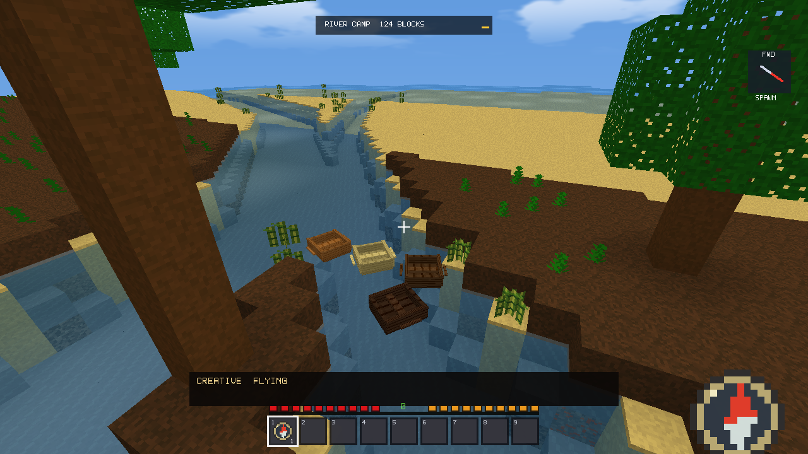
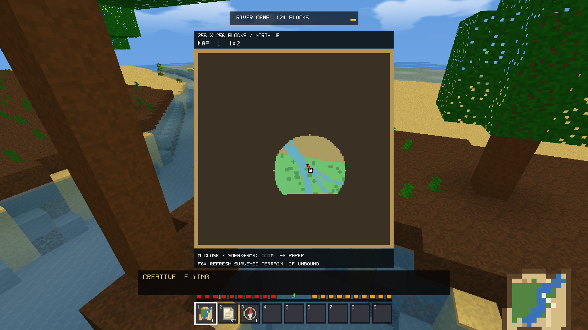
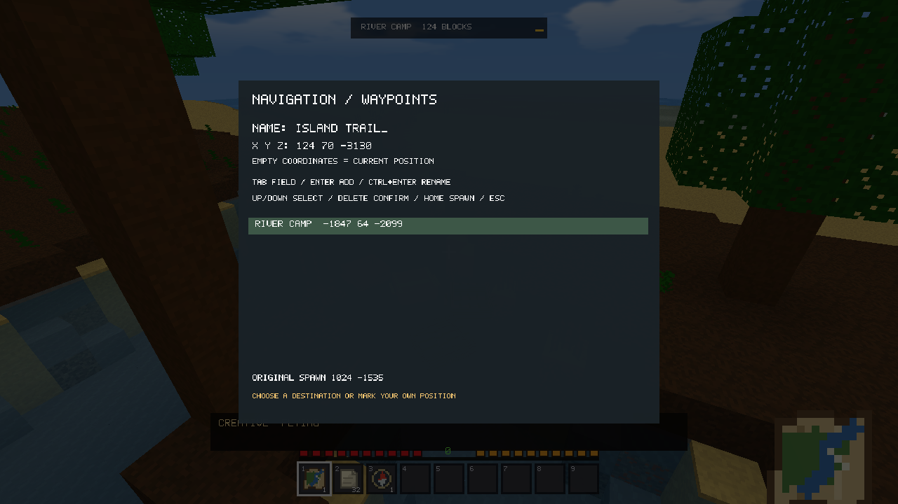
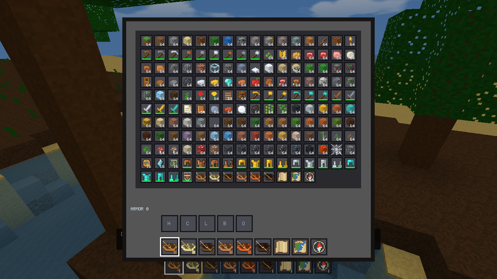

# v2.14.1: Transportation & Navigation Polish

Release validation, 2026-10-16. Publication approved by the user for v2.14.1. Generator V22 and generators 1–21 are unchanged. No item/block IDs, mobs, terrain or renderer architecture were added or replaced.

## Save reliability: findings and scope

The original v2.14.0 `SaveFile` implementation used a shared `.tmp` name, had no writer serialization and returned replacement failure without an error code. A standalone harness compiled from the **actual tagged v2.14.0 SaveFile sources** reproduced mixed data: writer A returned success, writer B failed, and the committed 256-byte record began with B data and ended with A data. This is a confirmed concurrent-writer defect. The harness is a development reproduction, not a claim that production inventory saves previously ran concurrently.

Rapid stress also reproduced intermittent native replacement failures without a deliberate lock: Access denied (5) during an experimental move-based replacement, and Unable to remove the file to be replaced (1175) with the established replacement primitive. Their cause and any lock owner are **still unresolved**. The move-based experiment was discarded. File attributes/handle-owner diagnostics are now available on these failures; a missing owner observation does not establish antivirus involvement or rule out a short-lived kernel/file-system lock.

### Implemented safeguards

- Serialization, flush and close are checked. Failures log the stage, path, error domain/code, thread, and available owner PIDs/process names. Optional Windows handle inspection falls back to unavailable if unsupported.
- In-process writers serialize. A zero-timeout named Windows mutex rejects a competing same-profile process without sleeping on the rendering thread.
- `ReplaceFileW` is retained; first creation uses a move only when the destination is missing. A replacement backup protects documented partial-failure states and is recovered before loading if needed. No retry deletes the destination. See [Microsoft's ReplaceFileW documentation](https://learn.microsoft.com/en-us/windows/win32/api/winbase/nf-winbase-replacefilew).
- `Game::saveAll` stages the world, navigation, inventory, player, mob and world metadata files. Global settings use their own atomic write and are excluded from world rollback; settings failures are reported separately. Existing files have snapshot backups (hard links where supported, copies otherwise). A journal precedes replacements. Failure rolls back the previous checkpoint; interruption recovery completes rollback before loading. An unrecoverable journal refuses loading/resetting rather than discarding the checkpoint.
- Commit failure returns false, is logged and shown to the player. Save-and-return refuses world teardown after failure. Three bounded retries use frame deadlines of 50/200/800 ms, without retry sleeps. Exit-save failure returns a failing process status.
- Existing `.vxw`, inventory V6/V4/V5 and `VXTRAV1` codecs remain unchanged. New journals/backups are coordination files, not new world formats. The standalone demo does not save world/navigation/checkpoint data.

Eight intermediate recovery stress runs completed 3,200 concurrent writes and 1,600 paired checkpoint commits. Two spontaneous concurrent-write replacement failures recovered through the test driver's bounded retries. The driver may sleep between attempts; **gameplay uses frame deadlines**. These results demonstrate tested recovery, not elimination of the underlying intermittent Windows failure.

## Boat physics and CPU work

Normal frames retain 120 Hz integration. Frame spikes integrate at most 32 steps over the existing maximum one-second catch-up interval; movement sweeps in at most 0.15-block axis segments independently of integration duration. Contacts advance up to the obstacle with a bounded binary search rather than abandoning an entire movement step. Axis sliding, acceleration, steering, drag and buoyancy are retained.

A reusable sorted spatial grid builds conservative motion envelopes before stepping, avoiding repeated SAT tests against distant saved boats. Quick axis rejection precedes hull trigonometry. Median water-surface samples reduce lifting from isolated high samples near flowing/shallow water. Rotated hulls, other boats, existing mob bounds and unloaded-column barriers remain part of collision handling. Mob AI and movement code are unchanged. A failing regression reproduced the old center-radius dismount check accepting overlap with a rotated neighbor. Exits now test the full player box against actual hulls and prefer the exposed water surface over submerged floors.

The engine's existing live-frame delta cap is unchanged. Long pauses beyond the one-second transport accumulator are not simulated as unlimited catch-up. Spike integration is deliberately not bit-identical to 120 microsteps; swept collision remains spatially bounded.

## Maps and navigation

- Large maps show high-contrast player/facing markers, dark label backplates, scale, coverage and north-up orientation. Marker geometry was reduced from an initial 174 vertices to 24 without extra draw calls.
- F6 requests refresh only with the large map open and the key unbound to existing controls. It preserves Ctrl/Sprint and existing map/secondary-action use.
- Refresh visits existing surveyed pixels only, skips unloaded columns and preserves cave surface-visibility rules for new exploration. A bounded vegetation-column check fixes forests (including snow-covered canopies) being mistaken for caves. Already surveyed loaded pixels can refresh from below without revealing new ones. Each call inspects at most 512 refresh slots and gathers at most 96/48 loaded samples. One immutable asynchronous color job remains outstanding at most.
- Unchanged colors do not increment revisions or upload textures. Quiet surveyed views skip repeated full scans; a bounded one-second recheck also handles new loaded terrain. Cached returns do not allocate a sample vector.
- Zoom uses eight Paper only after replacing the owned held stack successfully, reports the new identity/scale and debounces rapid clicks for 0.6 seconds. Existing held-button suppression remains.
- Waypoint coordinates must be finite, within X/Z limits and the current world's vertical bounds. Up from Spawn selects the last waypoint correctly. Deletion names the selected entry and requires another Delete within four seconds; selection changes cancel confirmation.
- Map/boat/waypoint limits remain 128/1,024/64. Prior zoom identities are retained. Map refresh updates observations; it does not reveal distant geography or generate chunks.

## Validation

All 13 final full/demo regression suites passed: transportation, commands, Survival/crafting/Recipe Book/equipment/physics, fluids and optimization; full weather, reset and Spectator cases. The full/demo menu suites additionally passed three-world switching/persistence checks. The final packaged standalone demo passed transportation, and rejected the new save-interruption fixture without creating files.

- Save tests: deliberate Windows delete locks; serializer rejection; 400 concurrent writes; 200 paired checkpoints per stress run; a real child process exiting between replacements; restart rollback; competing-process refusal; recovery of a replacement backup. Eight save-backend stress repetitions completed another 3,200 concurrent writes and 1,600 paired checkpoints with no exhausted retries. Earlier intermediate stress recovered two spontaneous native failures; their cause remains unresolved.
- Real Game paths: a locked inventory fails the save, schedules a retry and refuses menu teardown. Previous inventory/map identities remain paired. Release/retry commits the new pair. A separately locked global settings file is reported without rolling back a valid world checkpoint. Twelve real map/inventory checkpoint roundtrips retain valid identities.
- Boats: all six families; 15/30/60/120/240 FPS; 500 ms/one-second spikes; 32-step ceiling; shore/corner/rotated-hull collisions; two-block passages; source/flowing water; falls; entities; unloaded boundaries; negative coordinates; mount/exit/recovery; unmounted player contact. The rotated-neighbor dismount test failed before the fix and passed afterward.
- Limits: 1,024 saved boats, 128 fully surveyed maps, 64 waypoints save/reload; 36 crowded hulls simulate for 180 updates including a 500 ms spike without overlap.
- Maps: independent identities, inventory/chest/drop transfers, fog and zoom coverage, exact Paper use/debounce, offhand use, refresh without new reveal, unchanged-refresh revisions, canopy/snow-canopy ground traversal, underground privacy, refresh from below, shortcut conflicts and waypoint validation/deletion/rename. Compass direction settles correctly across eight turns, negative/far coordinates and teleportation.
- Both Release variants match **663** historical chunk hashes each: 567 generator 1–21 records plus 96 V22 records. No generator, block/item registry or billboard-mob source was changed.
- Actual v2.14.0 world/chest/inventory/drop/navigation files from the published executable loaded successfully in v2.14.1. The legacy navigation sidecar remained byte-identical through the command test. Inventory V5 migration remains covered.

Input fixtures inject frames into production handlers; they are not an OS mouse/keyboard automation claim. Native error 1176/1177 handling is defensive code based on documented states; those exact native failures were not forced. Process termination and the equivalent partial-backup recovery state were tested.

Evidence: [core suites](transportation-polish/regressions.log), [transport/save details](transportation-polish/transport.log), [before-fix dismount failure](transportation-polish/dismount-before.log), [legacy concurrency reproduction](transportation-polish/legacy-race.log), [initial unexpected save failure](transportation-polish/initial-unexpected-save-failure.log), [stress measurements](transportation-polish/stress.json), [historical hashes](transportation-polish/chunk-hashes.csv). Reproduce the historical race with `tools/reproduce_legacy_save_race.ps1`; current positive tests use `--transport-smoke` and `tools/run_transport_validation.ps1`.

## Performance

Same i7-14700F / Radeon RX 9060 XT / 32 GiB host; 1,280×720, uncapped, VSync/MSAA off, simulation distance 8, LOD/occlusion off in both versions, seed 123456789. Identical scene coordinates/camera paths. Gameplay includes Survival, rain, equipment and existing mobs; ocean cases include **six boats and a held map in both versions**. Every recorded case had 100% focus/visibility. No render-distance or product-quality reduction was used.

The initial matrix used two repeats with alternating order at RD8/16/32 in both scenes. A slower RD8 ocean startup case prompted a focused follow-up and reduction of marker geometry from 174 to 24 vertices. Final ocean cases below use one matched pair per distance after canopy refinement; gameplay cells average the two run-level summaries (including per-run quantiles), rather than pooled frame data. The final dismount-only correction is inactive in these scripted stationary/rotation/editing paths and has separate failing/passing functional evidence.

| Scene / RD | FPS old → new | Mean ms | p95 ms | p99 ms | RAM MiB |
|---|---:|---:|---:|---:|---:|
| gameplay / 8 | 3239 → 3118 | 0.309 → 0.321 | 0.590 → 0.593 | 1.922 → 1.971 | 300.7 → 290.1 |
| ocean / 8 | 4250 → 3960 | 0.235 → 0.253 | 0.293 → 0.325 | 1.268 → 1.406 | 287.0 → 286.5 |
| gameplay / 16 | 2117 → 2301 | 0.476 → 0.435 | 1.159 → 0.825 | 2.473 → 1.921 | 347.9 → 347.9 |
| ocean / 16 | 2125 → 2102 | 0.471 → 0.476 | 0.536 → 0.552 | 1.460 → 1.512 | 352.4 → 351.7 |
| gameplay / 32 | 969 → 935 | 1.032 → 1.074 | 1.496 → 1.894 | 2.822 → 2.949 | 562.9 → 561.0 |
| ocean / 32 | 764 → 759 | 1.309 → 1.317 | 1.409 → 1.428 | 1.494 → 1.545 | 570.6 → 570.4 |

**No general FPS or RAM improvement is established.** Final RD8 ocean mean frame time increased by 0.017 ms (~7% at uncapped thousands of FPS), and p99 by 0.138 ms. RD16/32 ocean differences were about +0.005/+0.008 ms. Gameplay results vary in direction. Earlier RD8 repeats varied more widely; raw results are retained rather than presented as a speedup. Audio/allocator/async-streaming state was not byte-identical between processes. The remaining small measured overhead is disclosed; no renderer or terrain simplification was used to conceal it.

Main-thread map batches averaged approximately 0.106–0.112 ms in the final ocean cases, with at most 96/48 samples. Quiet-cache returns are not counted as work batches; unchanged refresh avoids revision/upload churn. `Transportation::update` timing includes compass/map-job completion and mostly frames between 120 Hz steps, so its per-rendered-frame average is not a per-step cost.

The final functional run measured 1,024 saved boats/one active boat at approximately 0.036 ms for a 32-step spike, with zero other-boat collision candidates. Thirty-six crowded hulls averaged 0.047 ms per update, worst 0.721 ms including the 500 ms spike. The eight stress repetitions ranged roughly 0.031–0.052 ms for the one-active/1,024-save case. The limit test is not a 1,024-visible-boats GPU benchmark. Fully surveyed map pixels occupy 8 MiB; a maximum-size navigation save took 6.4 ms in the final core case and 10–19.5 ms during the separate stress repetitions. Save I/O can still exceed a frame budget at maximum data size.

### Focused RD32 streaming / teleport check

One matched pair: four seconds of 8× flight, six seconds recovery, plus stationary/teleport phases. Queues recovered in 0.185 → 0.216 seconds; recovery RAM was 544.9 → 546.3 MiB. Teleport worst frame was **37.2 → 63.5 ms**, with **57.8 ms** recorded in current retirement work. That stage includes CPU range management and OpenGL resource operations; the exact internal stall was not isolated. It is unchanged by this patch and is **not fixed**. A single pair establishes neither a causal regression nor a speedup; it confirms that long stalls remain.

Raw results: [initial two-repeat matrix](transportation-polish/performance.csv), [RD8 follow-up](transportation-polish/initial-rd8-followup.csv), [marker iteration](transportation-polish/final-ocean-performance.csv), [release ocean cases](transportation-polish/release-ocean-performance.csv), [streaming](transportation-polish/streaming.csv). Use `tools/run_transport_polish_benchmarks.ps1` with the published v2.14.0 executable as baseline. No RD64 tuning was performed.

## Actual in-engine captures

These are actual native engine captures on a naturally generated V22 river, inspected after rendering. No image generation or terrain painting was used; BMP captures were converted losslessly to PNG. The final dismount correction is inactive in these unoccupied-boat preview views.

## Remaining limitations

- The intermittent native replacement failure's cause is unresolved. No owner was identified for the spontaneous failures. Tested bounded recovery is a mitigation, not a guarantee against sustained locks, disk failure or permission denial. A persistently failed world commit retains its previous checkpoint. Independent global settings failures are reported separately.
- Journal tests cover process interruption, not a physical power-cut/storage-controller durability certification. Moving a world with an unfinished journal may require recovery in its original location because journal paths are validated.
- Checkpoint serialization/file I/O remains synchronous, as in the existing engine; retry sleeps were removed from the design rather than moving live game state across worker threads. Snapshot hard links avoid copying large unchanged saves on normal NTFS paths; copy fallback is more expensive.
- The existing retirement stage (CPU free-range work plus OpenGL resource retirement) can exceed streaming's soft time budget during teleportation. Its exact internal stall source was not isolated. No renderer rewrite or quality/render-distance reduction is included.
- No physical low-end/integrated-GPU machine or multi-hour crowded-ocean session was available. High-end measurements are not low-end FPS predictions.

## Release builds

- Full installer: `dist/VoxelFrontier-v2.14.1-Windows-Setup.exe`.
- Full embedded executable: `build/installed-release/Release/VoxelFrontier.exe`.
- Standalone demo: `dist/VoxelFrontier-v2.14.1-Windows-Standalone.exe`.
- Checksums: `dist/SHA256SUMS.txt` ([copy](transportation-polish/SHA256SUMS.txt)).

Both Release variants and the installer compiled. Full executable and exact packaged demo were exercised with isolated profiles. The installer payload is that tested full executable; installation/upgrade over the user's existing game was not performed. Packaged checksums match and demo profiles contain no persistent world, inventory, player, mob, navigation or checkpoint files. [Machine-readable validation](transportation-polish/validation.json).

Publication approved by the user for v2.14.1.

