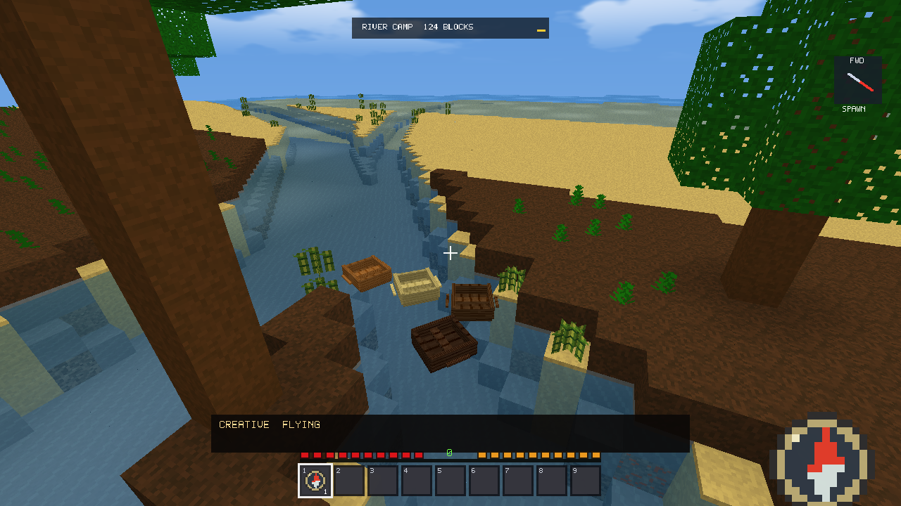
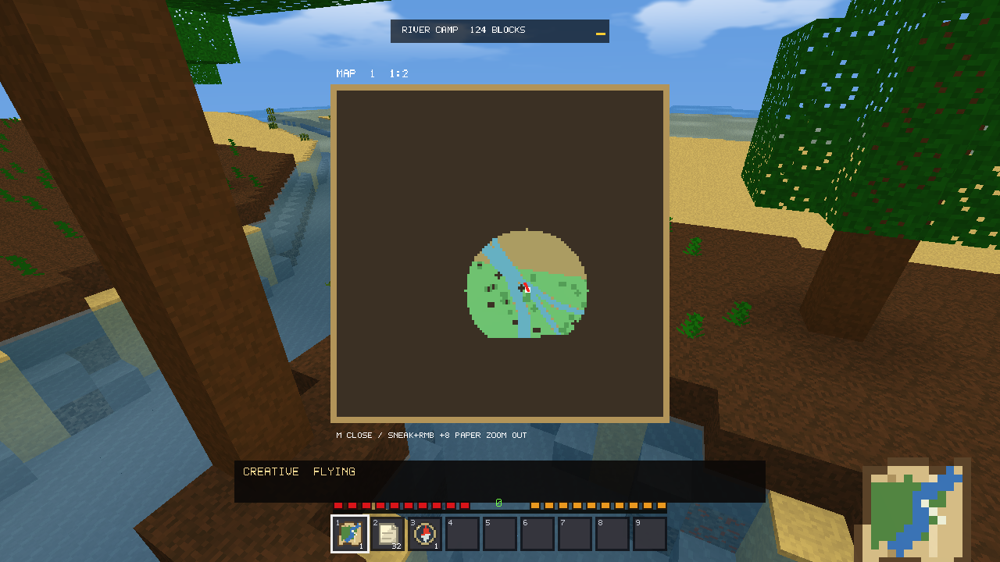
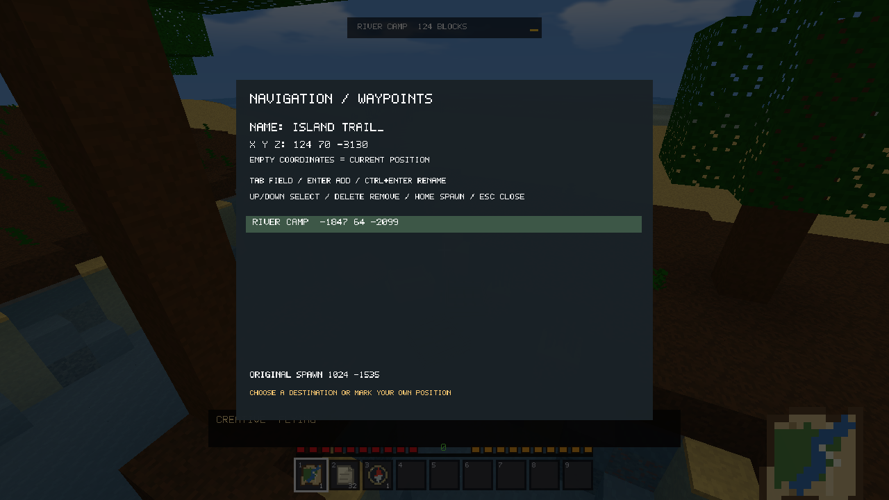
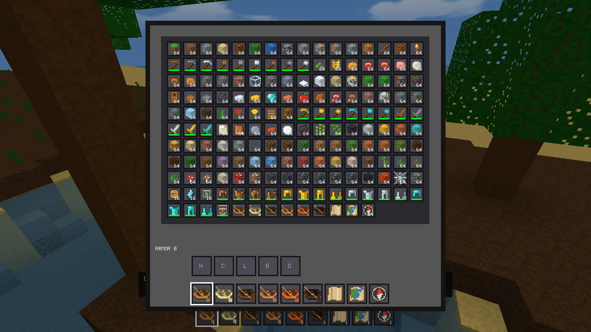

# v2.14.0: Transportation & Navigation validation

Local review build, 2026-10-15. Generator V22 remains the default. Nothing has been committed, pushed, tagged or published.

## Implemented

- Six craftable boats: Oak, Birch, Spruce, Jungle, Acacia and Dark Oak. Five matching planks make a boat. Original 16px wood textures, eight-part voxel models and original 16x16 item icons were added without changing historical atlas cells.
- Boat physics uses 120 Hz steps, acceleration/reverse, angular acceleration, momentum, drag and damped buoyancy at actual source/flowing-water heights. Oriented hull checks cover terrain, other boats and existing mob bounds. Rotations are validated before applying them. Unloaded columns are barriers. Only nearby loaded boats simulate within 96 blocks.
- Mounting attaches the player's seat while health, hunger, burning, equipment and combat continue. Dismounts check the complete player body against nearby supported ground/water. Teleports, death and Spectator changes detach the rider. Unmounted players collide with and can land on hulls. Click targeting respects nearer mobs/blocks. Mob AI, sprites, attacks, pathfinding and spawning algorithms are unchanged.
- Empty/Filled Maps have 32-bit identities, 128x128 samples and five scales covering 128, 256, 512, 1,024 or 2,048 blocks. Initial coverage is hidden. Surveys gather at most 96 loaded columns per 100 ms at the closest scale, or 48 at larger scales. One outstanding asynchronous color job receives immutable snapshots, without accessing World or OpenGL. Only changed texture rectangles upload. Deep underground positions skip surface columns more than four blocks overhead.
- Map identities survive inventory, offhand, cursor, chest, death/drop and reload paths. Tooltips identify maps; the view shows identity, scale, player position and facing. Zooming spends eight Paper, retains surveyed coverage and creates an independent map identity without revealing new territory.
- Compass uses four Iron Ingots around a Copper Ingot; Empty Map uses eight Paper around a Compass. The smooth compass needle always targets original spawn relative to the actual view. Selected waypoints have a separate direction/distance HUD. Up to 64 named waypoints are stored per world, with negative/distant coordinates and printable ASCII names up to 24 characters.

Optional stairs, fences, gates and trapdoors are **deferred**, following the transportation/navigation priority allowance. The byte-sized block registry and complete orientation/collision variants warrant a separate focused building-block pass; this update adds no block IDs or terrain-generation version.

## Controls

| Action | Control |
|---|---|
| Place / mount | Hold boat and aim at open water: RMB; RMB hull to mount |
| Drive / turn | Existing Forward/Backward and Left/Right bindings |
| Dismount | Existing Sneak binding; requires a real safe exit |
| Recover | Attack an unoccupied boat |
| Initialize map | RMB Empty Map |
| Large map | M or RMB Filled Map |
| Zoom out | Sneak + RMB, eight Paper, maximum 1:16 |
| Waypoints | N or RMB Compass |
| Edit | Tab field, Enter add, Ctrl+Enter rename, Ctrl+A clear field |
| Select / remove / spawn | Up/Down, Delete, Home |
| Close navigation | Escape |

M/N shortcuts yield to existing custom bindings using those keys. Map viewing preserves movement/combat input. The waypoint editor captures movement/text while the world continues simulating, like inventory use.

## Persistence and bounds

`voxel_travel.vtn` is an atomic per-world versioned sidecar containing boats, original spawn, occupied seat, maps and waypoints. World/profile migration includes it; reset removes it. Missing legacy navigation initializes empty collections and reconstructs the versioned canonical spawn, which is then persisted.

Inventory V6 adds map identities and accepts V4/V5. World container extension `VXENTS2` adds identities and accepts `VXENTS1`; terrain headers remain unchanged. Dropped stacks append `DRP1` after the unchanged mob identity sections. Gear durability, chest modifications, loot and mob records remain intact. Older executables are not expected to understand new stack extensions.

Per-world limits: 1,024 boats, 128 maps and 64 waypoints. Map colors are bounded to approximately 8 MiB; sparse disk encoding switches to a raw plane before exceeding 64 KiB/map. One active map texture uses 64 KiB; six boat texture tiles use 6 KiB. Navigation reuses bounded vertex/text caches. Demo navigation saves are disabled and no boat/map/waypoint sidecar is created.

## Validation

Reproduce with `tools/run_transport_validation.ps1`, `--transport-smoke`, `--transport-preview` and existing fixtures. Input tests inject frames into production handlers; this is not an OS keyboard/mouse automation claim.

- Full/demo transport: all woods; 15/30/60/240 FPS and a 500 ms physics spike; falling into water; source/flowing water; steering/reverse; shores, rotated corners, two-block channels; boat/mob bounds; unloaded placement rejection; dismounting, teleport detachment, single recovery drops; unmounted walking/landing contacts.
- Production handlers: RMB placement consumes one owned item; RMB mounts while respecting nearer mobs; bound movement/Sneak drive and dismount; LMB recovers once. Map creation, held-button suppression, offhand use and eight-Paper zoom are tested. Waypoint names containing N, coordinates, rename without duplication and Escape are tested.
- Independent map identities, hidden pixels, loaded-only survey, zoom coverage, slot/chest/drop transfers, inventory V5 migration, world/navigation/drop reload, negative coordinates and demo persistence guards.
- All 13 final full/demo suites passed: transport, commands, Survival/crafting/Recipe Book/equipment/physics, fluids; full weather/reset/Spectator; full/demo optimization.
- Optimization proof: eight raw/packed/indexed pixel scenes; 480 exact full-scene comparisons including MSAA/viewport changes; eight concurrent meshes; stale revision/epoch cancellation; teleports/negative coordinates/bounded queues; GPU page lifetime, LOD and occlusion.
- 663 baseline terrain hashes matched: 567 records for generators 1-21 and 96 V22 records across three seeds. A separate underground audit passed 1,776 historical records, 182 connected layouts (67 mineshafts, 93 dungeons, 22 ruins), deterministic loot and modified chest/finite encounter persistence.
- The combat ray fixture also failed in untouched v2.13.2 because a natural spawn can face terrain. Its test lane was explicitly cleared; production mob behavior was not changed to pass it.

The first preview river was frozen and correctly refused boats. Final naturally open V22 river captures were rendered and inspected; no terrain was painted for the images.

## Performance

i7-14700F / Radeon RX 9060 XT / 32 GiB, 1,280x720, uncapped, VSync/MSAA off, simulation distance 8, LOD/occlusion off equally in both versions. Seed 123456789, identical V22 scenes/camera paths. Gameplay includes Survival, equipment, existing hostiles, sound and rain. All recorded common/active frames were focused and visible. Product quality/render distance was not reduced.

### Common gameplay: v2.13.2 to v2.14.0

One final matched run at each distance, after unmounted hull contacts. Stationary phase shown; raw CSV also includes rotation/editing. Earlier two-repeat results illustrate variability and are not pooled. A subsequent click-priority guard is inactive during these scripted paths.

| RD | FPS old -> new | Mean ms | p95 ms | p99 ms | RAM MiB |
|---|---:|---:|---:|---:|---:|
| 8 | 3589 -> 3576 | 0.279 -> 0.280 | 0.451 -> 0.467 | 1.463 -> 1.459 | 292.2 -> 287.3 |
| 16 | 2681 -> 2732 | 0.373 -> 0.366 | 0.584 -> 0.559 | 1.250 -> 1.252 | 347.4 -> 347.4 |
| 32 | 1071 -> 1082 | 0.934 -> 0.925 | 1.045 -> 1.033 | 1.221 -> 1.186 | 565.8 -> 565.9 |

These small uncapped differences do not establish a speedup. Earlier RD8 runs ranged from 3,491-4,862 FPS in baseline and 2,801-4,766 FPS in the corresponding current build. Final stationary terrain vertices/live buffer bytes were identical at every distance. An unnecessary per-cuboid wood-uniform update found in the first comparison was removed for ordinary entities; navigation drawing reuses buffers/text geometry.

### Active ocean load

Baseline is the ocean without new objects; current adds a held scale-0 map and the boats accepted by real placement checks. This measures added workload, not an equal-scene renderer optimization. Current was repeated after final hull/player integration; one run per distance.

| RD | Boats | FPS old -> new | Mean ms old -> new | p99 ms old -> new | Current RAM MiB | Map main batch average / max ms |
|---|---:|---:|---:|---:|---:|---:|
| 8 | 6 | 4905 -> 3671 | 0.204 -> 0.272 | 0.981 -> 1.239 | 286.6 | 0.113 / 0.311 |
| 16 | 6 | 2344 -> 2181 | 0.427 -> 0.459 | 1.133 -> 1.250 | 352.2 | 0.097 / 0.171 |
| 32 | 5 | 785 -> 776 | 1.275 -> 1.288 | 1.427 -> 1.498 | 569.8 | 0.097 / 0.119 |

Added mean frame time was approximately 0.014-0.069 ms in these views. Main-thread map gathering/scheduling averaged 0.097-0.113 ms per batch at roughly 10 Hz; the color worker runs separately. These are not integrated-GPU predictions. Only changed texture rectangles upload.

### RD32 streaming stress

One matched 8x Spectator flight/recovery/teleport run per version. Flight mean was 1.704 -> 1.694 ms, p99 5.805 -> 5.609 ms; generation 262.3 -> 262.8 chunks/s and meshing 464.3 -> 472.6 chunks/s. Queues reached zero in 0.254 -> 0.258 seconds after flight; RAM after recovery 548.4 -> 549.7 MiB. This is effectively equivalent, not established throughput improvement. Worst teleport stalls remained approximately 48 ms in both versions. RD64 was not retuned.

Raw evidence: [common](transportation/performance.csv), [active/map timing](transportation/active-performance.csv), [earlier repetitions](transportation/earlier-repeats.csv), [streaming](transportation/streaming.csv). Reproduce with the existing render driver, `tools/run_transport_benchmarks.ps1` and the native streaming fixture.

## Remaining limits

- Optional building blocks are deferred. Boats have one player seat; animal passengers are not implemented.
- Existing mob navigation remains unchanged. The new bounds checks prevent boat-driven penetration without adding mob steering around vehicles.
- Map pixels are persistent surveyed observations, rather than a continuously refreshed edit/weather overlay. Deep underground positions do not survey far-above surface columns. Large scales sample coverage rather than generating remote full-resolution terrain.
- The 128-map quota includes prior zoom identities. Waypoint editing uses keyboard controls and the existing ASCII font.
- No physical integrated/dual-core machine or multi-hour ocean session was available. Uncapped discrete-GPU FPS is not a low-end hardware prediction.
- Existing per-file atomic saves are retained; this is not a multi-file transaction system. One rapid inventory replacement stress run did not commit its Book checkpoint; the previous Paper inventory and complete Book temporary file remained intact. A fresh isolated rerun passed all 13 suites. The external lock/IO owner was not established; no main-thread retry sleeps were added. See the observed evidence below.

## Local Release files

- Full installer: `dist/VoxelFrontier-v2.14.0-Windows-Setup.exe`
- Full embedded executable: `build/installed-release/Release/VoxelFrontier.exe`
- Standalone demo: `dist/VoxelFrontier-v2.14.0-Windows-Standalone.exe`
- Checksums: `dist/SHA256SUMS.txt`

The installer was built locally and not installed over the existing game. Both executable variants were exercised with isolated data directories. Publication was approved by the user for v2.14.0.
