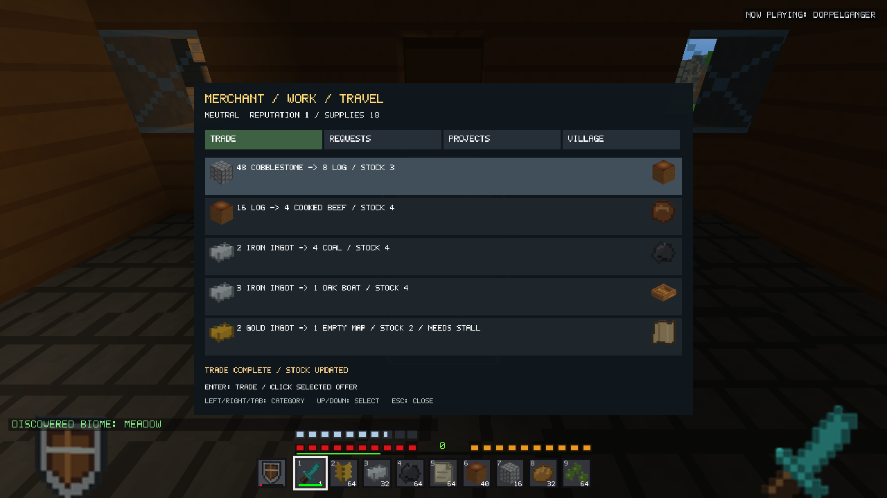
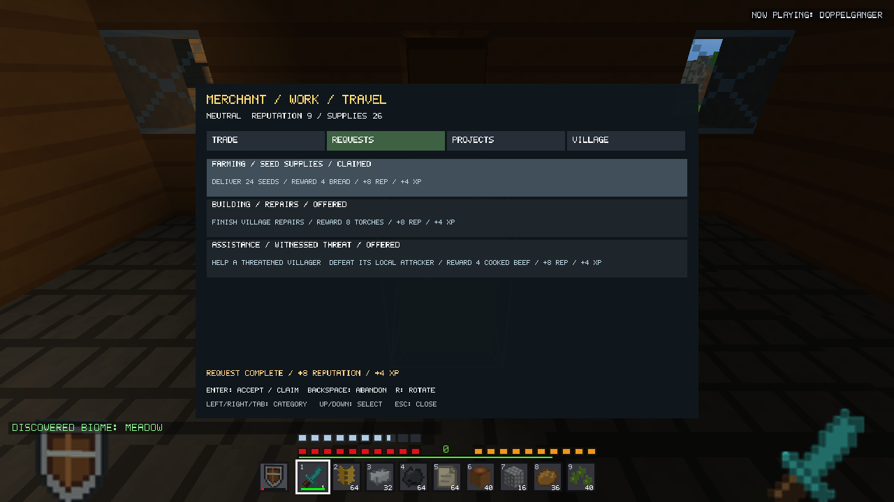
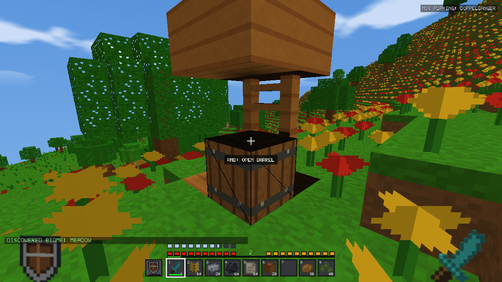
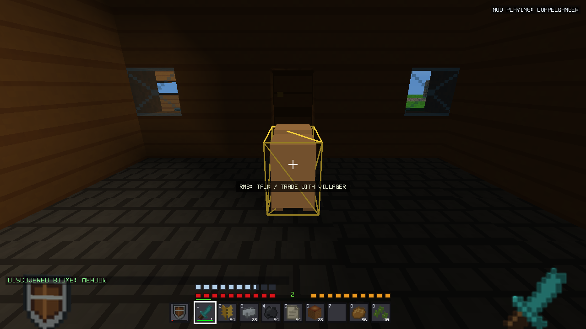

# v2.20.0 Villages & Living World — local validation

## Baseline and scope

Based on released v2.19.0, `656763c9974b670374e7044cd65d57a9c04d91cd`.
The initial tracked tree was clean. Existing `.idea/`, remote attachments and
Python caches were left alone. Original executables, a tracked-source archive,
preview manifest, fixture fingerprints and status are frozen under
`build/v2200-validation/baseline/`. No reset, stash, commit, push, tag,
publication, installation or real-world access was performed.

This candidate extends existing villages and the original Villager entity. It
does not introduce a generator, item, texture, character renderer, currency,
village regeneration pass or independently written save sidecar.

## Architecture and source changes

| Area | Implementation |
|---|---|
| Village state, barter, requests, projects | `include/Villages.h`, `src/Villages.cpp` |
| Loaded-plan association and bounded NPC movement | `src/VillageBehavior.cpp`, villager-only branches in `src/Survival.cpp` |
| Input and scaled dialog | `src/GameVillages.cpp`, `include/VillageUi.h`, `Renderer::renderVillage` |
| Snapshot and validation | `src/SaveSnapshot.cpp`, optional extensions in `World.cpp`/`Survival.cpp`, Game checkpoint cross-link validation |
| Immutable village lookup | `StructureGenerator::peekMajorPlan`; existing planning/template algorithms unchanged |
| Tests | `tests/stability/village.cpp`, `village_native.inc`, shared `tests/village_benchmark.inc` |
| Reproduction | `tools/validate_villages_v2200.py`, `run_village_validation.py`, `verify_village_packages.py` |

Village IDs hash seed, saved generator, canonical major-plan region and well
position. Only already cached immutable plains/desert plans are queried (nine
neighboring regions); association never generates distant terrain. Profession
variation uses the original home position and world identity, independent of
entity-vector order. The nearest matching workplace and entrance are chosen in
canonical template order. Farmers target actual crop-row cells.

NPC IDs are monotonic per world, saved explicitly, never vector offsets. IDs
survive movement/reordering; dead records remain tombstones. Natural spawn
markers and deduplication remain in force. Older villagers defer association until their terrain is loaded, then acquire a record
without changing their saved entity type. Independent summoned villagers have
finite trading access, without village requests/projects or automatic restock.
Bounds: 512 villages, 8,192 NPC records, 64 lifetime associations per village;
excess associations remain independent until the global record limit, where
interaction reports the limit and retains the NPC.

## Trading and stock

Four base offers per profession; the community stall unlocks the fifth. Initial
stock is 4/4/4/4/2 purchases, capped at six each. One replenishment adds one
purchase to each offer after 300 **active village seconds**, consumes four supply
units, and schedules the next interval from the current time. No catch-up loop.
Trades add two supplies, requests eight, projects sixteen; supplies cap at 256.
Absent supply, exhausted stock remains exhausted. Village clocks stop when the
center is unloaded or outside simulation range.

| Profession | Input → output, base price | Stall offer |
|---|---|---|
| Farmer | 20 wheat → 4 bread; 16 carrots → 8 potatoes (stable variant: 6 beetroot); 8 eggs → 4 seeds; 2 iron → 5 cooked beef | 1 gold → 4 pumpkin seeds |
| Blacksmith | 6 iron → iron pickaxe; 16 coal → 2 iron; 4 iron → iron shovel; 12 copper → 2 iron | 6 gold → diamond |
| Librarian | 24 paper → 2 books; 4 books → empty map; 3 gold → Surveyor Token; 32 paper → 8 torches | 4 gold → Cavern Shard |
| Merchant | 48 cobblestone → 8 logs; 16 logs → 4 cooked beef; 2 iron → 4 coal; 3 iron → oak boat | 2 gold → empty map |

Prices of eight or more rise by two for Untrusted reputation, fall by one from
Friendly, or two from Honored. Smaller prices remain fixed. The offer graph has
no reversible barter/crafting cycle returning more of its starting resource.
This is limited abstract village supply, not simulation of original treasure
chests, NPC furnaces or unlimited offline production.

Every exchange validates against an inventory copy: plain compatible resources
from unlocked player slots only, then output capacity, then inventory/stock/supply
and reputation commit. Equipment, offhand, crafting grid, cursor, hotbar locks,
durability and item identities retain ownership. Output tools receive their
proper full durability; traded maps are empty maps, never fabricated explored
map identities. Failed trades and repeated clicks cannot consume inputs or stock.

## Routines and navigation

World time drives work/travel before tick-time 480, evening meetings until 700,
then home/rest until morning. Weather shelter and nearby live threats take
priority. Interaction pauses ordinary travel; danger can still interrupt it.
Gathering villagers briefly face nearby peers using existing geometry/animation.
Stuck recovery retains heading during a real step jump; an integrated movement
regression covers the full update, beyond the collision helper. No NPC crop harvesting or autonomous resource production occurs.

Navigation uses loaded terrain, canonical home entrances, local A* with stable
tie ordering, at most two searches per simulation tick, 256 expanded nodes and
1,024 discovered positions per search, with a 24-block local radius. Think phases
are staggered by stable ID; blocked motion backs off. Diagnostics include expanded
nodes and searches. Short clearance probes plus a longer step probe allow narrow
doorways and one-block changes. Villager-only swept collision uses a 0.60-wide,
1.60-high body, bounded physics substeps and supported step jumps. Original
billboard collision helpers and navigation bodies remain unchanged.

Both halves of nearby ordinary wooden doors open through the existing atomic
batch path. Closed gates/walls/fences remain obstacles; open gates retain their
normal collision rules. NPCs never teleport, walk through walls or load terrain
to finish a route. Player-modified or steep older layouts can still be
unreachable within the local search; this is a documented limitation rather than
a reason to rebuild historical villages.

Initial intent-only route assertions passed while movement traces exposed door
leaf clearance, lost step motion and greedy wall-following problems. The final
tests retain physical position traces and swept-collision probes, rather than
treating a `WORK`/`REST` label as proof of arrival. Clear-weather day/night travel
is tested separately from rain/shelter behavior, since shelter correctly takes
priority over the work schedule.

## Reputation, requests and development

Reputation is per village, -100…100: Untrusted <0, Neutral <20, Friendly <45,
Trusted <75, Honored thereafter. Trade contributes at most ten reputation over
the village's lifetime. Requests give eight reputation/four XP once; projects
give twelve/six XP once. Attributable attacks lose five with a short cooldown;
killing a villager loses twenty more. Damage to designated completed public
works loses three with a cooldown. Ordinary mining outside those small project
footprints has no property penalty. There are no timed requests or failure fines.

Three requests persist per settlement, deterministically selected from village
ID, row and rotation counter:

- Delivery: 12 bread → 2 iron.
- Farming: provide 24 seeds → 4 bread. This verifies actual supplies, not unrelated
  mining or repeated crop-placement events.
- Building: finish the explicitly funded road repairs → 8 torches. This request
  is never offered again once the project is complete.
- Assistance: accept first, then help during witnessed nearby village danger by
  defeating a local hostile → 4 cooked beef. No enemies are spawned by requests.

Each also gives the stated reputation/XP. Full reward inventories leave objective
items, progress and reward flags untouched. Explicit rotation requires every
current request claimed/abandoned plus 600 active seconds, capped at 10,000 sets.
The journal's Challenges footer reports completed village requests/projects;
individual objectives remain in the village dialog.

| Project | Funding | Verified result |
|---|---|---|
| Village Repairs | 16 cobblestone + 4 logs | Four designated canonical public road cells become stone bricks; explicitly missing road cells can be restored |
| Community Stall | 8 logs + 4 iron | 2×2 plank floor/roof, fence supports and one **empty** barrel; unlocks fifth offers |

Funding is persisted escrow and can be partial. Refund restores all unspent
materials atomically if they fit. Construction requires a separate configured
Sneak+Enter confirmation. A bounded site search excludes canonical buildings,
edited ground, occupied space and nonempty block entities. All loaded expected
cells and player/mob occupancy are prevalidated, then the existing atomic world
batch commits the complete improvement. Failure retains funding and gives a
reason. Original treasure containers are never regenerated or moved.

Completion is historical: deliberately demolishing a finished project does not
rebuild it or offer another reward. The unlocked trade benefit remains recorded.
Repair property attribution covers the stored repair anchor; stall attribution
covers its 2×2×4 footprint. General village-property policing is intentionally
absent where ownership cannot be established reliably.

## Persistence and compatibility

Optional `VLG1` follows existing world extensions, with bounded village/NPC records
(116/57 serialized bytes respectively). Optional `VIN1` associates saved mob
records with NPC IDs; other entity records use zero. No world-header version or
existing extension was replaced. Missing extensions initialize empty/default;
duplicate IDs, invalid references/enums/quantities, oversized counts and every
truncated-prefix case are rejected before committing parsed state.

The immutable world snapshot copies village state; the mob snapshot copies NPC
IDs. Game capture/load cross-checks associations and death tombstones. Inventory,
stock, requests, project flags/edits, AUT1, BDP1, ERL1, ENC1, player and navigation
components remain in the same verified coordinated checkpoint. Background
encoders hold no mutable village/entity pointers. Live trade during old-snapshot
encoding followed by coalescing/reload is tested.

The source/resource verifier compares against the released baseline: original
generation and loot sources, original billboard rendering/collision helpers,
registry/art and all 365 preview entries/images. Preview manifest changes are
source fingerprints only. The new frozen V24 fixture archive contains original
v2.19.0 bytes and manifests for 738 chunks, including three 9×9 village districts;
its exporter changes test instrumentation only, not production generation.

## Verification results

| Check | Result |
|---|---|
| New focused full/demo | 1,800 / 1,794 passing assertions |
| Native 30/60/15 simulation cadences | 36,397 / 72,637 / 18,277 passing assertions |
| Preserved functional suites | 14 passed, plus the village suite |
| Generation suites | 9 full/demo suites passed |
| Packaged Release smoke suites | 20 passed |
| Historical V1–V22 records | 1,326 matched (663 per variant) |
| Frozen V23 bytes | 495 fixtures per variant matched |
| Frozen V24 bytes, states, loot and markers | 738 fixtures per variant matched original v2.19.0 |
| Embedded assets | 135 per executable, byte-verified |
| Original previews/art/source protection | 365 mappings/images, 1,002 files and recorded source regions retained |

The complete matrix ran before the final loaded-terrain association guard.
That narrow fix then passed the final full/demo village suites, all three native
cadences, game/checkpoint/async streaming checks, full/demo Survival smoke tests,
and fresh final-core V23/V24 exact fixtures and historical hashes. It reproduced
as a failed probe before correction; see [follow-up](villages-v2200/followup-results.json)
and [final compatibility](villages-v2200/final-compatibility.json).

A final dialog-only copy edit then exposed the assistance food reward and shared
+8 reputation/+4 XP before acceptance. Packages, a complete native route and all
48 UI targets were refreshed and rechecked afterward. No simulation, trading,
checkpoint or generation behavior changed in that copy edit.

Counts include per-frame survival/collision assertions, not that many independent
test scenarios. [Result summary](villages-v2200/results.json),
[functional suites](villages-v2200/functional-results.json),
[Release suites](villages-v2200/release-results.json),
[generation suites](villages-v2200/generation-results.json).

Focused coverage includes all professions, input/output conservation, protected
owners, full inventories, stock boundaries, no-catch-up replenishment, all four
request categories, exactly-once rewards, partial funding/refunds, loaded-site
validation, death tombstones, UID reorder/erase, independent villages, immutable
snapshots, malformed/duplicate/oversized/truncated records, scaled hitboxes and
door/slab/step/fence collision. The integrated movement test retains heading
during a step jump. Preserved suites cover checkpoint interruption/recovery,
asynchronous coalescing, automation, farming, UI, legacy worlds and ownership.

## Native gameplay and visual inspection

The native driver uses a genuine generated V24 village, seed 20260917, canonical
region (5,-1), center (1824,116,-198). No demonstration buildings substitute for
generated terrain. Setup preloads the district and gives an established Survival
kit; test viewpoint teleports and automated ordinary combat input are disclosed.
The route opens trade with actual ray-targeted RMB input, checks Sneak bypass and
shield priority, trades, accepts/claims a seed request, funds/confirms both
projects, verifies Friendly pricing, simulates a complete 1,200-second day,
captures a coherent asynchronous checkpoint, reloads, trades again, and rejects
a second reward claim. It never grants quest rewards by editing completion flags.

30/60/15 FPS tests refer to **fixed simulation input cadences**, with accelerated
day simulation and sampled native rendering; they are not claims of a 20-minute
real-time human play session. Timed frame/GPU measurements are separate below.
The final day/night fixture requests clear weather; explicit rain workloads test
shelter. Every route exports NPC positions and distances, not only intentions.

[All 48 scaled UI targets](villages-v2200/ui-contact.png),
[project/reputation screen](villages-v2200/04-projects-reputation.png),
[evening view](villages-v2200/07-daily-gathering.png),
[night view](villages-v2200/08-night-return.png).

Observed clear-weather route distances (block units, full 3D distance; the
normal work/home stop region is about one block):

| NPC | Closest work position during work period | Closest home position during rest | Distinct recorded positions |
|---|---:|---:|---:|
| 1 | 0.941 | 1.146 | 77 |
| 2 | 0.898 | 1.212 | 107 |
| 3 | 0.950 | 0.815 | 144 |

UI checks cover all four tabs, three exact pixel resolutions (1280×720,
1920×1080, 2560×1440), and Auto/Small/Normal/Large. Larger targets use native
offscreen GL framebuffers on the available display, explicitly distinguished
from a physical 1440p monitor test. Scaled hitboxes and independent summoned
villager tabs are also exercised. Screenshots are unretouched native captures;
PNG conversion/contact-sheet layout only.

## Performance

Matched instrumented v2.19.0/current production-object drivers, seed 20260917,
V24 district (5,-1), same 1280×720 camera, RD, simulation distance 8, LOD and
occlusion settings. Two repeats alternate old/new order. Six-second warmup,
then 12 seconds at an explicit 60 FPS cap: daytime, night, rain/shelter and busy
UI phases. Controlled cohorts start at natural road cells; ambient spawning and
NPC audio are excluded in both variants. This isolates 10/30-NPC load; the native
Survival route separately retains ordinary spawning, combat and audio.

No compiler, second benchmark or regression process ran concurrently. GPU queries
end before presentation and are read only after availability. CPU work excludes
the explicit limiter but includes normal presentation calls; it is not pure GPU
time. Wall-frame percentiles include the intentional cap. Resident/triangle
ranges are recorded because streaming and moving NPC scenes are not byte-identical
render workloads. No graphical setting was lowered to obtain a result.

Daytime phase, pooled across the two repeats; CPU work and GPU times in ms:

| Version | NPC / RD | Mean work | p95 work | p99 work | Mean NPC AI / last tick | Mean GPU | Peak RAM MiB |
|---|---|---:|---:|---:|---:|---:|---:|
| v2.19.0 | 10 / 8 | 1.249 | 1.633 | 6.591 | 0.003 | 0.444 | 337.4 |
| v2.20.0 | 10 / 8 | 1.429 | 2.091 | 6.573 | 0.006 | 0.472 | 334.8 |
| v2.19.0 | 30 / 8 | 1.286 | 1.764 | 3.878 | 0.011 | 0.446 | 334.8 |
| v2.20.0 | 30 / 8 | 1.504 | 1.890 | 7.759 | 0.022 | 0.497 | 333.3 |
| v2.19.0 | 30 / 16 | 3.915 | 4.851 | 6.019 | 0.008 | 2.959 | 407.0 |
| v2.20.0 | 30 / 16 | 4.022 | 4.905 | 6.668 | 0.026 | 2.992 | 403.7 |
| v2.19.0 | 30 / 32 | 9.035 | 11.768 | 26.741 | 0.008 | 3.134 | 657.1 |
| v2.20.0 | 30 / 32 | 9.140 | 12.822 | 25.468 | 0.026 | 3.142 | 652.5 |

Individual repeats and wall-frame percentiles are retained in
[results.json](villages-v2200/results.json) and the copied per-run CSVs. The busy
phase compares the new trading dialog to the old inventory, so it is a UI load
check, not an identical-interface speedup claim.

| New 30-NPC phase at RD8 | Mean CPU work ms | p99 CPU work ms | Mean NPC AI / last tick ms |
|---|---:|---:|---:|
| Night return | 1.470 | 8.975 | 0.024 |
| Rain / shelter | 1.442 | 2.174 | 0.026 |
| Trading UI | 1.912 | 4.335 | 0.057 |

| 30-NPC checkpoint, RD8 | Capture median ms | Complete median ms | Snapshot bytes range |
|---|---:|---:|---|
| old | 1.107 | 17.682 | 37,188–37,188 |
| new | 1.547 | 15.484 | 45,716–45,716 |

| CPU-affinity proxy, new 30 NPC / RD8 | Mean work ms | p95 ms | p99 ms | Peak RAM MiB |
|---|---:|---:|---:|---:|
| 2 logical CPUs | 1.437 | 1.987 | 2.712 | 317.8 |
| 4 logical CPUs | 1.339 | 1.919 | 2.269 | 315.7 |

These are short matched observations on the recorded Windows i7-14700F / Radeon
RX 9060 XT machine, not universal FPS guarantees. Affinity proxies apply before
worker initialization; they are not physical low-end/iGPU certification. The final request reward wording was added after these timing runs; it affects
only the Requests tab, which is not the timed Trade UI. Final native UI/gameplay
and embedded assets were rechecked. No
claim of a new engine optimization or improved autosave architecture is made.
Villager navigation remained within two searches / 512 expanded nodes per tick.
Village snapshot overhead is bounded; no world-generation/quality tradeoff is
used. Naturally populated simultaneous multi-village performance and multi-hour
resource accumulation remain untested.

## Remaining limits and untested areas

- Bounded navigation is best effort in steep, obstructed or player-modified
  historical villages. No automatic terrain repair, teleportation or guarantee
  that every villager reaches every workplace is made. The exported traces show
  actual distances rather than only schedule labels. Simple collision fixtures and one
  generated Survival route do not certify every village seed/layout.
- Farmer activities are work travel/trade/seed provisioning, not autonomous crop
  harvesting. Blacksmith tool repair is not implemented (optional scope).
- Existing simple villager geometry/idle animation is retained. No new costumes,
  bedsleep animation, building animation or extensive conversation trees.
- Requests use compact fixed objectives and finite rotations; there is no task
  deadline system, general property crime detector or automatic town expansion.
- Assistance validates witnessed danger and a local player kill, not a scripted
  rescue encounter or exact attacker identity across long-distance pursuit.
- Three requested resolutions are rendered exactly, but higher resolutions were
  checked in offscreen targets on this display. Physical integrated-GPU and
  multi-hour village endurance certification were not performed.
- Multiple-village identity/reputation independence is tested. A naturally
  populated multi-village simultaneous performance scene is not certified.
- Existing large-coordinate precision and documented driver/RD64 limits remain
  outside this update. No unrelated migration or renderer rewrite is attempted.

The local full installer and demo are prepared for review. Their presence does
not indicate publication or installation approval.
