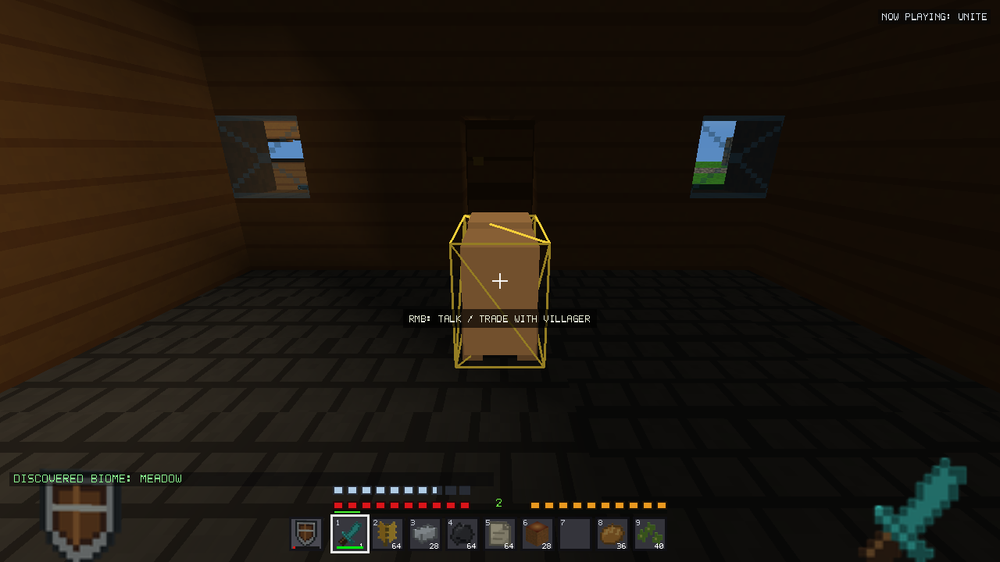
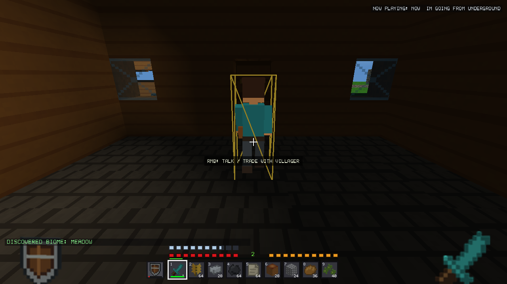
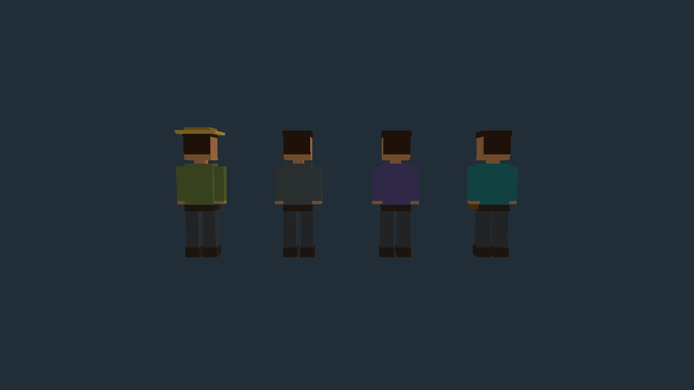
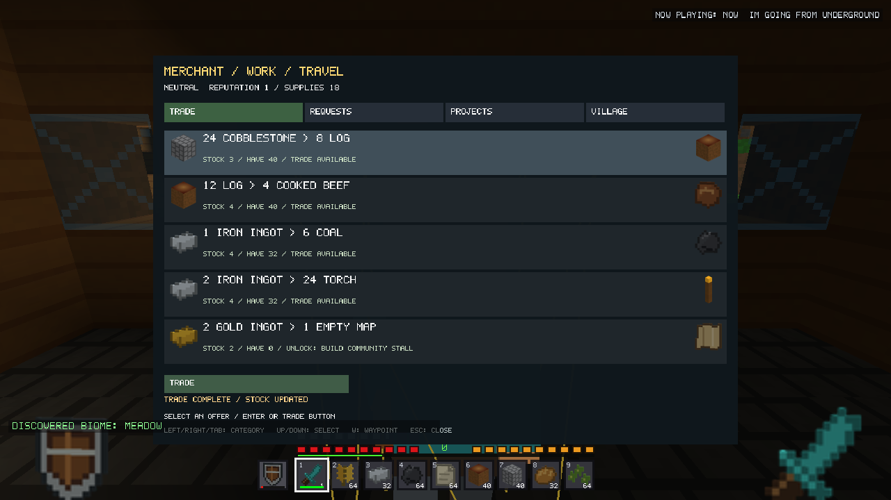
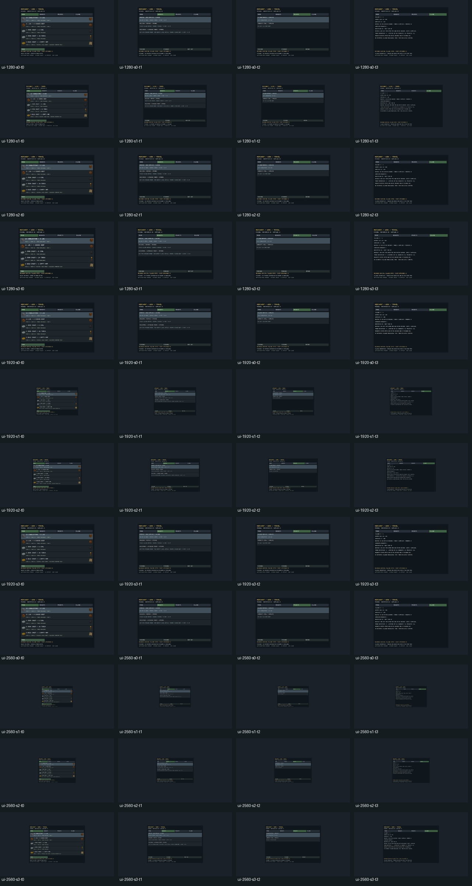
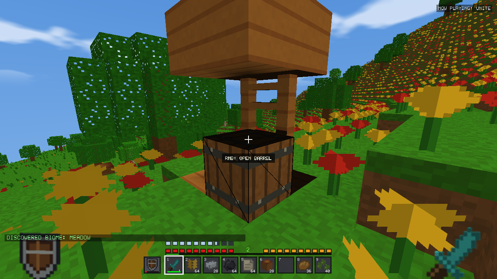
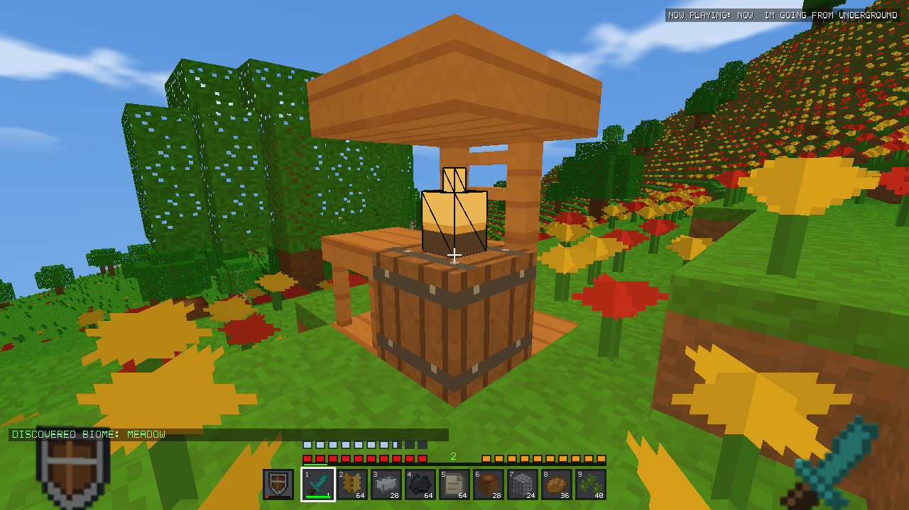
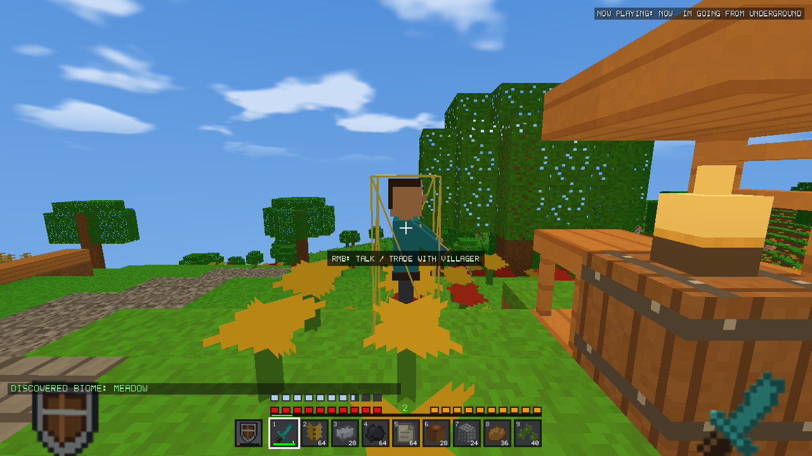

# v2.20.1 Village Polish validation

**Follow-up:** The user subsequently authorized improved pig/cow models and
movement. [Livestock validation](LIVESTOCK_VISUALS_v2.20.1.md) supersedes animal-preservation
statements and package/source fingerprints below for the current local candidate.
The original village-stage evidence is retained as recorded.


## Baseline, scope and safety

Local candidate on `48f751131a5a5d430fdbb4ce5b2dcba5a7aee6c1` (README-only
follow-up to released v2.20.0, `7e3c11350cb3de4ce5c677b84248969922059f72`).
Initial tracked files were clean. Untracked agent guides, review documents,
attachments, IDE state, Python caches and `assets/item_icons (1).rgba` were left
alone. Original full/demo executables, the original driver, source archive, status
and hashes are frozen in `build/v2201-validation/baseline/`.

No commit, push, tag, publication, installation or real-world access occurred.
All game launches used isolated profiles with `VOXEL_FRONTIER_DATA_DIR` and
`.voxel_test_sandbox`. Packaging compiles the installer but never executes it.

This is a focused runtime/visual change, not a replacement village simulation.
The report distinguishes completed changes from remaining requested polish.

## Confirmed rendering problem and replacement

The original native village route reproduced the short horizontal animal body,
offset head and four legs. The generic sphere at Y+0.55 also did not cover the
upper head of the intended 1.60-block villager body. The latter root cause was
identified in code; no separate before-build head-ray probe is claimed.




`include/VillagerModel.h` provides one shared original biped construction path.
`SurvivalWorld::renderCuboids` exits through that path for villagers before the
unchanged quadruped builder. Head, neck, torso, two shoulder-pivot arms/hands,
two hip-pivot legs/shoes, belt, hair, eyes, brows, nose and mouth are colored voxel
geometry, not copied character artwork. Clothing/accessories distinguish farmer
(straw brim, green clothing), smith (dark apron), librarian (purple vest/book) and
merchant (teal coat/pouch). No new bitmap assets or per-villager materials exist.





Turntables are controlled poses drawn by the real OpenGL entity renderer against
an empty background; they are not represented as unscripted gameplay captures.
The generated-village route separately captures actual NPCs and construction.

Presentation-only state in `Animal` is reconstructed during simulation: yaw
turns exponentially toward movement or conversation direction; gait advances
from actual horizontal distance; motion amplitude decays while stopped; a bounded
clock drives breathing/gestures. Trading pauses ordinary heading immediately,
faces the player and remains interruptible by threats. Work gestures require the
work routine, proximity and stopped horizontal movement. Existing hurt tint,
death timing/shrink and distance culling remain. No pose data enters the save codec.

Villager targeting, outline, obstacle/placement occupancy and damaging-block
contact use the upright 0.60 x 1.60 body. Physical navigation remains separate.

The renderer adds one shared instance buffer and OpenGL 3.3 instanced matrix/color
attributes for villager parts. Visible parts are uploaded together and drawn in
one instanced call; ordinary animal, boat and item rendering retain their paths.
No NPC creates a texture, VBO or draw-call group of its own. Buffer deletion occurs
at renderer shutdown. Total frame draw calls are not independently GPU-captured;
the one-villager-batch bound is established by the implementation.

## UI, economy and guidance

- Panel limit grows from 720x480 to 840x560 logical pixels, constrained to the
  available screen. Important trade names/quantities use larger two-line rows.
- Live usable-item counts honor locked slots, durability and identities.
  Availability dry-runs the same copy/commit inventory exchange as a real trade.
  Cache signatures include inventory, locks, stock, routine and village clock.
- Rows select; explicit mouse buttons perform trade, contribution, construction,
  claim, abandonment, refund and request rotation. Keyboard controls remain.
  Held inputs use existing press-edge handling. Completed rows/buttons/footer
  say finished instead of inviting another contribution/reward.
- Restock text states the active-time countdown, four-supply cost and reserve,
  including shortages. Existing 300-active-second replenishment remains bounded;
  no offline catch-up, free stock or new timer persistence is introduced.
- Village information includes completed requests and the next reputation tier.
  The existing finite reputation ranges, discounts and lifetime trade cap remain.
- W selects/adds a deduplicated village turn-in or selected-project waypoint
  through existing Navigation, with explicit list-full feedback.
- A greeting reuses the existing villager sound on opening conversation.

| Merchant offer | v2.20.0 | v2.20.1 |
| --- | --- | --- |
| Building supplies | 48 cobblestone → 8 logs | 24 cobblestone → 8 logs |
| Travel food | 16 logs → 4 cooked beef | 12 logs → 4 cooked beef |
| Fuel | 2 iron → 4 coal | 1 iron → 6 coal |
| Travel lighting | 3 iron → oak boat | 2 iron → 24 torches |

Other professions retain their existing offers. Finite stock, protected inventory
slots and atomic admission are unchanged. Honored coal/iron exchanges still lose
resources on a round trip (14 coal → 2 iron → 12 coal); no reciprocal route was
added for the other revised outputs. This is a compact balance review, not proof
against every possible future recipe/economy combination.




1280x720, 1920x1080 and 2560x1440, each Auto/Small/Normal/Large and four tabs,
are captured at exact pixel dimensions through native GL framebuffers. Higher
resolutions are offscreen targets on the available display, not physical-monitor
certification. Shared layout tests cover rendered row/button hitboxes. Inspection
found no obvious overlaps/clipping in these captures; Small intentionally remains
small. Long transaction reasons can still shrink to fit a row/footer.

## Projects and daily behavior

New Community Stalls retain the original 2x2 site, cost, identity and escrow, with
a half-height slab canopy, counter/table and lantern above a functional empty
barrel. Approved terrain support and a clear standing approach are required.
No barrel is populated or rerolled. Completed old stalls are never reconstructed
or upgraded automatically. No historical template or generation stage changed.




A merchant derives its work destination from the completed stall origin without
rewriting saved workplace identity. Ordinary bounded navigation must reach it;
no teleportation or obstacle bypass is added. The pending-project preview uses
the exact same `projectCells` planner as construction, and completed projects have
no pending ghost. Final actor occupancy, funding and ownership are revalidated
on Build. A structurally valid ghost is not a promise that an NPC/player will
remain out of the site until confirmation.

The generated route records merchant approach distance and a real working-at-stall
capture. The existing two-search/512-expanded-node per-tick navigation budget is
unchanged. Navigation search is skipped during ordinary conversation instead of
spending its budget on a destination the NPC is not allowed to pursue.

## Reproductions and regression results

The original six-part animal-shaped villager is visible in the frozen native
route. New focused coverage checks humanoid parts/bounds, head/torso rays,
outside-width rejection, upright outline, all professions, unchanged animal part
counts, shared instancing, project preview/actual-edit agreement and scaled action
buttons. Existing trade, reward, refund, malformed/truncated records, checkpoint,
identity, collision and movement assertions remain.

A preserved step-jump regression caught a new error during implementation:
conversation pause compared zero IDs and froze an unassigned villager. Both pause
and presentation now require a nonzero talking ID. The original assertion passes
unchanged. A reload route also exposed a fixture assumption: scripted teleporting
before destination readiness. The fixture now prepares its destination and aims
at the actual humanoid head; production unloaded-terrain guards remain intact.
The demo fixture deliberately skips saved-world screenshots because creating
saved worlds is prohibited there; model/unit and full demo suites still run.

Validation result tables and binary hashes follow below.

## Final verification evidence

| Check | Result |
| --- | --- |
| Focused full / demo | 1,895 / 1,873 assertions passed |
| Native Survival routes, 15/30/60/120 simulation FPS | 18,279 / 36,399 / 72,639 / 145,119 assertions passed |
| Existing functional groups | 15 passed, including village, exploration/review, engine/streaming, automation/stabilization, building, Creative/QOL, farming, checkpoint/game and legacy building |
| Full/demo generation groups | 9 passed, including 50-seed spawn coverage and V24 puzzle validation |
| Windows Release smoke suites | 20 passed; demo persistence output rejected by runners |
| Historical generator records | All 1,326 matched |
| Frozen V23 exports | 495 per variant matched exactly |
| Frozen V24 exports | 738 per variant matched exactly |
| Embedded package assets | 135 resources per variant verified |
| Protected art/source | 1,002 files unchanged; 365 preview entries and images unchanged |
| Extended three-village fixture | 49 assertions passed |
| Matched performance runs | 24 completed, old/new alternating order |

[Structured summary](village-polish-v2201/summary.json),
[regression logs](village-polish-v2201/regression-logs.zip),
[source fingerprints](village-polish-v2201/source-fingerprints.json),
[asset protection](village-polish-v2201/package-assets.json),
[original build fingerprints](village-polish-v2201/baseline.json).

The final production binaries ran the broad matrix. A subsequent **test-only**
addition asserted/captured merchant arrival and performed multi-village endurance;
that driver was relinked to the same production objects and passed the focused
full/demo and four native cadences again. Production source/packages did not
change afterward. Native gameplay injects control events and uses an established
resource kit, viewpoint teleports, ordinary automated defense and accelerated
simulation; it is not an unscripted human playthrough. The higher frame rates are
simulation cadence checks with sampled rendering, not guarantees of that wall FPS.

The legacy tools/check_inventory_previews.py also ran: its per-icon geometry,
coverage and raw/PNG checks passed, but its fixed v2.16.0 full source-atlas equality
assertion failed because later released content already changed that atlas.
The original checker was left intact. tools/check_village_polish_previews.py runs
the same coverage/centering/identity/art tests against released v2.20.0; it passes
all 365 mappings with no duplicate icon images. The packaging fingerprint check
also passes. This is not treated as a new v2.20.1 art regression or a reason to
rewrite historical expected images.

## Extended village cycles

Nine accelerated simulated days, visiting three naturally generated villages
in sequence with nine verified save/exit/reload operations. The fixture uses
Creative safety, repeated admitted/failed trades, natural population markers and
one injected villager death/tombstone. It checks coherent inventory/NPC reload and
bounded state. Village records reach three and NPC records reach eleven; both
then remain constant. Loaded mobs remain 44 including ordinary ambient types.
RAM samples span 334.176–342.941 MiB, finishing at 341.625 MiB; they do not show
continuous growth across these visits. This does not prove multi-hour leak freedom.

[Raw samples](village-polish-v2201/endurance.csv). Distances from the separate
Survival route put the merchant within about 0.995 blocks of its stall target,
with an actual stopped work animation; no NPC teleport is used to reach the stall.



## Matched performance results

Intel i7-14700F (28 logical CPUs), Radeon RX 9060 XT; native 1280x720, seed 20260917, V24 district (5,-1), SD8, unchanged render settings. Original v2.20.0 production-object driver versus the new production-object driver. Six-second warmup and twelve measured seconds per run, four phases (day, night, rain, Trade UI), two repeats in alternating old/new order. Cohorts start at natural roads; ambient spawning/audio are excluded equally. No compiler or other test process ran during timing.

The explicit cap is 60 FPS, but wall intervals include limiter/scheduler/presentation waiting and often exceed 16.7 ms on this host. CPU work excludes the limiter and includes presentation; it is not pure GPU time. GPU queries are collected only when available. Moving NPCs/streaming can produce different resident geometry; exact counts and triangle ranges are retained in performance.json and raw CSVs.

Daytime metrics below are medians of the two per-run summaries (not pooled percentile calculations), in milliseconds. Worst and RAM are maxima across those daytime repeats.

| Version | NPC/RD | Mean CPU | p95 | p99 | Worst | Mean GPU | Mean NPC AI | Peak RAM MiB |
| --- | --- | --- | --- | --- | --- | --- | --- | --- |
| v2.20.0 | 1/8 | 0.967 | 2.030 | 2.948 | 6.690 | 0.190 | 0.001 | 333.8 |
| v2.20.1 | 1/8 | 0.986 | 2.208 | 2.733 | 6.751 | 0.194 | 0.001 | 335.6 |
| v2.20.0 | 10/8 | 0.975 | 2.053 | 2.931 | 6.490 | 0.194 | 0.007 | 334.6 |
| v2.20.1 | 10/8 | 0.945 | 2.146 | 3.060 | 6.753 | 0.209 | 0.007 | 336.1 |
| v2.20.0 | 30/8 | 1.062 | 2.313 | 3.219 | 6.528 | 0.192 | 0.023 | 334.8 |
| v2.20.1 | 30/8 | 1.133 | 2.420 | 3.065 | 6.431 | 0.201 | 0.026 | 334.9 |
| v2.20.0 | 60/8 | 1.222 | 2.440 | 2.996 | 7.503 | 0.209 | 0.049 | 334.4 |
| v2.20.1 | 60/8 | 1.277 | 2.581 | 3.498 | 6.760 | 0.201 | 0.051 | 333.9 |
| v2.20.0 | 30/16 | 1.403 | 2.591 | 4.010 | 6.688 | 0.494 | 0.027 | 402.9 |
| v2.20.1 | 30/16 | 1.546 | 2.987 | 3.816 | 6.552 | 0.487 | 0.028 | 410.1 |
| v2.20.0 | 30/32 | 7.425 | 9.040 | 36.151 | 51.568 | 1.104 | 0.031 | 614.3 |
| v2.20.1 | 30/32 | 6.987 | 8.706 | 25.702 | 28.726 | 1.091 | 0.027 | 614.0 |

30-NPC RD8 p99 CPU work by repeat:
- old: 3.372 ms, 3.067 ms
- new: 3.070 ms, 3.061 ms

The previously recorded 7.759 ms p99 is a reference observation rather than a universal baseline. These repeated results do not establish a specific root cause for that earlier outlier or promise an across-the-board performance gain. This update adds richer geometry while bounding its submission to a shared instance batch.

| New 30-NPC RD8 phase | Mean CPU ms | p99 CPU ms | Mean GPU ms |
| --- | --- | --- | --- |
| Day | 1.133 | 3.065 | 0.201 |
| Night return | 0.973 | 2.531 | 0.204 |
| Rain shelter | 1.139 | 2.625 | 0.202 |
| Trade UI | 1.647 | 3.378 | 0.212 |

Raw per-run save capture/complete durations, snapshot sizes, CPU/frame/GPU timing, resident/triangle counts and navigation work are in benchmark-raw.zip. No physical low-end/iGPU certification or naturally populated simultaneous multi-village performance claim is made.

| 30 NPC / RD8 checkpoints | Capture median ms | Complete median ms | Encode median ms | Commit median ms | Snapshot bytes |
| --- | --- | --- | --- | --- | --- |
| old | 2.141 | 24.825 | 1.962 | 20.133 | 45716, 45717 |
| new | 2.004 | 22.510 | 1.929 | 17.317 | 46436 |

Snapshot sizes reflect the actual saved NPC state, not raw presentation data. New poses have no save extension. These short captures do not establish a save-speed improvement.


## Local packages and reproduction

- `build/installed-release/Release/VoxelFrontier.exe`: 77,735,936 bytes; SHA-256 `0665fcc75bd8d4e390ac509807efa45f234db0fd20e1a223ce1bcac60bff748b`.
- `dist/VoxelFrontier-v2.20.1-Windows-Setup.exe`: 71,635,044 bytes; SHA-256 `4a5895d1f076c49695509819ff2c1d52c93d1c7e74ede7b20c0eab7b8de7e866`.
- `dist/VoxelFrontier-v2.20.1-Windows-Standalone.exe`: 77,454,848 bytes; SHA-256 `1c6c340f05f2234a7d5aa2fdcd41bec89ae248a4f588763f9b285d3ae6c51bfd`.

Installer not executed. The demo remains stateless. Checksums are also in
[village-polish-v2201/SHA256SUMS.txt](village-polish-v2201/SHA256SUMS.txt).

Reproduction (fresh output directories, matching production full/demo drivers):

```powershell
.\package_release.ps1 -BuildJobs 4
python tools/run_village_polish_evidence.py --phase native --output build/fresh-polish-native
python tools/run_village_polish_evidence.py --phase endurance --output build/fresh-polish-endurance
python tools/validate_village_polish.py --phase functional --output build/fresh-polish-functional
python tools/validate_village_polish.py --phase generation --output build/fresh-polish-generation
python tools/validate_village_polish.py --phase release --output build/fresh-polish-release
python tools/run_village_polish_evidence.py --phase exact24 --output build/fresh-polish-v24
python tools/run_village_polish_evidence.py --phase benchmark --output build/fresh-polish-benchmarks
python tools/verify_village_polish_packages.py
python tools/check_village_polish_previews.py
```

Pillow is required by the asset/preview tools. The bundled workspace Python was
used for these checks; system Python lacked Pillow. Version-specific runners
expect paths under build/v2201-validation and dist; inspect them before porting.
The benchmark runner expects the untouched frozen baseline driver. See the
root AGENTS.md for safe build/profile setup. No test expectation archive changed.

## Limits and incomplete polish

- This candidate does not implement paid equipment repair, new request variants,
  an alternate peaceful assistance objective, new Trusted/Honored services or
  resource-backed instant restocking. Existing accepted requests, stock deadlines,
  costs and progression records are preserved instead of silently reinterpreted.
- Work is visual; NPCs do not harvest crops or manufacture resources. Work gestures
  share a simple reach/wave pattern rather than separate profession task rigs.
  Resting NPCs stand quietly; lying/sleeping poses and new voices are not included.
- The stall gains a counter, canopy and lamp, but not a new banner/sign asset,
  expanded market footprint or automatic path/interior-lighting upgrade. Historical
  dark interiors stay unchanged. Existing completed stalls keep their old visuals.
- Rows no longer buy on double-click selection. Deliberately repeated clicks on
  the explicit Trade button can still buy repeatedly; no special double-click
  debounce was added beyond ordinary press-edge input.
- Request objectives/rewards and contribution counters remain compact; there is
  no always-visible request HUD, new quest framework or changed task migration.
- Local navigation can still fail in obstructed/steep/player-modified villages.
  The tests do not certify every seed or simultaneous naturally populated villages
  inside one simulation radius. The endurance fixture visits three villages in
  sequence and uses Creative safety, while the separate route uses Survival.
- Hurt/death keep the original behavior and functional coverage; exhaustive native
  hurt/death, every weather/interior pose, short-stall interpolation and multi-hour
  physical low-end GPU certification are not claimed.
- Existing large-coordinate precision and RD64/driver limits are outside scope.

These are explicit remaining requested enhancements/validation limits, not claims
that the entire original polish specification or every possible bug is complete.
The candidate is local and requires review before any publication decision.
