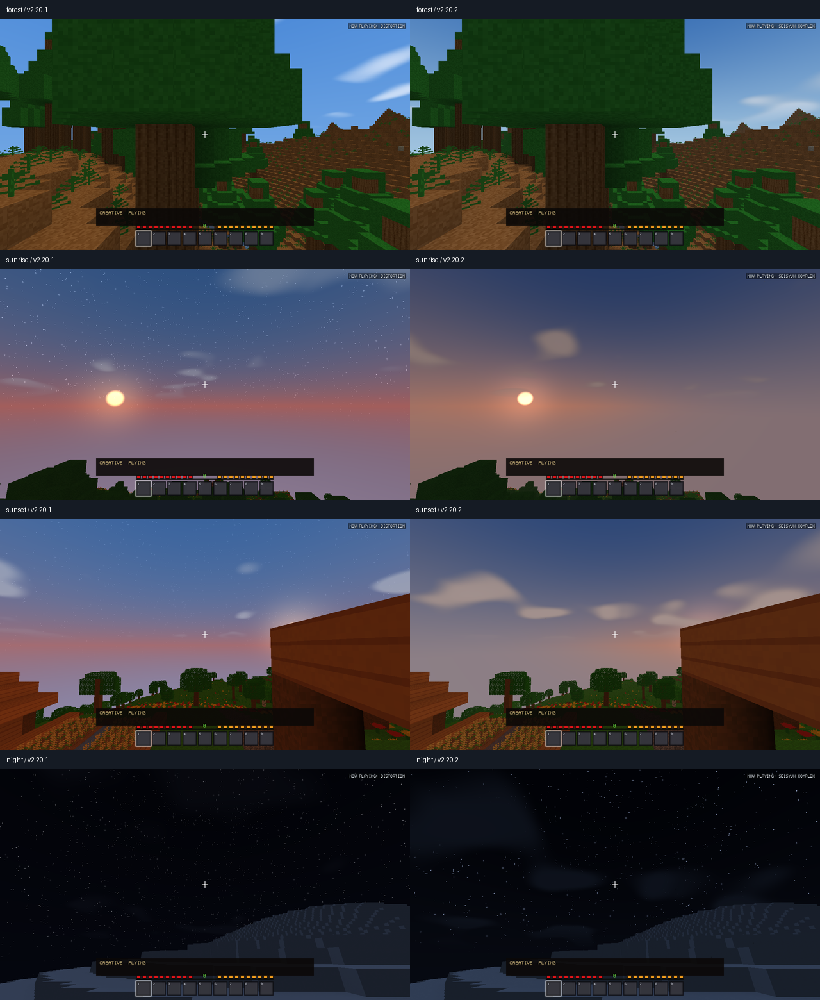
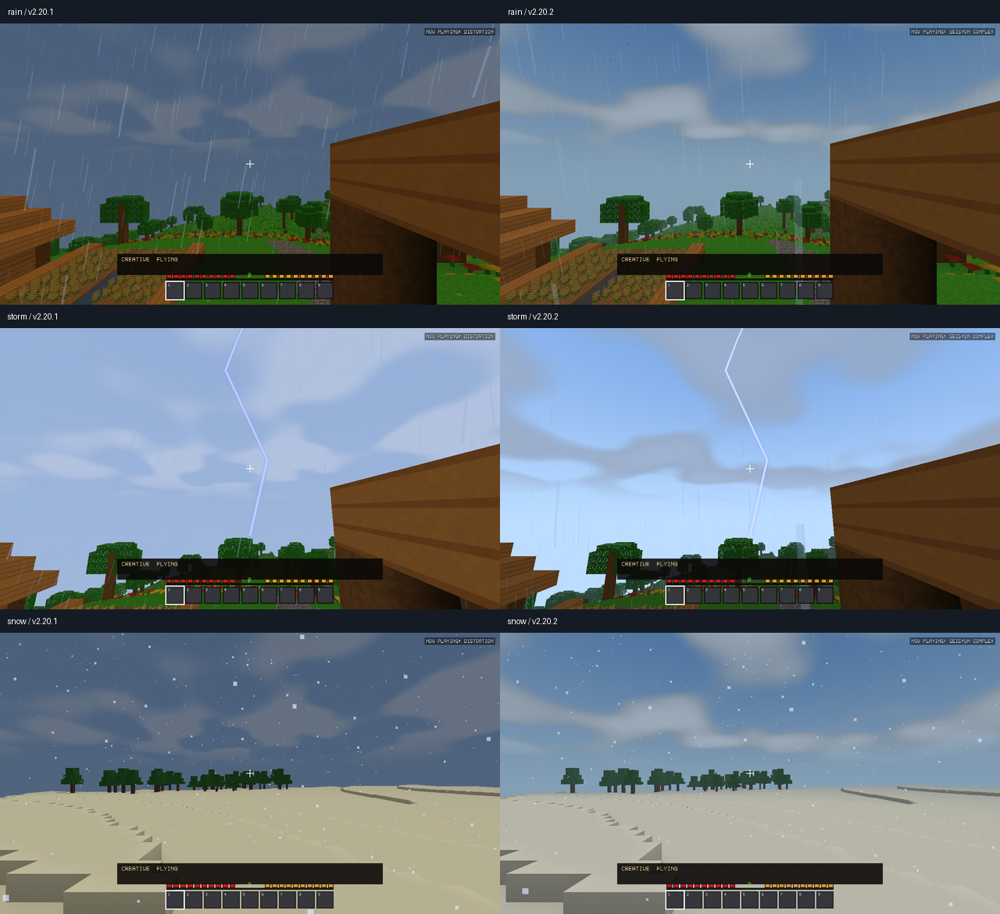
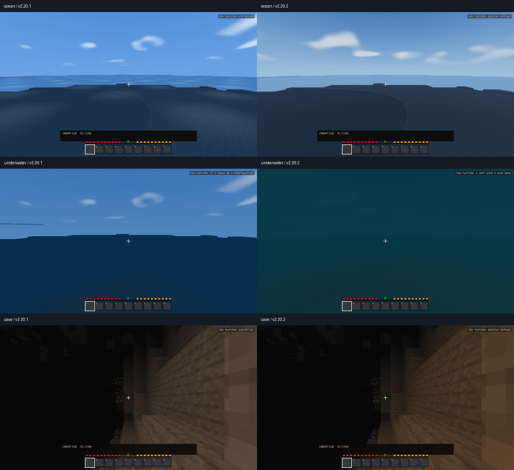
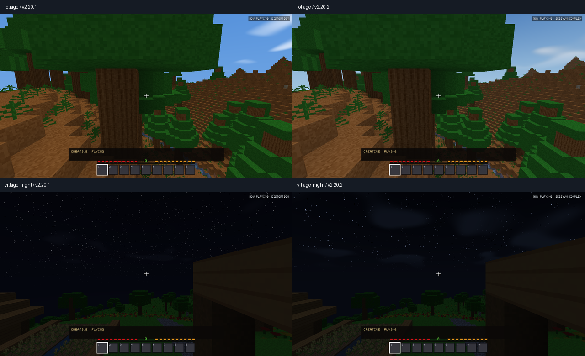
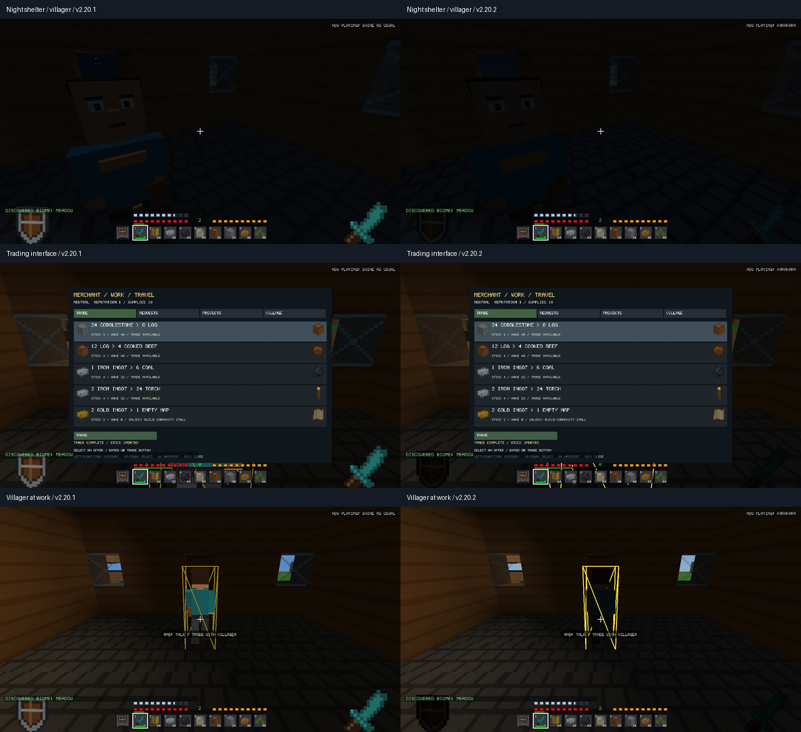
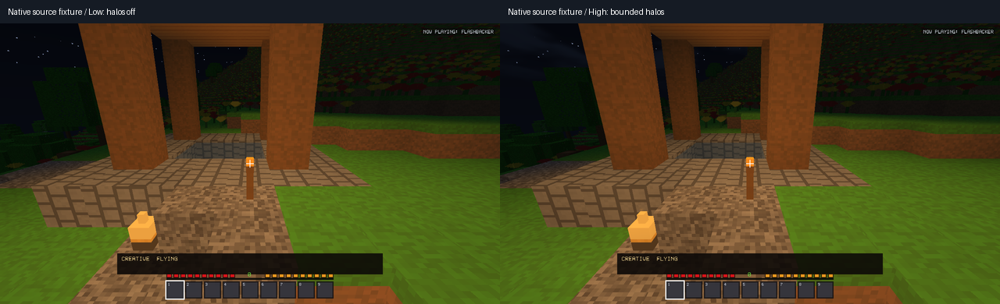

# v2.20.2 — Visual & Atmospheric Polish validation

Development validation used a local candidate without publication, installation
or real-save access. Publication was subsequently authorized November 21, 2026.

Evidence collected November 3–4, 2026.

## Baseline and reproducibility

Baseline: released v2.20.1, `ed879112a157f04ab9bbbc8801fbb6141d2c1387`.
The initial tracked tree was clean. Existing untracked editor files, review files,
attachments, the duplicate item atlas and Python cache were preserved.

Original binary fingerprints:

| Variant | SHA-256 |
| --- | --- |
| Full | `c044e55130c129fccdcc94f3ef31b9cb8065db36260ebe5c3af6145bef8b0fac` |
| Demo | `475c729faac74d6df4f134592ad3c5dd25a7e4b222017d5c728175fce53fa3a1` |

`build/v2202-validation/baseline/` retains those binaries, source archive and
fingerprints. A separate extracted copy of that frozen source supplies matching
baseline production objects for the common native fixture. This instrumented
baseline driver is distinct from the original shipped executable.

Native context: AMD Radeon RX 9060 XT, ATI Technologies Inc., OpenGL
`3.3.0 Core Profile Context 26.7.1.260716`. These are desktop-GPU measurements,
not physical integrated-GPU/low-end certification.

All launches use fresh directories with `.voxel_test_sandbox` and an isolated
`VOXEL_FRONTIER_DATA_DIR`. Tests do not use installed binaries or player worlds.

## Implementation and source changes

- `Renderer.cpp`, `Renderer.h`, new `VisualLighting.h`: GLSL 330 gradients,
  bounded clouds, celestial occlusion, common sun/moon/blocklight coloration,
  local light attributes for models and world sprites, water normals/Fresnel,
  clear/weather haze, smooth underwater attenuation and cached uniform locations.
- New `Atmosphere.cpp`: small private visual hash sequence, loaded-cell-only dust
  and cached light-source positions. No gameplay RNG, terrain generation or save
  state. Work runs at 5 Hz, at most 32 source-cell probes each update.
- `WeatherRenderer.cpp`: transparent streaks, eight-segment splash rings,
  varied snow size/drift and restrained bolt core/glow fade. The existing weather
  simulation, exposure checks and precipitation quality rules are unchanged.
- `Game.cpp`: pass local world lighting to visual models/items, update cosmetics,
  and detect eye immersion using the actual water surface. Swimming/physics are
  untouched. `InventoryUI.cpp`: held-light tint, smooth underwater overlay and
  a dark outer selected-slot border. UI hitboxes and actions are unchanged.
- `CMakeLists.txt`: version 2.20.2 and the new cosmetic translation unit.
- `generate_item_thumbnails.py`: include the new shared shader/header inputs in
  required preview fingerprints. The offline export keeps its legacy model-light
  path, preserving existing icon pixels. The manifest is regenerated normally.
- Native fixture, benchmark and verification tools are described below.

## Shader and quality decisions

Textures keep their original color-space assumptions. No blanket gamma transform
is introduced. The packed terrain layout, atlas coordinates, climate tint, AO,
light propagation, fluid geometry, sorting, meshing and world generation stay intact.

The shared palette uses neutral daylight, restrained warm directional twilight,
cool moonlight and warm blocklight dominance. Terrain retains its existing scalar
light curve and baked AO; entities use the same response without fabricated AO.
Frame-constant directional, ambient and clear-horizon colors are computed once
on the CPU and uploaded as one three-vec3 array per program. The same palette
feeds terrain, models, sprites and sky. Zero-blocklight fragments skip the warm
blocklight calculation; invisible daytime stars/moon skip their detailed math.

World sprites and billboards now sample existing local light rather than remaining
bright against cave terrain. Original hostile sprites and all hostile logic are
unchanged. Preview exports explicitly retain their historical shading.

Water uses two wave directions, with an extra small High detail pair, a grazing
Fresnel approximation and the procedural horizon color. It does not sample scene
depth or invent bathymetry. Geometry/transparency order is unchanged. Exponential
underwater attenuation affects terrain, relevant entities and sky; a smooth
camera-immersion blend also drives the restrained UI overlay.

Clear haze is independent of Weather Fog. Weather Fog still controls added
weather-dependent density. Existing skylight gates outdoor haze to avoid washing
out sealed caves. Render-distance-dependent starts avoid a fixed fog wall.

Sky drift, vegetation phases and snow drift use periodic harmonics of the existing
1,200-second world cycle. No gameplay clock or weather transition is changed.

| Effect | Low | Medium | High |
| --- | --- | --- | --- |
| Sky/palette/local lighting | Improved | Improved | Improved |
| Cloud detail | Disabled | 2 octaves | 4 octaves |
| Water ripples | Basic tint/Fresnel | Two slopes | Extra detail pair |
| Clear haze | Off | 8% distant maximum | 14% distant maximum |
| Crossed-plant wind | Off | 0.018-block base amplitude | 0.035-block base amplitude |
| Dust maximum at 100% particles | 0 | 24 | 64 |
| Cached light-source points | 0 | 4 | 16 |

Storm wind increases plant amplitude by at most 70%. Only the existing crossed
Tall Grass/Red Flower/Yellow Flower materials move, with bases anchored inside
their existing inset. Connected cube leaves stay rigid: moving their vertices
independently would open seams. No collision/harvesting/mesh data is altered.

Cosmetics retain a maximum 4,096-entry admission threshold so they do not expand
combat-particle storage. Dust is short-lived, camera-culled and uses no per-particle
GPU resources. Torches, emitting lanterns and campfires are the supported halo
sources. These are small depth-tested point effects, not added blocklight or bloom.
A 64-entry cache reuses exact local light samples for model parts sharing a cell
within one draw. It is discarded each call, so lighting changes cannot become
stale between frames. Fixed splash-ring directions/normals are computed once,
retaining the same eight-segment shape without trigonometry per splash. Detailed rings are limited to 8m on Medium
and 10m on High; farther splashes retain a cheap fading version of the original
quad. Existing precipitation distance and density are unchanged.

Zero particle amount and Low clear dust/halo caches. Existing break/hit/explosion/
burning particles retain their simulation and square style.

## Native visual evidence

Seed `20260917`, Generator V24, 1280×720, matching camera/time/weather settings.
The 12 scene pairs cover forest, sunrise, sunset, night, cave, village at night,
rain, lightning, snow, ocean, underwater and dense cutout foliage. Images below
are labeled, resized native captures, not generated artwork. Full-size BMPs,
camera CSVs, GL identity and capture hashes remain in the evidence directories.









The primary underwater row uses **Survival**, actual physics water contact and
identical eye coordinates `(-767.5,61.6196,256.5)`, yaw 180°, pitch −8°, time 300.
Both before/after fixtures assert swimming and water at the eye. The separate
Creative-flight captures also expose the old body-swimming flag's failure to
apply underwater visuals during flight; camera-based detection fixes that case.
No baseline immersion flag was forced manually.

Final Medium recaptures: `native-final-render`; frozen baseline: `native-before`.
The full Low/Medium/High and RD matrix is retained in `native-after`. The final
recapture checks 36 UI resolution/MSAA/scale combinations (720p/1080p/1440p,
MSAA 0/2/4, four scales), Fullbright and Creative/Spectator contexts. Programs
compile/link on the native GL 3.3 context; scene and UI frames report no GL errors.

Before/after native Survival village routes each pass **36,401 checks**, including
movement, trading, a full simulated day, projects, save/reload and UI captures.
They are gameplay-driven captures, not only a posed village scene. The source
fixture emits zero halo primitives on Low and two visible source points on
Medium/High in both full/demo; replacing its torch with a candle removes the old
halo. Each full/demo source fixture passes 16 focused checks.

The final supplemental route (`night-verified`) includes a camera-only close view
of a naturally associated villager inside its night shelter. The camera is restored
before simulation continues; no NPC is moved for the photograph. This unlit room
stays dark, with models and held items responding to its local illumination.



The following isolated source fixture checks halo quality/depth behavior; it is
not presented as a generated-world scene.



## Performance measurements and limits

Hardware: Core i7-14700F (20 cores/28 logical processors), approximately 32 GB RAM,
Radeon RX 9060 XT. Twenty paired runs, 720 measured frames each, two repetitions
with reversed variant ordering; 30 controlled villagers on genuine village terrain.
Both builds use the same corrected fixture, settings, fixed simulation warm-up,
60 Hz simulation steps and high-resolution limiter. Rendering windows are hidden
for controlled timing; this is not fullscreen/compositor certification.

`work_ms` includes simulation, rendering, driver/presentation work and excludes
intentional limiter waiting. GPU queries end before presentation and are read
asynchronously. `wall_ms` includes the 60 FPS limiter and is reported separately.
Do not infer uncapped FPS from this capped workload. The separate scene-capture
queries include presentation and a fixture-only completion wait; they are not
substituted for the asynchronous GPU benchmark.

| Quality / RD | Old median work ms, runs | New median work ms, runs | Change | Old/New p99 work ms, runs |
| --- | --- | --- | --- | --- |
| Low / 8 | 1.053/1.107 | 1.112/1.173 | +5.8% | 2.850/3.569 → 3.236/3.725 |
| Medium / 8 | 1.176/1.072 | 1.282/1.181 | +9.6% | 3.165/3.244 → 3.897/3.349 |
| High / 8 | 1.527/1.271 | 1.315/1.241 | -8.7% | 3.658/3.399 → 3.566/3.248 |
| Medium / 16 | 1.479/1.444 | 1.491/1.484 | +1.8% | 3.715/3.718 → 3.973/3.672 |
| Medium / 32 | 6.931/7.222 | 7.032/7.138 | +0.1% | 32.599/35.153 → 34.524/34.083 |

| Quality / RD | Old GPU median ms, runs | New GPU median ms, runs | Mean median change |
| --- | --- | --- | --- |
| Low / 8 | 0.1811/0.1754 | 0.1801/0.1796 | +0.92% |
| Medium / 8 | 0.1891/0.1857 | 0.1949/0.1909 | +2.96% |
| High / 8 | 0.1957/0.1969 | 0.2005/0.1987 | +1.69% |
| Medium / 16 | 0.4841/0.4789 | 0.4855/0.4836 | +0.64% |
| Medium / 32 | 1.3289/1.3407 | 1.3204/1.3265 | -0.85% |

**The active-work engineering targets are not universally met.** At RD8, Low is
+5.8% and Medium +9.6%, above the requested 2%/4% targets. High active work is
−8.7% in these runs. GPU median changes at RD8 are +0.92%/+2.96%/+1.69% for
Low/Medium/High, within their numerical targets. These GPU results do not erase
the active CPU/driver cost. The limited wall-frame medians differ by less than
0.3%; the limiter must not be used to claim zero rendering overhead.

One RD8 Low repetition and one Medium repetition show active-work p99 increases
above 10%; the other repetitions are smaller. GPU timing remains much steadier.
The fixture isolates simulation time but not every driver/presentation/UI cost,
so the residual spike attribution is unresolved. No universal p99 or physical
low-end certification is claimed. Further broad CPU/driver optimization is not
hidden behind a lower render distance or changed terrain quality.

Geometry differences during asynchronous streaming are recorded rather than
attributed to shaders:

- Low RD8: old 403562/403524 ; new 403562/403562
- Medium RD32: old 4597412/4541745 ; new 4639226/4545651

The Low difference is 38 triangles (less than 0.01%). RD32 has meaningful residency/geometry
variation; its aggregate work numbers do **not** prove a performance improvement.
Visible model-part medians match in all five comparisons. Per-run mean, median,
p95, p99, worst, GPU sample counts, loaded chunks, triangles and RAM are in
[measurements.json](visual-polish-v2202/measurements.json). Raw CSVs remain under
`build/v2202-validation/benchmarks-final-render`.

Terrain GPU allocation high-water marks from the native scene matrix (MiB):

| Configuration | Old | New |
| --- | --- | --- |
| q0-rd8 | 88.0 | 88.0 |
| q1-rd8 | 88.0 | 88.0 |
| q2-rd8 | 88.0 | 88.0 |
| q1-rd16 | 296.0 | 296.0 |
| q1-rd32 | 1328.0 | 1272.0 |
| q0-rd64 | 248.0 | 240.0 |

These are terrain allocations, not total driver VRAM. Existing texture bytes and
texture assignments are identical; no reflection framebuffer or additional scene
texture is introduced. New transient costs are the small instance light attribute,
particle kind attribute, bounded source cache and shader uniforms. Portable GL 3.3
does not provide an application-wide texture/driver allocation total here.
RD64 is a brief stress view, not a recovery or low-end target: queues still contain
pending work after the short capture. No claim of resolving RD64 retirement stalls.

The isolated 5,760-combat-particle snapshot measures old/new CPU medians
0.0620/0.0644 ms and GPU medians 0.0064/0.0081 ms.
Its 1,440/5,760 point counts are unchanged. Opaque combat points write depth first;
translucent dust/halos follow without depth writes. Native pixel arrays match
v2.20.1 byte-for-byte for empty, 32-burst and 128-burst cases. Full/demo both pass
all 548 reported assertions per stress fixture. This is an isolated native
particle target, not a generated-world screenshot.

## Regression and package results

All completed checks below used production Release objects or the packaged
executable, with test/profile paths under `build/v2202-validation/`.

| Verification | Result |
| --- | --- |
| Functional groups | 15/15 passed |
| Generation/exploration groups | 11/11 passed |
| Packaged full/demo Release suites | 20/20 passed |
| Historical V1–V22 records | 1,326 matched (663 per variant) |
| Frozen exact V23 files | 495 per variant matched |
| Frozen exact V24 files | 738 per variant matched |
| Existing spawn suite | 50 seeds × V22/V23, 100 records |
| Embedded resources | 135 per variant matched authoring bytes |
| Protected source/art/registry files | 1,120 unchanged from v2.20.1 |
| Original previews | All 365 entries and exported artwork unchanged |

The functional matrix includes villages, relics/adventure review, subsystems,
Game input, checkpoint/recovery, engine streaming, automation/stabilization,
building, Creative UI, QOL, farming and legacy building fixtures. Generation
includes V24 puzzles, existing V23 ecosystem/spawn/determinism checks and frozen
V23/V24 archives. Full/demo suites include transport, commands, Survival, weather,
fluids, menus, optimization, patch272 and UI; full also covers reset/Spectator.
Demo profiles were checked for forbidden persistent-world files.

No expected archive or historical hash was regenerated. Weather.cpp, WorldFluids,
terrain/LOD/packing code, mob logic, definitions and persistence code are unchanged.
The required preview manifest now fingerprints the shared shader/header inputs.
Both atlas images/raw outputs and individual historical previews remain exact.

The initial instrumented driver used a macro via CMAKE_CXX_FLAGS and emitted an
exception-unwinding warning. Final native/benchmark drivers restore normal MSVC
`/EHsc` flags and use the dedicated `VISUAL_POLISH_CANDIDATE` CMake option.
The production binaries retain normal compiler flags throughout.

Two parallel build retries encountered C1083 temporary object-write access
errors; a later driver link encountered LNK1104. Serial retries completed. These
were build-file access failures, not shader/compiler source errors; failed logs
are retained alongside the successful serial packaging/relink logs.

Final local package fingerprints:

| File | Bytes | SHA-256 |
| --- | --- | --- |
| Full game executable | 77,777,408 | `d2d625f558af3539ed47bf019b7e0430aaf48d94f986aa34ff47c6720eb2ea60` |
| Standalone demo | 77,496,320 | `434b7954ec6fc503ce6e4d0d3596fbf7782ae4b2d83233de98fda350cfeff289` |
| Installer | 71,648,763 | `c3e8eac4d0e2447792b75bb23e85c74a1f81853a7488628e64dd96d2821c56c1` |

Artifacts: `dist/VoxelFrontier-v2.20.2-Windows-Setup.exe`,
`dist/VoxelFrontier-v2.20.2-Windows-Standalone.exe`, `dist/SHA256SUMS.txt`.
The installer was compiled and inspected as a resource artifact; it was not run.

Commands used (repository root, PowerShell):

```powershell
cmake --build build/installed-release --config Release --parallel 1
cmake -S tests/stability -B build/v2202-validation/driver -DVISUAL_POLISH_CANDIDATE=ON
cmake --build build/v2202-validation/driver --config Release --parallel 1
# An isolated marked VOXEL_FRONTIER_DATA_DIR was set for the offline export.
# Run this with Pillow 12.0.0 from tools/requirements-thumbnails.txt.
python tools/generate_item_thumbnails.py --skip-build
.\package_release.ps1 -BuildJobs 1
# Demo driver configured with matching BASE/DEPENDENCIES and -DDEMO=ON.
python tools/verify_visual_polish_packages.py
python tools/validate_visual_polish.py --phase functional --output build/v2202-validation/functional-final
python tools/validate_visual_polish.py --phase generation --output build/v2202-validation/generation-final
python tools/validate_visual_polish.py --phase release --output build/v2202-validation/release-verified
python tools/run_visual_polish.py --variant new --quick --output build/v2202-validation/native-final-render
python tools/run_visual_polish.py --variant old --output build/v2202-validation/native-before
python tools/benchmark_visual_polish.py --output build/v2202-validation/benchmarks-final-render
python tools/validate_visual_polish.py --phase effects --output build/v2202-validation/effects-verified
python tools/validate_visual_polish.py --phase effects --output build/v2202-validation/night-verified
python tools/validate_visual_polish.py --phase particles --output build/v2202-validation/particles-final
python tools/validate_visual_polish.py --phase underwater --output build/v2202-validation/underwater-final
```

The offline thumbnail authoring used the bundled Python and an isolated
`build/v2202-validation/pillow12` dependency directory from
`tools/requirements-thumbnails.txt` (Pillow 12.0.0). The `--target` directory was
prepended to `sys.path` for export. Sheet composition can use another Pillow
version because it does not replace game artwork. Wrong-version authoring is
rejected before writing assets; `--check` still works without rebaking.

The offline thumbnail/sheet authoring uses Python;
the native game and packaging do not require Python. Runners refuse existing
output directories. Baseline driver building uses the separate archived source,
never a reset or overwrite of the working tree.


## Rejected experiments and known limits

- Early fixture errors put the sunset after twilight and the underwater eye above
  water. Those captures were retained as diagnostics and excluded from final claims.
- Early scene weather only advanced four seconds, leaving rain during a nominally
  clear ocean view. Final comparisons use validated exact weather states through
  the existing decoder, then normal exposure update. Transition captures are kept
  separately from steady-state captures.
- Visual inspection caught a bright underwater sky and added matching attenuation.
- A cached halo initially survived replacing a torch with a different emissive
  block. Eligibility is now rechecked against the same supported-source list;
  full/demo GL primitive-count tests verify removal after replacement by a candle.
- Early inherited village benchmarks advanced NPC warm-up according to rendering
  speed and used coarse short sleeps. Final paired fixtures use a fixed six
  seconds of simulation, exactly 720 measured steps and a high-resolution waitable
  timer. Limiter waiting is excluded from active work. Earlier partial runs were
  retained as diagnostics, not combined with final measurements.
- The prior session stopped a baseline repetition with exit 1073807364 before
  completing the matrix; no assertion failure was recorded. It is excluded.
- Uniform lookup work was moved into the existing cache. Dry-camera underwater
  calculations and zero-contribution haze now return early.
- No deforming connected leaf cubes, volumetric clouds, screen-space reflections,
  refraction passes, dynamic shadows, persistent wetness maps or fullscreen bloom.
- Pillow 13.0 changed 11 downsampled preview images despite byte-identical native
  128px exports (`c614426ef611b83a28c9a7db525ae9af77f83ab26ac54f1feabc3ae48b84f039`).
  The protected-art gate rejected that candidate. Pinning Pillow 12.0.0 restores
  all 365 released images exactly through the normal export pipeline; expected
  baselines and artwork hashes were not weakened or replaced manually.
- Separate textured drifting-leaf particles and feature-specific emitters are
  deferred. The existing point stream is untextured; adding another material path
  was deferred while active-work targets remain unmet. Ambient dust is implemented. Halos deliberately
  support only verified torch/lantern/campfire sources, not every luminous block.
- Halo depth uses the existing terrain depth buffer. Translucent glass/water do
  not become new occluders. Very near camera points retain small point silhouettes.
- Water reflection is an artistic sky approximation, not a reflection of nearby
  builds. There is no terrain-depth-aware absorption. Existing transparent-water
  and render-distance silhouettes remain possible.
- The daytime workplace capture exposes a remaining interior-lighting limit:
  the villager can look darker than adjacent floor surfaces near a doorway.
  Model parts sample their local cell rather than interpolating the terrain's
  face/vertex lighting. The night shelter intentionally remains dark, but these
  doorway transitions need further visual review; universal model/terrain
  brightness parity is not claimed.
- The known coordinate precision and RD64 driver/resource limits remain outside
  this visual update. Existing compiler warnings are recorded in build logs.
- Native screenshots and focused assertions do not establish every seed, graphics
  driver, camera pose, or weather/geometry combination as defect-free.

## Publication verification — November 21, 2026

The original November 4 installer and standalone demo are published unchanged;
their hashes match the package table above. The full-game build directory was
subsequently rebuilt and no longer matches the tested full executable fingerprint;
that later executable is not the release payload. The installer remains byte-for-byte
identical to the original validated package. The 20 recorded Release suite results
refer to the original executable fingerprints; those suites were not rerun for this
documentation-only publication. Fresh thumbnail, embedded-resource and download
checksum verification was performed during publication preparation.

The release includes only Setup, Standalone and SHA256SUMS.txt as uploaded assets.
Build directories, test profiles and local archives are excluded. Existing committed
repository files were preserved. No real installation or saved world was accessed.
